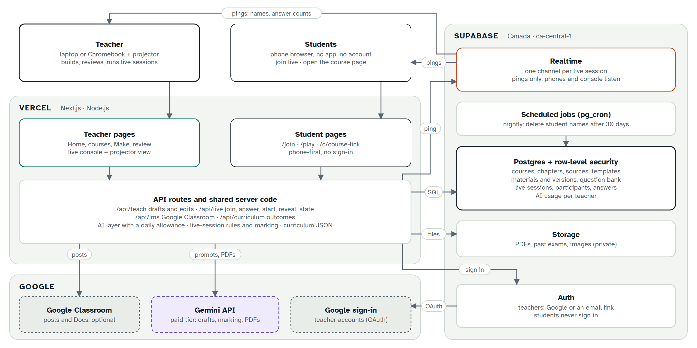
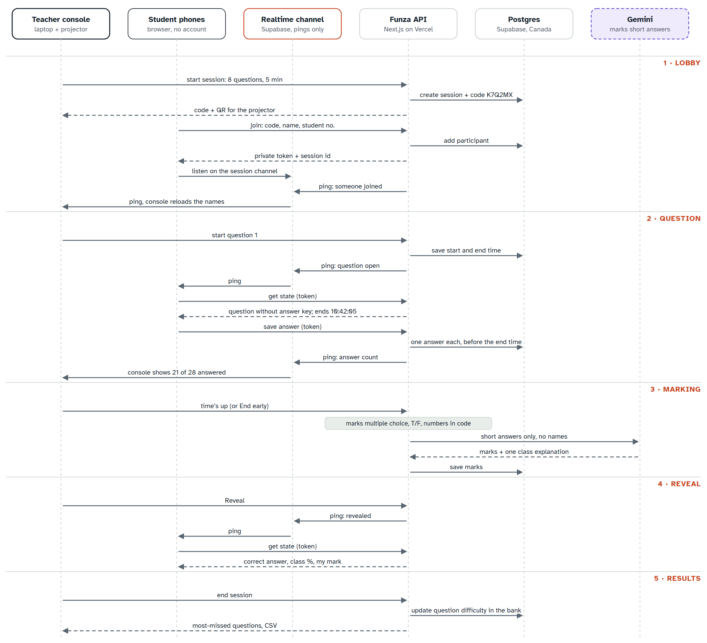
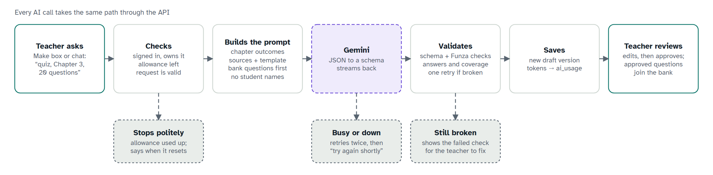
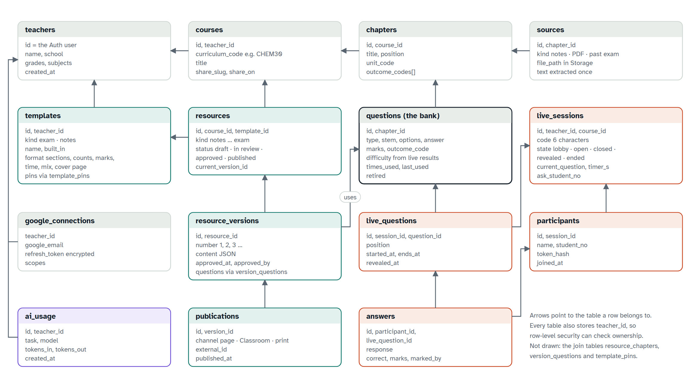
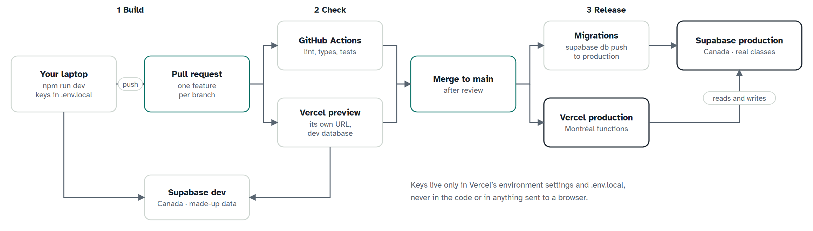

# Teacher Studio: requirements and architecture

**Funza Teacher Studio · v0.2 · 21 November 2026**

This document covers what the Teacher Studio must do, how well it must do it, and the system that does it. The system is one Next.js app on Vercel, with Supabase in Canada for sign-in, data, files and live updates, and Gemini for the AI. It builds on the agreed [user flows and features plan](../01_user_flows_and_features/), with its questions Q1–Q10 at their defaults. The product is summarized in the [repo README](../../../README.md).

Diagrams are in [`diagrams/`](diagrams/) as PNG and SVG. The step-by-step build plan is in [development steps](../../04_development/01_development_steps.md).

**At a glance:** the website and backend run on **Vercel** (one Next.js app; its API routes are the Node.js backend, in Montréal). Data, files, teacher sign-in and live updates are on **Supabase** in Canada (Central). The AI is **Gemini**, called only by the server. AWS is not used (decided 21 November 2026).

## Contents

1. [Decisions in one look](#1-decisions-in-one-look)
2. [The tool list, checked](#2-the-tool-list-checked)
3. [The product in brief](#3-the-product-in-brief)
4. [What it must do (functional requirements)](#4-what-it-must-do-functional-requirements)
5. [How well it must do it (non-functional requirements)](#5-how-well-it-must-do-it-non-functional-requirements)
6. [Scope, assumptions and limits](#6-scope-assumptions-and-limits)
7. [The system](#7-the-system)
8. [How a live session works](#8-how-a-live-session-works)
9. [How the AI is called](#9-how-the-ai-is-called)
10. [Sign-in and who can see what](#10-sign-in-and-who-can-see-what)
11. [The data](#11-the-data)
12. [Rate limits and allowances](#12-rate-limits-and-allowances)
13. [Privacy and security](#13-privacy-and-security)
14. [Environments and deployment](#14-environments-and-deployment)
15. [What it costs](#15-what-it-costs)
16. [Risks](#16-risks)
17. [What changes in the code](#17-what-changes-in-the-code)
18. [Build order for Release 1](#18-build-order-for-release-1)
19. [Open questions](#19-open-questions)
20. [Sources](#20-sources)

---

## 1. Decisions in one look

- **One app, no servers to run.** The Next.js app in `app/` is both the frontend and the backend. Its API routes are the Node.js backend and run as Vercel functions, so there is nothing to patch or keep awake.
- **Supabase does four jobs.** It handles teacher sign-in, the Postgres database, file storage for PDFs, and Realtime, which tells phones the moment a question opens or answers are revealed. That is one service and one bill, with the data kept in Canada.
- **Only the server calls Gemini.** The key never reaches a browser. Every call passes a daily allowance per teacher and is logged. Billing is turned on before real students use it, because free-tier prompts can be used to improve Google's products.
- **Students never sign in.** A student joins with the code, a name and, if the teacher asks, a student number. They get a private token for that one session. Every student action goes through our API, so answer keys stay on the server until Reveal.
- **Realtime sends pings, not content.** The server saves each change in Postgres, then sends a short ping on the session's channel. Phones and the teacher console then ask the API for the current state. A fake ping cannot show anyone a wrong answer.
- **AWS is left out for now.** Vercel and Supabase already run on AWS underneath, and the data sits in a Canadian region. A second platform would mean a second deploy, a second bill and a second set of keys to protect.

## 2. The tool list, checked

Four of the five proposed tools stay. The Node.js backend is the Next.js app's own API routes, and AWS isn't needed yet.

| Tool | Proposed for | Verdict | What it does in Funza |
|---|---|---|---|
| **Supabase** | Sign-in and database | **Yes, and more** | Teacher sign-in (Google or an email link), Postgres with row-level security, Storage for PDFs and past exams, and Realtime for live mode. Project region: Canada (Central), `ca-central-1`. |
| **Vercel** | Deployment | **Yes** | Hosts the Next.js app. Every pull request gets a preview URL, and `main` deploys to production. Functions run in Montréal (`yul1`), the same city as the database. Funza goes in the existing **Pro** team, "Aubino Chris' projects", which already pays US$20 a month and includes US$20 of usage credit each month. Funza adds no new fee, and Pro allows commercial use. |
| **Gemini API key** | AI | **Yes, with billing on** | Suggests and drafts questions, notes and exams, marks short answers, and reads PDFs and scanned past exams. Production uses the paid tier, for two reasons: free-tier prompts and answers can be used to improve Google's products, and free rate limits are too low for a class. The provider switch in `lib/ai/server.ts` stays, so another model can be swapped in with one setting. |
| **Node.js** | Backend | **Yes, inside Next.js** | The API routes in `app/src/app/api` already run on Node.js. Keeping the backend there means one codebase, one deploy, and the same TypeScript types on the screens and the server. A separate Express server would be a second app to deploy and secure, with nothing gained. |
| **AWS** | Deployment | **Not now** | Vercel already deploys the app, and Supabase covers the database, files and real-time updates. Revisit only if a school division requires its own AWS account, or a job turns up that runs longer than Vercel's 5-minute limit. |

### Also add

| Addition | Why | When |
|---|---|---|
| **Supabase Realtime** for live mode | Pushes "question open", "answers revealed" and answer counts to phones and the console in well under a second, without running our own WebSocket server. | R1 |
| **Supabase CLI migrations** in the repo | The database schema becomes code. It is reviewed in pull requests, matches between dev and production, and generates the TypeScript types. | R1 |
| **Two Supabase projects**, dev and production | Development and previews never touch real student data. The free plan allows two active projects. | R1 |
| **Zod** for checking data | One schema per request body and per AI response. Bad input from a phone or broken JSON from Gemini is caught before it reaches the database. | R1 |
| **GitHub Actions** | Runs lint, type checks and the tests on every pull request, so `main` always builds. | R1 |
| **pg_cron** clean-up job | Deletes student names, numbers and answers 30 days after a session, keeping only anonymous counts per question. | R1 |
| **Google Cloud budget alert** | Sends an email when Gemini spending passes US$10 in a month. This is on top of the daily allowance per teacher. | R1 |
| **Sentry** (free plan) | Error reports from browsers and functions, with the line that failed. Vercel's logs are enough until real classes use it. | R2 |

## 3. The product in brief

**Problem.** Saskatchewan Grade 10–12 teachers spend evenings writing notes, quizzes and exams that match the curriculum. Checking understanding during class needs paid tools or student accounts.

**Who uses it.**
- **Teacher.** The only person with an account. Uses a laptop or Chromebook, often with a projector, usually with a school Google account.
- **Student.** Grade 10–12, aged about 15 to 18. Uses a phone browser and never makes an account.
- **Department head (later).** Shares exam templates with a department.

**Goal for Release 1 (1 December 2026).** A teacher signs in, sets up a course, has Funza draft a quiz from a chapter, and approves it. The teacher then runs it live with a class of 30 on phones and sees which questions were missed most.

**How we'll know it works.**
- Under 10 minutes from signing in to the first live question on the projector.
- 30 students joined in under a minute.
- No lost answers in a test session with 40 phones.
- Teachers keep most of Funza's suggested questions with light edits (measured at the pilot).

| Release | Date | Contains |
|---|---|---|
| **R1** | 1 December 2026, end of ENSE 400 | All **Must** rows below marked R1: accounts, courses in the database, Make and approve, and live mode end to end. **Should** rows if time allows. |
| **R2** | 9 April 2027 (tentative), end of ENSE 477 | Templates (describe, upload, controls, pins), bank reuse, difficulty from live results, notes templates, Funza chat edits, the Classroom connection on the account, and practice from weak spots. |

## 4. What it must do (functional requirements)

Each requirement traces to a use case (UC) in the flows plan. Priority is Must, Should or Could.

### Account and courses

| ID | Requirement | UC | Priority | Release |
|---|---|---|---|---|
| FR-1 | A teacher signs up and logs in with Google or an email link. | UC1 | Must | R1 |
| FR-2 | First-time setup asks for grades, subjects and courses from the Saskatchewan curriculum. | UC2 | Should | R1 |
| FR-3 | Create, rename, reorder and delete courses and chapters. New chapters start from the curriculum units. | UC3 | Must | R1 |
| FR-4 | Show the curriculum outcomes for each chapter. *Exists today.* | UC4 | Must | R1 |
| FR-5 | Attach notes, PDFs and past exams to a chapter. They stay attached for later drafts instead of being discarded. | UC5 | Must | R1 |

### Live

| ID | Requirement | UC | Priority | Release |
|---|---|---|---|---|
| FR-6 | Funza suggests questions from a chapter, an uploaded source or a saved quiz. The teacher keeps, edits or removes each one. | UC6 | Must | R1 |
| FR-7 | The teacher sets one shared timer and opens a lobby showing a QR code and a 6-character code. | UC7 | Must | R1 |
| FR-8 | A student joins on a phone with the code, a name and, if the teacher turned it on, a student number. No account, no app. | UC8 | Must | R1 |
| FR-9 | Names appear in the lobby as students join. The teacher can remove one. | UC7 | Should | R1 |
| FR-10 | Students answer multiple-choice, true-or-false, number and short-answer questions. Answers save as they go and lock at 0:00. | UC9 | Must | R1 |
| FR-11 | A student who reloads the page or loses Wi-Fi gets back into the same session with their answers intact. | UC9 | Must | R1 |
| FR-12 | Code marks multiple-choice, true-or-false and number answers exactly, and Funza marks short answers. The teacher can flip any mark. | UC10 | Must | R1 |
| FR-13 | The teacher presses Reveal. The projector shows the correct answers and the percent right, and each phone shows that student's own result. | UC11 | Must | R1 |
| FR-14 | Results show the most-missed questions and the most common wrong answers. | UC12 | Must | R1 |
| FR-15 | Export results as a CSV file. | UC12 | Should | R1 |
| FR-16 | Live results update each question's difficulty in the bank. | UC12 | Should | R2 |
| FR-17 | Make a practice set from the weak spots. | UC13 | Could | R2 |

### Prepare

| ID | Requirement | UC | Priority | Release |
|---|---|---|---|---|
| FR-18 | Make notes or slides from chosen chapters, using quick prompts. *Exists today; moves from the browser to the database.* | UC14 | Must | R1 |
| FR-19 | Make a quiz, test or exam with one builder and the built-in templates: Quiz, Unit test, Midterm, Final. | UC15 | Must | R1 |
| FR-20 | Save a template by describing it, uploading a past exam, or saving the controls. Pin questions to it. | UC16 | Should | R2 |
| FR-21 | Templates for notes. | UC16 | Could | R2 |
| FR-22 | Edit a draft by chatting with Funza. Each change is kept as a new version. *Redoing one question with a hint exists today.* | UC17 | Should | R2 |
| FR-23 | Review and approve. Approving locks a version. The states are draft, in review, approved and published. | UC18 | Must | R1 |
| FR-24 | Publish to a course page that students open by link or QR code, without accounts. | UC19, UC20 | Should | R1 |
| FR-25 | Post to Google Classroom. *Works today with a browser cookie; R2 keeps the connection on the teacher's account.* | UC21 | Should | R1 |
| FR-26 | Print or save as PDF. *Exists today.* | UC22 | Must | R1 |

### Question bank

| ID | Requirement | UC | Priority | Release |
|---|---|---|---|---|
| FR-27 | Every approved question is saved to its chapter's bank. | UC23 | Must | R1 |
| FR-28 | New drafts take questions from the bank first, and Funza writes only the gaps. A question used with the same course in the last 60 days is skipped unless pinned. | UC23 | Should | R2 |
| FR-29 | A bank page per chapter, where the teacher can search, edit, retire and pin questions. | UC23 | Should | R2 |

### Across the product

| ID | Requirement | UC | Priority | Release |
|---|---|---|---|---|
| FR-30 | Each teacher has a daily AI allowance. When it runs out, Funza says so and says when it resets. | all AI use cases | Must | R1 |
| FR-31 | Every AI draft passes the existing checks (structure, answers, coverage) before it is shown as ready. *Exists today.* | all AI use cases | Must | R1 |

## 5. How well it must do it (non-functional requirements)

| ID | Area | Requirement | How we check |
|---|---|---|---|
| NFR-1 | Speed | A question or a reveal shows on every phone within 1 second of the teacher's click. A saved answer shows in the teacher's count within 1 second. Both hold 95% of the time on school Wi-Fi. | A script opens 40 simulated phones against a preview deployment and logs the times. |
| NFR-2 | Speed | Under 30 seconds from scanning the QR code to "You're in", with nothing to install. | Timed with five real phones. |
| NFR-3 | Speed | The first words of an AI draft appear within 5 seconds. A 30-question exam finishes within 90 seconds. (Vercel stops a function at 5 minutes.) | Logged on every AI call. |
| NFR-4 | Speed | Teacher pages are usable within 2.5 seconds on a school Chromebook. | Vercel Speed Insights. |
| NFR-5 | Capacity | A session holds at least 40 students. Five classes can run at once on the free plan, which allows 200 Realtime connections. | The 40-phone script, five copies at once. |
| NFR-6 | Reliability | No answer is lost: once a phone shows "Saved", the answer is in the database. Saving twice keeps one answer per student per question. | The 40-phone script compares sent and stored answers. |
| NFR-7 | Reliability | A phone that drops its connection catches up on its own: current question, time left and its saved answer. | Turn Wi-Fi off mid-question on a test phone. |
| NFR-8 | Reliability | If the AI is down, both modes still work with questions from the bank or typed by the teacher. Only drafting and short-answer marking wait. | Run a session with no AI key set. |
| NFR-9 | Security | Row-level security on every table: a teacher reads and changes only their own rows. | Tests that sign in as teacher B and try to read teacher A's rows. |
| NFR-10 | Security | Answer keys never reach a phone before Reveal, and a phone only ever sees its own marks. | Inspect every API response a phone gets. |
| NFR-11 | Security | The Gemini key, the Supabase secret key and the Google secrets exist only on the server. Stored Google tokens are encrypted. | Search the built browser bundle for keys. |
| NFR-12 | Security | Every public endpoint (join, answer, state) has a rate limit, and every teacher has a daily AI allowance. | Tests that go over each limit. |
| NFR-13 | Privacy | The database and files stay in Canada. | Supabase project region. |
| NFR-14 | Privacy | No student name or student number is sent to the AI. Short answers go to Gemini with a random id. | Read the prompt builder and log one marking prompt. |
| NFR-15 | Privacy | Student names, numbers and answers are deleted 30 days after a session. Anonymous counts per question are kept for difficulty. | The nightly job's log. |
| NFR-16 | Devices | Works on iPhone Safari, Android Chrome, Chromebooks, and Windows and Mac browsers from the last two years. | Manual test list before each release. |
| NFR-17 | Access | WCAG 2.2 AA: enough contrast, keyboard use on teacher screens, phone tap targets at least 44 px, readable at 200% zoom. | Automated checks plus a keyboard-only run. |
| NFR-18 | Access | The projector view is readable from the back of a classroom: question text at least 32 px, timer at least 96 px. | A projector test in a classroom. |
| NFR-19 | Usability | Each screen points one way, and detailed controls start collapsed (from the flows plan). | Usability test at the pilot. |
| NFR-20 | Cost | Total spending stays under the US$150 project budget through April 2027. | Monthly check of the three bills. |
| NFR-21 | Upkeep | One repo, one language (TypeScript), the schema in migrations, and tests on every pull request. | GitHub Actions. |

## 6. Scope, assumptions and limits

**Not in R1 or R2:**
- Student accounts, student dashboards or study apps for students
- Sending marks back to the Google Classroom gradebook
- Phone apps in the App Store or Google Play
- Parent access
- Two teachers editing the same draft at once
- Offline use
- Languages other than English
- Payments and subscriptions

**Assumptions and constraints:**
- Two developers, each working about 8 to 10 hours a week.
- R1 is due 1 December 2026, with a work-in-progress demo at the bazaar on 24 November.
- Self-funded, with a budget of US$150.
- On a school network a whole class often shares one public IP address, so limits can't be set per IP at classroom scale.
- Some school networks block unfamiliar sites. This needs testing on a real school network before the pilot.
- Most teachers can sign in with a school Google account. Some divisions may need Microsoft sign-in instead; to confirm in teacher interviews.

## 7. The system

Code runs in three places: the browser, Vercel and Supabase. Google provides the AI, Classroom and sign-in.



*Diagram 1. Only the API talks to Gemini, Classroom, Postgres and Storage. Phones and the teacher console listen to Realtime but never write to it.*

| Part | Runs on | What it does | Today |
|---|---|---|---|
| **Teacher pages** | Vercel (Next.js) | Home, courses and chapters, the Make box, review and approve, the live console and a separate projector view. | Partial |
| **Student pages** | Vercel (Next.js) | `/join` (code, name, number), `/play/[session]` (answer, see result), `/c/[link]` (course page). | New |
| **API routes** | Vercel functions, Node.js, Montréal | `/api/teach` (drafts and edits), `/api/live/*` (start, join, answer, close, reveal, state, end), `/api/lms/*` (Classroom), `/api/curriculum/*`. | Partial |
| **Shared server code** | Inside the API | `lib/ai` (Gemini and the allowance), `lib/live` (session rules and marking), `lib/db` (Supabase clients), `lib/curriculum`, `lib/lms`. | Partial |
| **Curriculum data** | A JSON file in the repo | 134 courses and 3,219 outcomes. It is read-only, so it stays a file, and the database stores only the dataset's ids (such as `sk-63` for a course and `sk-63-162290` for an outcome; codes repeat across courses, so never the bare code). | Real |
| **Auth** | Supabase | Teacher accounts with Google or an email link. Sessions are kept in cookies, so server code knows who is asking. | New |
| **Postgres** | Supabase, Canada | Every course, chapter, draft, version, template, bank question, live session, answer and AI usage row, all with row-level security. | New |
| **Realtime** | Supabase | One channel per live session. The API sends pings; phones and the console listen. | New |
| **Storage** | Supabase, Canada | Uploaded PDFs, past exams and images, private to each teacher. | New |
| **Gemini API** | Google | Drafts, edits, short-answer marking, and reading PDFs and scanned pages. | One of four providers |
| **Google Classroom API** | Google | Creates Docs and posts materials and assignments. | Real |

## 8. How a live session works

Live mode has the strictest timing in the system. The server keeps the only true copy of the session, and everything else asks it.



*Diagram 2. One live session, start to finish. Solid arrows are requests; dashed arrows are replies. Realtime only says "something changed"; the content always comes from the API.*

- **Only the server changes state.** A session moves lobby → question open → closed → revealed → (next question) → ended. Each step is one API call by the teacher, saved in Postgres before the ping goes out.
- **Pings, then a fetch.** Realtime messages carry no questions, answers or names. Anyone holding the public key can send on a channel, but a fake ping only makes phones ask the server again. Reconnecting uses the same fetch.
- **One clock: the server's.** The server stores when each question ends. Phones get the server's time on every fetch and count down from it, so a phone whose clock is wrong still shows the right time. Answers that arrive more than 2 seconds late are refused.
- **Questions close even if the laptop sleeps.** The console closes the question at 0:00. If the console is gone, the first request after the end time closes it. The teacher can reopen the console on any device and carry on.
- **Codes that can't be mixed up.** Codes are six characters with no look-alikes (no O and 0, no I and 1). Each is unique among open sessions and stops working once the session ends. The channel is named by the session's random id, not the code.
- **One answer per student per question.** A database constraint keeps one row, and a later save replaces it until 0:00. Saving twice can't create a duplicate.
- **If Realtime is blocked.** Some school networks block WebSockets. Phones that can't connect ask for the state every 2 seconds instead, which is slower but still works.
- **Budget per session.** About 10 pings per question go to 31 listeners, so a 15-question session uses roughly 5,000 messages. The free plan's 2 million messages a month cover about 400 sessions.

## 9. How the AI is called

Every AI feature, from suggesting live questions to marking short answers, goes through one path in the API.



*Diagram 3. The AI request path. It can stop in three ways: the allowance is used up, Gemini is busy, or the answer still fails the checks after one retry.*

- **One entry point.** `lib/ai/server.ts` stays, with Gemini as the default provider. The code still names `gemini-2.5-flash`, so set `FUNZA_AI_MODEL` to the current Flash model.
- **JSON in a fixed shape.** Gemini returns JSON that must match a schema. Zod and the existing checks (structure, answers, coverage) validate it, and one retry sends back what failed.
- **Streamed.** Long drafts stream to the screen, so the teacher sees progress and the function finishes well inside Vercel's 5-minute limit.
- **PDFs are read once.** The browser uploads the file to Storage, and Gemini reads it, including scanned pages (up to 1,000 pages, per its documentation). The extracted text is saved with the source, so later drafts reuse it instead of paying to read the PDF again.
- **A daily allowance.** In R1 each teacher gets 40 AI actions a day, a setting we can change. Each call is logged in `ai_usage` with its tokens. The Make box only mentions the allowance when it runs low.
- **What is sent.** Curriculum outcomes, the teacher's sources, the template and bank questions. Never student names or student numbers.

| AI action | Rough size | Rough cost on a paid Flash model |
|---|---|---|
| Suggest 15 live questions from a chapter | 8,000 tokens in, 3,000 out | about 2 to 4 cents |
| Draft a 20-question quiz | 15,000 in, 6,000 out | about 4 to 8 cents |
| Draft a 30-question exam from a 40-page PDF | 30,000 in, 10,000 out | about 7 to 14 cents |
| Mark 30 short answers to one question | 3,000 in, 1,000 out | under 1 cent |

The ranges use the Flash prices on Google's pricing page on 21 November 2026. Listed prices differ between models, and one model's input price doubles on 1 January 2027, so check the page before turning billing on.

## 10. Sign-in and who can see what

- **Teachers.** Supabase Auth with Google, plus an email link as a fallback. Microsoft sign-in can be switched on later if a division needs it.
- **Students.** No Supabase account. Joining returns a random token, and only its hash is stored. Every student request carries the token, and the API checks it against that session.
- **Why not anonymous sign-in.** Supabase can sign students in anonymously, but by default it allows only 30 sign-ins an hour per IP address. A class behind one school IP would hit that limit in its first lesson.
- **Row-level security.** Every teacher table has the rule "teacher_id equals the signed-in user". Student tables (`participants`, `answers`) have no browser access at all; only the API writes them, using the secret key.
- **Google Classroom.** A separate "Connect Classroom" step asks for Classroom permissions only when the teacher wants them. R1 keeps today's sealed cookie. R2 moves the token into `google_connections`, encrypted, so it works on any device.
- **Course page.** The server renders it from published versions only. Its link is random and the teacher can reset it. Drafts are never reachable from it.

## 11. The data

The database has fifteen tables and three join tables. Today all of this data lives in one browser's local storage under `funza.workspace.v1`.



*Diagram 4. Data model. Teal tables belong to Prepare, orange ones to Live; the bold one is the question bank and the violet one is AI usage.*

**Rules the schema enforces:**
- An approved version never changes. Editing it creates the next version number.
- One answer per participant per live question (a unique constraint).
- Join codes are unique among open sessions.
- Every row carries `teacher_id`, so each security rule is one line.
- Deleting a course deletes its chapters, drafts and sessions. Bank questions are kept but marked retired.

**How the bank learns:**
- Approving a version copies its new questions into the chapter's bank and links them through `version_questions`.
- When a live session ends, each question's percent correct updates its difficulty.
- Difficulty is shown only after at least 10 answers, so one small class doesn't mislabel a question.
- On first sign-in, Funza offers to import drafts already saved in that browser.

## 12. Rate limits and allowances

In R1 the counters live in Postgres, since each of these requests already writes there. A separate store such as Upstash Redis is worth adding only if load demands it.

| What | Limit (R1) | Why |
|---|---|---|
| AI actions per teacher | 40 a day | Cost, and Gemini's own rate limits. |
| Gemini spending | Budget alert at US$10 a month | An early warning if something loops. |
| Students per session | 60 | Keeps Realtime connections predictable, and stops a leaked code from filling a session. |
| Open sessions per teacher | 2 | Catches old sessions left open by mistake. |
| Join attempts | 10 a minute per phone; 100 a minute per network address | Stops code guessing. A class of 30 behind one school address stays well under it. |
| Answer saves | 30 a minute per student token | Repeated taps and scripts. |
| State fetches | 60 a minute per student token | Covers the 2-second polling fallback with room to spare. |
| Uploads | 20 MB a file | Supabase's free plan has 1 GB of storage in total. |
| Gemini busy (HTTP 429) | Two retries with backoff | Then a plain "try again shortly" message. |

## 13. Privacy and security

Saskatchewan school divisions answer to The Local Authority Freedom of Information and Protection of Privacy Act (LA FOIP). Before a real class uses Funza, ask the pilot division what it needs. The choices below answer the usual first questions.

- **Data stays in Canada.** The database and files are in Supabase's Canada (Central) region, and the functions run in Montréal.
- **Students give very little personal information.** A first name is enough to join, and the student number is optional per session. Neither is sent to the AI.
- **Deleted after 30 days.** A nightly job deletes names, numbers and answers 30 days after a session. Anonymous counts per question stay.
- **Paid AI tier.** Google doesn't use paid-tier prompts and responses to improve its products. The free key is only for development, with made-up data.
- **Secrets stay on the server.** Only the Supabase URL and public key reach browsers, and they're safe there because of row-level security. Everything else stays on the server.
- **Tested rules.** Automated tests sign in as a second teacher and try to read the first teacher's rows. They also send phone requests with someone else's token.

## 14. Environments and deployment

There are three environments: your laptop, a preview for each pull request, and production from `main`.



*Diagram 5. From laptop to production. A migration first only adds things (new tables or columns), and old ones are removed in a later release. That way it doesn't matter whether the database or the code updates first.*

| Setting | Where | Notes |
|---|---|---|
| `NEXT_PUBLIC_SUPABASE_URL`, `NEXT_PUBLIC_SUPABASE_PUBLISHABLE_KEY` | Browser and server | Public by design; row-level security protects the data. The key is the `sb_publishable_…` key, not the legacy anon key. |
| `SUPABASE_SECRET_KEY` | Server only | The `sb_secret_…` key, not the legacy service_role key. Bypasses row-level security. Used only for student writes and scheduled work. |
| `FUNZA_AI_PROVIDER=gemini`, `GEMINI_API_KEY`, `FUNZA_AI_MODEL` | Server only | Already read by `lib/ai/server.ts`. Use separate keys for dev and production. |
| `FUNZA_AI_DAILY_LIMIT` | Server only | New; default 40. |
| `GOOGLE_CLIENT_ID`, `GOOGLE_CLIENT_SECRET`, `FUNZA_SESSION_SECRET` | Server only | Already used by Classroom publishing. The same Google client is entered in Supabase for sign-in. |

## 15. What it costs

Free tiers cover the course project. The right-hand column is what a real school rollout would need.

| Service | Now to April 2027 | When schools rely on it |
|---|---|---|
| **Vercel** | US$0 extra: Funza joins the existing Pro team (US$20 a month, already paid; Funza's usage should fit in the US$20 monthly usage credit) | Same. Another US$20 a month only if a second person needs a paid seat. |
| **Supabase** | Free, US$0, for both projects: 500 MB database, 1 GB files, 200 Realtime connections, 2 million messages a month | Pro, about US$25 a month: no pausing, daily backups, higher limits. |
| **Gemini** | About US$5 to 15 a month for five active teachers on the paid tier; US$0 for development on the free key | Grows with use; the daily allowance caps it per teacher. |
| **Domain** (optional) | About US$15 to 25 a year | Same. |
| **Total** | **Well under the US$150 budget** | About US$45 a month plus AI. |

Free Supabase projects pause after a week with no activity. Before the first class after a break, open the app or press Resume in the Supabase dashboard. The limits come from Supabase's and Vercel's pricing pages and 2026 reviews of them; check them before relying on a number.

## 16. Risks

| Risk | What would happen | What we do |
|---|---|---|
| A school network blocks Supabase or Vercel | Live mode fails in front of a class. | Test on a real school network before the pilot. Keep the 2-second polling fallback and use a custom domain. |
| Ten days to R1 | Live mode isn't finished by 1 December. | R1 is only the Must rows. If time runs short, the course page and CSV export move to R2 first. |
| The free Supabase project pauses | The app is down on the first day back. | Open it weekly, or move production to Pro before the pilot. |
| Gemini returns broken or wrong content | Bad questions reach the review screen. | A schema, the checks and one retry. The teacher always reviews, and exact marking stays in code. |
| Gemini is down or rate-limited | Drafting and short-answer marking stop. | Retries and a plain message. The bank and typed questions still work, and the teacher can mark short answers by hand. |
| AI costs run away | The budget is gone. | A daily allowance per teacher and a budget alert. |
| Student data is handled badly | A division refuses to use Funza. | Canada region, no names sent to the AI, deletion after 30 days, and security tests. |
| More than five classes at once | On the free plan, the 201st connection fails. | Unlikely during the pilot. Supabase Pro raises the limit. |

## 17. What changes in the code

Most of today's app stays. The biggest change is moving storage from the browser to Supabase.

| Today | Change | Release |
|---|---|---|
| `lib/resources/store.ts` saves to one browser's local storage | Saves to Supabase tables, with a one-time import of local drafts on first sign-in. | R1 |
| `lib/ai/server.ts` supported four providers | Gemini first, with Groq and OpenRouter kept as development stand-ins; the Anthropic provider was removed on 21 November. Still to do: a current Flash model, the daily allowance and usage logging. | R1 |
| `/api/teach` | Add the sign-in check, the allowance, streaming, and saving a version to the database. | R1 |
| `lib/lms` keeps Google tokens in a sealed cookie | No change in R1. In R2 the token moves to `google_connections`, encrypted. | R2 |
| Curriculum JSON and `/api/curriculum` | No change. | – |
| The exact-answer checker and join form deleted on 18 November | Restore them from git (`c611d8f^`) as starting points for `lib/live` and `/join`. | R1 |
| The earlier teacher workspace's screens, the visualization engine, and the lesson plan, worksheet, homework and interactive-graph kinds | Removed on 21 November, because Teacher Studio gets a new design. The ideas are kept in `docs/04_development/04_concepts_from_the_earlier_app.md`. | R1 |
| Nothing yet | New: `lib/db`, `lib/live`, `/api/live/*`, the student pages, the live console and projector view, `supabase/migrations`, and a CI workflow. | R1 |

```
app/
  src/app/(teacher)/     home, courses, make, review, live console, projector view
  src/app/(student)/     join, play/[session], c/[link]
  src/app/api/           teach, live/{start,join,answer,close,reveal,state,end}, lms, curriculum
  src/lib/               ai, db, live, curriculum, resources, lms
  supabase/migrations/   one .sql file per schema change
  tests/                 node:test, plus a 40-phone live script
.github/workflows/ci.yml lint, types, tests on every pull request
```

## 18. Build order for Release 1

R1 is ten days away. Each step leaves the deployed app working. The full checklist, including account setup and Release 2, is in [development steps](../../04_development/01_development_steps.md).

1. **Supabase and the schema (21–22 Nov).** Create dev and production projects in Canada. Write the first migration, with every table in Diagram 4 and its security rules. Add the Vercel settings and the CI workflow.
2. **Teacher sign-in (23 Nov).** Google and email link; teacher pages require a session. For the bazaar on 24 November: this document, the flows plan, and sign-in plus Make working on the deployed app.
3. **Courses, Make and the bank in the database (24–25 Nov).** Save courses, chapters, drafts and versions. Approving saves questions to the bank. Gemini becomes the default, with the allowance, and local drafts can be imported.
4. **Live mode (26–28 Nov).** Start, the lobby with QR and code, join, pings, answers, close, marking, reveal, results and CSV.
5. **Course page (29 Nov).** Publish to a link and QR code. This is the first thing to move to R2 if time is short.
6. **Test and release (30 Nov).** Run the 40-phone script, test on real phones and a school-like network, then deploy to production. 1 December: Release 1 and Vlog 2.

## 19. Open questions

Each question has a default that applies until the team decides otherwise. Numbering continues from the flows plan (Q1–Q10).

| # | Question | Default | Why |
|---|---|---|---|
| Q11 | Leave AWS out for now? | **Decided 21 Nov 2026: yes, Vercel.** | Aubin already pays for a Vercel Pro team, so Funza adds no new hosting cost. Revisit if a division asks for its own AWS account. |
| Q12 | Turn on Gemini billing for production? | Yes, with a US$10 monthly budget alert. | The free key stays for development with made-up data. Free-tier prompts can be used to improve Google's products, which isn't acceptable for student answers. |
| Q13 | How do teachers sign in? | Google, plus an email link. | Add Microsoft sign-in later if a division needs it. |
| Q14 | How long are student names and answers kept? | 30 days after the session. | Long enough to review and export results. Anonymous counts per question are kept for difficulty. |
| Q15 | Daily AI allowance per teacher? | 40 actions a day in R1. | At most about US$2 to 3 per teacher per day. Raise it once real use is known. |
| Q16 | Release 1 scope? | Every Must row marked R1, plus the course page and CSV if time allows. | Templates, bank reuse, chat edits and practice sets go to R2. |
| Q17 | Whose accounts host it? | **Decided 21 Nov 2026.** Vercel: Aubin's existing Pro team, "Aubino Chris' projects". Supabase: an organization on the team's Funza Google account (project **Funza**, `oitifuxpuxsbzubokukn`, Canada Central), with Aubin and Chop sharing that account's login. | A separate Funza account keeps RydeHub's Supabase projects and limits apart. |

## 20. Sources

All checked on 21 November 2026.

- [Gemini API pricing](https://ai.google.dev/gemini-api/docs/pricing): the free tier is "used to improve our products" and the paid tier is not; Flash prices.
- [Gemini API document understanding](https://ai.google.dev/gemini-api/docs/document-processing): PDF input up to 1,000 pages.
- [Supabase pricing](https://supabase.com/pricing) and [a 2026 review of the free tier](https://dev.to/mahdi_benrhouma_fe1c6005/supabase-free-tier-limits-in-2026-what-you-actually-get-and-when-you-will-hit-them-4mhe): 500 MB database, 1 GB files, 200 Realtime connections, 2 million messages, pause after a week.
- [Supabase regions](https://supabase.com/docs/guides/platform/regions): Canada (Central), `ca-central-1`.
- [Supabase anonymous sign-ins](https://supabase.com/docs/guides/auth/auth-anonymous): 30 sign-ins an hour per IP by default.
- [Supabase Realtime authorization](https://supabase.com/docs/guides/realtime/authorization).
- [Vercel Pro plan](https://vercel.com/docs/plans/pro-plan): US$20 a month with one deploying seat and US$20 of monthly usage credit. [Hobby plan](https://vercel.com/docs/plans/hobby) and [fair use guidelines](https://vercel.com/docs/limits/fair-use-guidelines): non-commercial only.
- [Supabase billing](https://supabase.com/docs/guides/platform/billing-on-supabase): 2 free projects, counted across organizations where you are an Owner or Administrator.
- [Vercel Montréal region (yul1)](https://vercel.com/changelog/introducing-the-montreal-canada-vercel-region-yul1).
