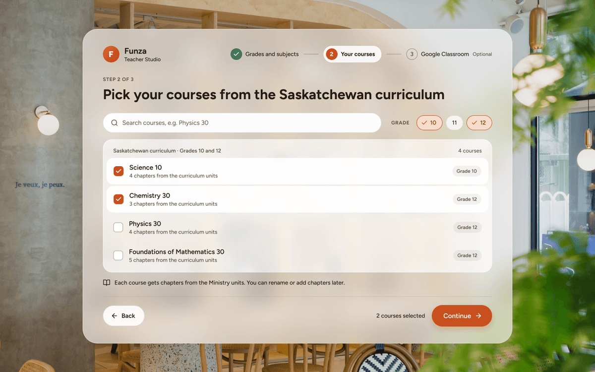
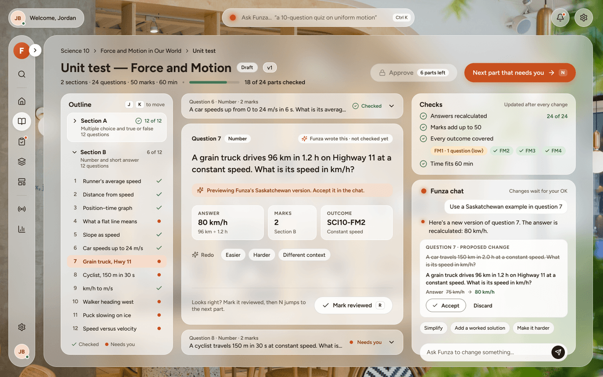
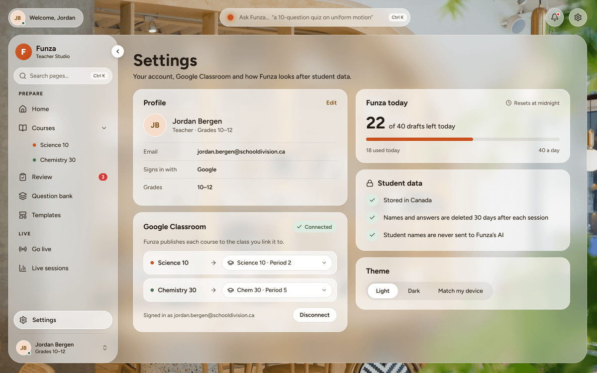
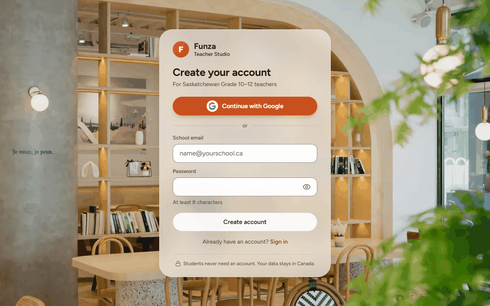
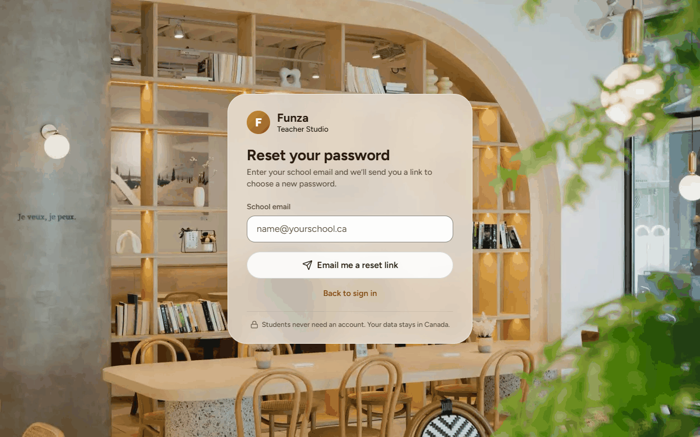
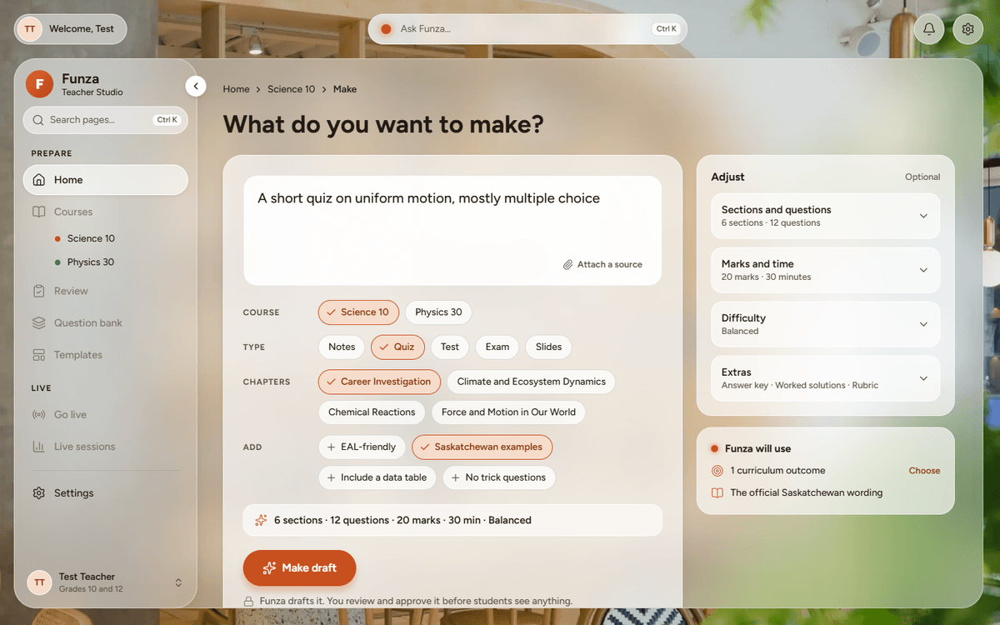
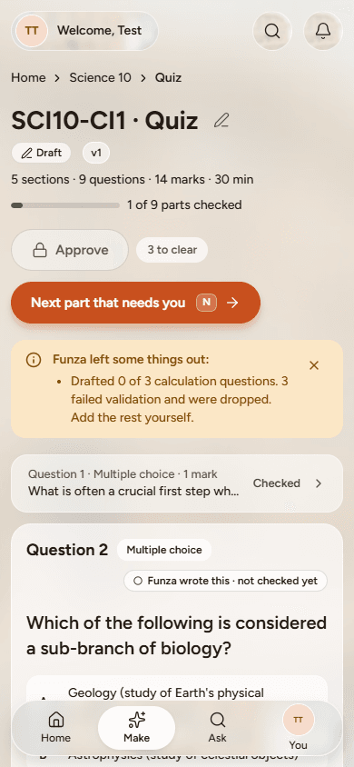

# UI design: F · Oak

**Funza Teacher Studio · v0.6 · 24 November 2026**

*Changed in v0.6: templates (section 4d): Word, PowerPoint and Funza materials as examples, saved Make settings, duplicate, pinned questions, printing in the template's style and saving review changes back; and Make's Format panel, which scrolls on its own. v0.5: students can press Submit on their phone and wait for Reveal. v0.4: the Live screens of step 5 (setup, console, projector, results, sessions, and the student join and answer screens), section 4c, and the projector clock size.*

*Changed in v0.3: the step 4 screens (Courses, a course, a chapter, sources, publishing), section 4b.*

*Changed in v0.2: the sign-in card has an email and password form, with "Create account" and "Forgot password?", instead of the email link, and a new "Choose a new password" screen (section 4).*

This is the design Funza is built on, and how the app turns it into code. The team picked **F · Oak** on 21 November from eight directions (`01_ui_directions.pdf` in this folder). This version covers the tokens, the shared parts and the screens of development step 3 (sign-in, first-time setup, Home, Make, review and Settings). The Live screens and the student join and answer screens are in section 4c; the student course page is added with step 6.

- **Figma file:** [Funza UI directions](https://www.figma.com/design/FIMcX0HYeZurSRrgxJygxz), page "★ F · Oak (picked)" plus the pages "F · Account and students", "F · Prepare screens" and "F · Live screens".
- **In the code:** the tokens are in `app/src/app/globals.css`, the shared parts in `app/src/components/ui/`, and the page shell in `app/src/components/shell/`.

## 1. The direction

> Warm and grounded: a sunlit school library, oak shelves and terracotta chairs, behind soft frosted glass. It feels like working in a calm reading room. *(Figma, direction frame 24:2)*

- **Background:** a full-bleed photo of a wood library café, by Raymond Yeung on Unsplash (Unsplash License). The credit is in `app/public/backgrounds/CREDITS.md`.
- **Workspace:** one large frosted glass panel holds the work. White translucent cards sit inside it.
- **Around it:**
  - a collapsible glass sidebar on the left;
  - a top bar with "Welcome, {name}", a centred "Ask Funza…" command bar (Ctrl K), notifications and settings;
  - on pages with sections, a tab dock at the bottom.
- **Accent and status:** terracotta for primary actions; sage green and amber for status.
- **Type:** Figtree.

## 2. Tokens

The Figma file defines no variables or styles. The tokens below are the values the frames actually use. Each is defined once in `globals.css` as a Tailwind 4 theme token, and components use the token names, never hex values.

### Colour

| Token | Value | Use |
|---|---|---|
| `ink` | `#241B14` | Main text, icons |
| `ink-2` | `#5E5046` | Secondary text, placeholders |
| `accent` | `#C8501E` | Primary buttons, selected chips, focus ring |
| `accent-hover` / `accent-pressed` | `#B8441A` / `#A33C17` | Not drawn in Figma; `#B8441A` is the logo gradient's end colour |
| `accent-ink` | `#8A3410` | Terracotta text, on the tint and on glass |
| `accent-tint` | `#F6DCCB` | Selected chips, avatar, count pills |
| `sage`, `sage-ink`, `sage-tint` | `#3D7A55`, `#2F5E41`, `#DCEBDD` | Checked, approved, connected |
| `amber-ink`, `amber-tint` | `#7A4A00`, `#FBE7C6` | In review, needs you |
| `red`, `red-ink`, `red-tint` | `#B4321F`, `#9A2A19`, `#F8DCD6` | Failed checks, errors |
| `dot` | `#D6353B` | Count badges and dots |
| Logo | `linear-gradient(135deg, #E0662F, #B8441A)` | The "F" circle (`bg-logo`) |

### Material states

| State | Background | Text | Border |
|---|---|---|---|
| Draft | white 70% | `ink` | 1px ink 16% |
| In review | `amber-tint` | `amber-ink` | none |
| Approved | `sage-tint` | `sage-ink` | none |
| Published | `accent-tint` | `accent-ink` | none |

Each chip also shows an icon and its word, so colour never carries the meaning alone.

### Glass

| Surface | Fill | Border | Radius | Shadow |
|---|---|---|---|---|
| Workspace panel | white 40% | white 40% | 32 | `0 24 64` brown 10% |
| Sign-in and setup panel | white 62% | white 45% | 36 | `0 24 32` brown 12% |
| Sidebar | white 50% | white 45% | 32 | `0 16 24` brown 10% |
| Card | white 65% | white 50% | 22 | none |
| Top-bar pills | white 50% (Ask bar 72%, see 7) | white 60% | pill | none |
| Tab dock | white 60% | white 70% | 26 | `0 10 15` brown 14% |

Shadows use warm brown (`rgb(58 36 20)`), never black.

**How the glass is drawn.** Figma blurs what is behind each surface (CSS `backdrop-filter`, 15 to 28 px). A live blur over a full-screen photo is slow on school Chromebooks. So the glass surfaces show a small pre-blurred copy of the photo (`oak-library-blur.webp`, 3 KB) instead:
- The copy is fixed to the viewport, so it lines up with the sharp photo behind it.
- It sits under the surface's white tint, which reproduces the frosted look with no blur filter at all.
- Phones and tablets ignore fixed backgrounds, so there the tint is raised to 72% instead.

The utilities are `frost` plus `frost-panel`, `frost-auth`, `frost-sidebar`, `frost-bar` and `frost-dock`.

### Type (Figtree)

| Role | Size / line height | Weight |
|---|---|---|
| Home greeting | 40 / 48 | Bold |
| Page title | 36 / 44 | Bold |
| Sign-in and setup heading | 34 / 40 | Bold |
| Review title | 30 / 38 | Bold |
| Card title | 18 / 24 or 16 / 22 | Bold |
| Row title | 15 / 20 | SemiBold |
| Body | 14 / 20 | Medium |
| Meta | 13 / 18 | Medium |
| Badge | 12 / 16 | SemiBold |
| Overline | 12, uppercase, tracking 0.72 px | Bold |
| Button | 15 (16 for the large one) | SemiBold |
| Projector clock and join code (`--text-timer`, added) | 144 / 144 | Bold |

On phones, page titles drop to 28 / 34.

### Shape and size

- **Buttons** are pills. The primary is 46 tall (52 for the main action on a screen); secondary buttons are 46; icon buttons are a 44 circle.
- **Chips:** 36 for choices, 32 for quick prompts, 30 for small ones.
- **Fields** are 52 tall with radius 14.
- **Touch:** on a touch screen every control grows to at least 44 px.
- **Icons** are [Lucide](https://lucide.dev) (`lucide-react`), 14 to 20 px, which is the set the Figma frames use.

## 3. Shared parts

| Part | Variants and states | File |
|---|---|---|
| Button | primary, secondary, ghost; sm / md / lg; with icon; loading; disabled (also as a link that explains why) | `ui/Button.tsx` |
| Chip | status (the four states); choice and quick-prompt (selected = tint + terracotta border + check); tag; count | `ui/Chip.tsx` |
| Card | card, card header, overline, keyboard key | `ui/Card.tsx` |
| Field | input, textarea, select, checkbox; label, hint, error | `ui/Field.tsx` |
| Disclosure | collapsed row with a live summary (the Adjust panel) | `ui/Disclosure.tsx` |
| Dialog | modal on the native `<dialog>` | `ui/Dialog.tsx` |
| Misc | logo, Google "G", empty state, tooltip, setup stepper, progress bar | `ui/Misc.tsx` |
| Page shell | photo, panel, sidebar, top bar, Ask Funza dialog, page header, tab dock, toasts | `shell/` |

**No coloured vertical bars.** No frame has a coloured stripe or thin pill in front of a row, card, chip or field, and none is used in the code. Selection is shown with a tint and a border. Status is shown with an icon, a word and colour.

## 4. Screens in step 3

### Sign in (A1, 45:625)

- **Card:** a centred 472 px glass card with no app chrome. "Continue with Google" comes first. Below the "or" divider is an email and password form; the copy above it is as drawn.
- **Changed from Figma (23 Nov):** the frame still shows the email field with "Email me a sign-in link". The built card replaces it with email and password (the built screenshot in section 8 is the reference until the frame is redrawn):
  - **Sign in:** School email, Password with a show/hide eye button, "Forgot password?" right-aligned under it, a "Sign in" button (secondary), and "New to Funza? Create an account" under the form.
  - **Create account:** the same card titled "Create your account", Google still first, the password hint "At least 8 characters", a "Create account" button and "Already have an account? Sign in".
  - **Forgot password:** "Reset your password", one sentence, the email field and "Email me a reset link". No Google button: one direction on this screen. "Back to sign in" under it.
  - The three are one card that switches in place; `/sign-in?mode=create` and `?mode=forgot` open it on the other two.
- **Google mark:** the drawn one is an imitation, so it is replaced with Google's official "G".
- **Added states (not drawn):**
  - "Check your email", worded for a new account ("Open the link we sent to … to confirm your account") or a reset ("If there's a Funza account for …, we sent it a link"), so the page never says whether an address has an account
  - errors in plain sentences: wrong email or password, email not confirmed, an account that already exists, too many tries, a password under 8 characters
  - errors from the email links (cancelled, expired or already used)
  - "You're signed out"
  - a spinner on the buttons

### Choose a new password (A1b, added; not drawn)

- **Card:** the sign-in card's frame, titled "Choose a new password", with "For name@school.ca" under it, one "New password" field (eye button, hint "At least 8 characters") and a primary "Save password" button. The footer reads "Your password is stored encrypted. Funza never sees it."
- **Reached from:** the link in the reset email (through `/auth/confirm`), and "Change password" next to "Email and password" in Settings → Profile.
- **Afterwards:** Settings with "Your new password is saved.", or first-time setup for a teacher who hasn't finished it.
- **Phone:** the card spans the width with 12 px margins.

### First-time setup (A2, 47:2)

Three steps under the drawn stepper. Only step 2 is drawn; steps 1 and 3 use its parts.

1. **Grades and subjects:**
   - a name field (email sign-ins arrive without a name) and an optional school;
   - grade chips;
   - subject chips taken from the Saskatchewan courses taught in those grades. Courses with no subject count as "Other".
2. **Your courses (as drawn):**
   - search, grade filter chips and a checkbox list with grade tags;
   - each row is one course at one level, so there is no separate level picker. A course offered at several levels, such as "Accounting 10, 20, 30", becomes one row per level ("Accounting 20", Grade 11).
3. **Google Classroom (optional):** connect now, or finish and do it later in Settings.

Each step is saved as the teacher moves on, so a teacher who stops halfway comes back to setup and finds their answers kept.

### Home (F1, 24:58)

- **Kept as drawn:** the greeting with the date, and the two mode cards. "Go live" opens Live setup (step 5).
- **Waiting for review:** lists this teacher's drafts that aren't approved yet, with an empty state.
- **Your courses:** shows the courses chosen in setup. Each one opens Make for that course.
- **Left out until Live exists:** "Last live session" and "Most missed".

### The page shell (F2, 27:531)

- **Sidebar:**
  - Desktop (1024 px and wider): 264 px expanded or 64 px collapsed; the setting is remembered.
  - Expanded, it overlaps the panel, which pads its content instead of moving, as in F1.
  - It lists the drawn items. Those not built yet (Review, Question bank) are shown disabled, with a note saying when they arrive. Templates is built (section 4d).
- **Ask Funza (Ctrl K):** opens a command dialog. Typed text starts a Make brief; the other entries go to Home, Make or Settings, or sign out. Chatting with Funza is Release 2.
- **Sign out:** in the account menu on the sidebar's profile row, and in the Ask Funza dialog.
- **The chapter screen itself** comes with courses and chapters in step 4.

### Make (F3, 28:159)

- **Main area:** "What do you want to make?" with a free-text request, "Attach a source", then rows of chips:
  - **Type:** Notes, Quiz, Test, Exam, Slides.
  - **Chapters:** the course's curriculum units at its level. Courses whose curriculum has no units show their outcomes instead.
  - **Add:** the quick prompts: "Use my notes", "EAL-friendly", "Saskatchewan examples", "Include a data table", "No trick questions".
- **Below the chips:** a live summary line, then "Make draft" with the promise line.
- **Adjust column:** starts with every row collapsed (sections and questions, marks and time, difficulty, extras). "Funza will use" lists the source and the outcomes.
- **Left out for now:**
  - The **Template** row waits for templates (built-in ones with step 4, the teacher's own in step 8).
  - "Practice" and "More" have no matching kind yet.
- **Added (not drawn):** the drafting state, which shows Funza's five stages with Cancel, and errors with Retry or "Start from the question bank".

### Review (P1, 47:226)

- **Columns:** an outline (J/K to move), the current part, and checks.
- **Header:** the status, version, "X of Y parts checked", "Next part that needs you" (N), and Approve. Approve stays locked until every part is reviewed and every check passes.
- **Each question:**
  - shows its answer, marks and outcome;
  - a multiple-choice question shows the right option in green with a check and the word "Correct", as in P3;
  - the "Redo" chips (Easier, Harder, Different context) ask Funza for a new version shown next to the original;
  - "Mark reviewed" is also the R key; Edit opens the question in place.
- **Checks:** only "passed" is drawn. "Failed", "needs you" and "changed" use the same row with red or amber icons and their fix buttons.
- **Approve:** opens a confirmation in the P2 style. Its "Publish to" options arrive with steps 4 and 6.
- **Funza chat** (P1's right column) is Release 2 (FR-22).

### Settings (A3, 47:1882)

- **Profile:** can be edited in place. The "Signs in with" row reads "Google" or "Email and password"; for email accounts it ends with a "Change password" link to Choose a new password.
- **Google Classroom:** connect or disconnect.
- **Student data:** the three fixed facts.
- **Sign out of this browser.**
- **The tab dock** jumps between these sections.
- **Left out:** "Funza today" (the daily AI allowance arrives in step 4) and "Theme" (no dark design exists).
- **Course list:** choosing a class per course arrives with course pages.

## 4b. Screens in step 4

Built from the shared parts, following the F2 chapter frame (27:531). Screenshots are added once the step 4 migration is on the database.

### Courses (`/courses`)
- **Header:** "Courses", with one line saying what a course holds, and the primary "Add a course".
- **Cards:** one per course: a terracotta or sage dot, the title, a "Grade N" tag, "N chapters · N materials", and "Open course".
- **Add a course (dialog):** two chips, "From the curriculum" and "My own course".
  - *From the curriculum:* grade chips (the teacher's first grade selected), then one Course select grouped by subject. It lists each course at each level ("Accounting 20") and hides courses the teacher already has.
  - *My own course:* one Course name field.
  - Footer: Cancel and "Add course". It opens the new course. Home's "Add a course" and the command menu open this dialog (`/courses?add=1`).

### A course (`/courses/[id]`)
- **Header:** crumbs "Courses › {course}", the title, "N chapters · From the Saskatchewan curriculum" (or "Your own course"), and the primary "Make something". Make is offered only for curriculum courses.
- **Chapters card:**
  - Numbered rows with the chapter title and "N outcomes · from the curriculum". The title opens the chapter page.
  - Four quiet round buttons on each row: rename (in place, with Save and Cancel), up, down, delete (with a confirm dialog saying its questions stay in the bank, retired).
  - An "Add a chapter" field at the end.
- **Materials card** (right column): each material with its type, version, date and state chip, opening in Review.
- **Course settings** (collapsed): rename, and "Delete this course" with a confirm dialog.

### A chapter (`/courses/[id]/chapters/[chapterId]`)
- **Header:** crumbs "Courses › {course} › {chapter}", "Chapter N of M · N outcomes · From the Saskatchewan curriculum", and "Make something", which starts Make on this chapter.
- **Left column:** Materials, then **Outcomes**, "From the official source": each outcome's code tag and its official wording.
- **Right column:**
  - **Question bank:** count, a line "N Multiple choice · N True or false · … · N marks in all", and a scrolling list of stems with type and marks (and "% right in class" once live results exist).
  - **Sources:** each file with its type tag ("Notes", "PDF", "Past exam") and "Text ready for Make" or "No text found". The title opens the file; a round button deletes it, with a confirm dialog. Under the list are a small "Notes or PDF / Past exam" select and "Add a source", which reads and uploads the file and shows its progress on the button.
  - **Live sessions:** an empty state saying it arrives with Live mode.
- **Changed from Figma:** the frame's bottom tab dock is left out until the page has five sections that hold something.

### Make
- **Chapters:** the chips are the course's chapters from the database, so a teacher's renamed or added chapters appear.
- **Opening Make from a chapter page** starts on that chapter.
- **Chapter sources:** next to "Attach a source", each chosen chapter's sources with text appear as small "Use {file}" buttons. One click makes it the brief's notes.
- **No chapters:** a course with none says so and links to its course page.
- **Daily allowance:** when 5 or fewer AI actions are left today, a quiet line under Make draft says how many. At 0 it says when they reset and that the question bank still works.

### Publish (on Review, once a version is approved)
- **Card "Publish version N"**, with "The student copy has no answers or keys" beside the title.
- **Print or save as PDF** (secondary) opens the student copy in a new tab: a white page on the cream background, with a thin bar holding "Student copy · vN · no answers or keys" and a terracotta "Print or save as PDF" button. The bar is hidden when printing.
- **Google Classroom:**
  - "Connect Google Classroom" when not connected, then "Choose classes".
  - Classes appear as checkbox rows. Each row shows that class's progress and result after posting, with a link to the post.
  - Chips choose Assignment or Material, and "Save as a draft in Classroom" or "Post now".
  - The primary button reads "Save draft to N classes" or "Post to N classes".

## 4c. Screens in step 5 (Live)

Drawn in Figma on the page "F · Live screens" (L1 to L5) and in the student phone frame F5 (32:220). The lobby and the phone's "You're in" screen weren't drawn; they follow the requirements and the other frames. Every Live screen ends with the stepper pill **Setup › Lobby › Answering › Marking › Reveal › Results**, the current step on white.

**Decided:** the whole set runs at once on one shared timer. No Pause and no leaderboard in R1 (the Figma Pause button and leaderboard toggle are left out, or shown off). **The projector never shows names:** the setup's Name row says "Shown to you, never on the projector", so the projector lobby shows only how many have joined; names are on the console.

### Go live (L1, `/live/new`)
- Crumbs: course › chapter › Go live. Course and chapter selects under the source chips.
- **Source chips:** This chapter / Upload a PDF or notes (the chapter's sources) / A saved quiz / Exit ticket preset (3 questions, 3:00).
- **Question card:** "Funza suggested N questions" with a "You kept N" pill and "Show the N you skipped". Each row has a checkbox, Q#, the question, a type tag, marks, the outcome code, where it came from, and a pencil that edits the wording in place. Questions from an approved quiz show "Edit in Review" instead, because an approved version can't change. Fill-in, matching and long answers are shown dimmed: "Not on phones yet". An empty bank offers "Suggest 8 questions".
- **Ask Funza for:** "+ 3 more", "Easier", "Harder", and "N Funza actions left today" when 5 or fewer remain.
- **Session settings:** the timer (− 5:00 +, steps of 30 s), the title, Name (always, never on the projector), Student number (on by default), Pacing "Whole set at once", Leaderboard (off, disabled), a summary ("8 questions · 13 marks · 5:00"), and the one primary action, **Open the lobby →**. When new or edited questions are kept, the summary says they will be saved to the chapter's bank as an approved quiz.

### The console (`/live/[id]`)
- **Lobby (added):** a card with "Join code", the code at 40 px, a QR code, and the join address; a Students card with each name (and student number) and a remove button with a confirm dialog. Actions: "Cancel session" (ghost), "Open projector view" (opens the projector in its own window), **Start answering**. Starting with nobody joined asks to confirm.
- **Answering (L2):** the title, "Students are answering · 8 questions · 28 joined with code K7QM4P", "Projector shows the clock and the join code", and "End early" (with a confirm). A ring timer ("3:12 left of 5:00"), "21 of 28 answered", answers in, finished and not started; "Answers per question" bars; a Students grid with a dot per question and "✓", "7 of 8" or "Not started". Footer: "Answers stay hidden until you press Reveal".
- **Check marks (L3):** "Funza marked N answers…". Left, the questions with their state ("marked exactly ✓", "check Funza's marks", "Funza is marking…", "Couldn't mark"). Right, the chosen question: tags, correct / partly / incorrect counts, the answer, then a table of Student, Answer, Funza's mark, Marks and Change. Change opens the marks (0 to the question's marks, or Right/Wrong for exact questions); a changed row is tinted, says "Changed by you · Funza gave N", and offers Undo. "Funza marks answers without seeing student names". The primary action is **Reveal**; with unmarked answers it asks first.
- **Reveal:** the projector's view in small, with ‹ n/N › (which also moves the projector), "Change a mark", and **See results**, which ends the session.

### The projector (`/live/[id]/screen`, L4; no shell)
- A pill at the top: title · course (· Answers revealed).
- **Lobby (added):** a large QR code (up to 42% of the screen height) on white with its quiet zone, "Join on your phone", the address, the code in `--text-timer` (144 px), and "N joined". No names.
- **Answering:** the clock in `--text-timer`, red in the last 30 seconds; "21 of 28 answered"; the address and code for late joiners.
- **Time's up**, then **Reveal (L4):** "Question 4 of 8" with its type and progress dots; the question at 40 px (NFR-18 asks for at least 32); the options with their percent bars, the correct one in sage with "✓ Correct answer" (for typed answers, the answer); "38% of the class got it right" at 96 px; "Names are never shown" and "Each phone now shows that student's own result". ← and → step (kept in step with the console), F goes full screen.

### Results (L5, `/live/[id]/results`)
- "Title · results", the date, course, chapter, questions, marks and timer. Actions: "Export CSV" and "Make practice" (disabled until Release 2). "Save to course" is left out.
- Class average; By outcome (% right bars); Funza's summary (its one-line notes from marking, when there are any); Most missed (the 3 lowest, with "Common wrong answer: False · 62%"); "Results added to N questions in the bank" with "Open question bank"; Student scores in two columns ("Only you see this list").
- After the 30-day clean-up, a note says names and answers are gone and only the per-question counts remain.

### Live sessions (`/live`)
"Open now" (each with its state and "Open console · code") and "Past sessions" (each with "Results"), and the primary "Go live". The chapter page lists its five latest sessions and has a secondary "Go live".

### Student phone (F5)
- **Join (`/join`):** the Funza logo, "Join a live session", "The code is on your teacher's screen.", Code (filled in from the QR code, spaced capitals), Name, "Student number (if your teacher asks)", **Join →**, "No account needed. Your teacher will see your name." A phone that joined before sees "Rejoin as {name}". Inputs are at least 16 px, so iOS doesn't zoom.
- **You're in (added):** a sage check, "You're in, {name}.", "Wait for your teacher…", and the number of questions and minutes.
- **Answer:** "Question 3 of 8", the timer pill (the server's clock; red in the last 30 s), a progress bar, the question card, option rows at least 52 px tall with a round check (selected: terracotta edge on tint), a number box with the unit after it and a hint under it when it can't be read, or a text box. Under it: the "✓ Saved" pill ("Saving…", "Not saved yet · retrying", "Locked"), Back and **Next →**, and dots that jump to a question. A last screen, "Check your answers", lists every question, with Back and **✓ Submit**. If a question has no answer, Submit first asks: "2 questions have no answer. Submit anyway?" At 0:00 the phone locks: "Time's up. Your answers are locked."
- **Submitted:** "Your answers are in." (with a spinner and "Sending your answers…" until the server has every answer), "You answered 7 of 8. You'll see your results here when your teacher reveals the answers.", the time left for the class, and a ghost "Change my answers" while time remains. Submit is the student's "I'm done"; it stays after a reload, and answers can still change until 0:00.
- **Time's up:** "You answered 7 of 8. Your teacher is checking the answers; you'll see your results here when they reveal them."
- **After Reveal:** "Your result · 6 of 8 · 75%", then each question with Right, "Not quite" (with "You: True · Answer: False"), "Partly · 2 of 3", "No answer" or "Not marked", and "Your teacher will go over the answers now."
- **Removed or ended:** "This phone isn't in the session." with **Join again**.

## 4d. Templates (built early)

Templates are the teacher's own formats. Funza copies how they're made, never what's in them. Rows start collapsed and show their value; each screen has one primary button.

- **Templates** (`/templates`, sidebar):
  - Four groups, always in this order: Quizzes & tests, Exams, Notes, Slides.
  - **Rows:** each shows the name and its value ("3 sections · 27 questions · 60 marks · 90 min · used 4×"). A row opens the template. ✎ renames in place, and 🗑 deletes after a confirm dialog ("Materials made from it stay as they are").
  - **Empty:** an empty group says "None yet" with a link. A teacher with no templates sees one empty-state card.
  - The primary button is **+ New template**.
- **New template** (`/templates/new`), one page that unfolds:
  1. **For:** chips for the four categories.
  2. **Example:**
     - a drop zone for up to three files (PDF or text), and "Or describe it in words";
     - a lock line: "Funza reads it once to learn the format. The file isn't kept."
     - **Read the format** is the primary button; "or set it up yourself" starts from Funza's defaults with no AI.
  3. **Check:** the skeleton.
     - Each section shows its title and rows ("20 multiple choice × 1 mark"). Opened, a section has its title, instructions and type/count/marks rows, with ↑ ↓ and remove.
     - Then the rows Time and difficulty, Extras, Wording style and Cover page.
     - Notes show Parts, Style and Extras. Slides show Slides (count, most bullets, the pattern of a content slide, speaker notes) and Parts.
     - Notices in amber appear when Funza left out copied lines or couldn't read a section.
  4. **Name:** name and an optional one-sentence summary, then **Save template**.
  - Opened from Make, saving goes back to Make with the new template chosen.
  - **Examples:** files can be PDF, Word (.docx), PowerPoint (.pptx) or text. "Or start from one of your Funza materials" lists materials of the same kind. A quiz, test or exam gives its exact structure at once, with no AI; notes and slides are read by Funza.
- **A template** (`/templates/[id]`):
  - **Header:** "Exam · learned from midterm.pdf · used for 4 materials", the name and summary fields, and the same skeleton editor.
  - **Read another example:** collapsed; it replaces the skeleton.
  - **Pinned questions** (quizzes, tests and exams), collapsed: each pin shows its section letter, the start of the question, its type and marks, and an unpin button. To add one, choose a chapter, a question from its bank, then a section that asks for that type, and press **Pin it**. Every material from the template includes pinned questions unchanged, and Funza writes the rest of the section around them.
  - **Buttons:** **Save changes** (enabled only when something changed), Use in Make (secondary), Duplicate (ghost), and Delete template (ghost, with a confirm dialog).
- **The list:** each row also has a Duplicate button ("… (copy)").
- **Make's Format panel:** the right column is one panel. On wide screens it is sticky and scrolls on its own, so the Make box stays in place.
  - **Header:** the title, the switch **(Adjust) (Template)** and one value line.
  - **Adjust:** today's collapsed rows.
  - **Template:** the category's templates as choices. The chosen one has the selected recipe (tint, terracotta border, check) and shows its skeleton. Below are "+ New template" and Manage.
  - **No templates yet:** "No exam templates yet. Show Funza a past exam and it makes new ones in the same format." with **New template**.
  - **Switching:**
    - Template picks the most-used template.
    - Quiz ↔ Test keeps it; another type clears it.
    - Adjust brings back the teacher's own settings.
    - With Template chosen and no template, Make draft is disabled.
  - **"Funza will use":** starts with "Your template "…" · Its format and wording style, never its content".
  - **Below wide screens:** the panel sits under the Make box, collapsed at first, and the summary line has a "Change" link.
  - **Adjust** ends with "Save these settings as a template": a dialog asks for a name, and the new template is chosen straight away.
  - The chosen template's skeleton shows "· 1 pinned" on sections with pinned questions.
- **Review (a material made from a template):** when the teacher has changed its structure (a question more or less, other marks, instructions or time), a row says "You changed this material's structure. Save it to your template so the next one starts from it?" with **Save to template** (secondary) and ×. Questions Funza couldn't draft don't count as a change.
- **Printed copies and Classroom Docs** follow the template: numbering straight through or restarting in each section, marks in brackets, in the margin or not shown, and the cover page (title, name line, totals, instructions) on its own page.

## 5. Phones (added; not drawn for teacher screens)

Only the student phone (F5, 32:220) is drawn. Teacher screens below 768 px follow its rules:
- **Background:** a full-screen frosted layer instead of a floating panel, with cards on top.
- **Top bar:** the welcome pill, Ask Funza and notifications.
- **Bottom bar:** a glass bar (Home, Make, Ask, You) replaces the sidebar. "You" holds Settings and Sign out.
- **Layout:** 12 px side margins, single-column cards, and the main action full width where it matters.
- **Touch:** every tap target is at least 44 px.

The team should review this before the bazaar.

## 6. Gaps filled and inconsistencies settled

**Not drawn, built from the same parts:**
- hover, pressed and focus states;
- empty states and toasts (in the style of F5's "Saved" pill);
- the sign-in card's email and password form, its create-account and forgot-password modes, and its email-sent and error states;
- Choose a new password;
- setup steps 1 and 3;
- Make's drafting state and open Adjust rows;
- failed and waiting checks;
- inline editing.

**Settled where frames disagree:**

| Difference in the frames | Settled as |
|---|---|
| Two badge reds (`#D6353B`, `#E5484D`) | `#D6353B` |
| Three ways to show "selected" | Tint plus a solid terracotta border and a check |
| Draft border at 14% and 16% | 16% |
| Card fill 55% and 65% | 65% |
| Primary buttons 40 to 54 tall | 46 and 52 |
| A book icon on F3's breadcrumb only | Removed |

## 7. Accessibility (WCAG 2.2 AA)

- **Text contrast:**
  - Ink on cards is about 12:1.
  - Secondary text (`#5E5046`) on cards is 5.2:1 or more.
  - White on terracotta is 4.54:1, which passes for the 15 px SemiBold button text. Terracotta is never used for small text on glass; `#8A3410` is used instead.
  - All four status chips are above 6:1.
- **Changed from Figma:**
  - **Field and checkbox edges:** ink at 12–14% measures about 1.3:1, below the 3:1 needed for a control's edge. They are now ink at 50% (3.3:1).
  - **Secondary text placement:** it never sits on the bare 40% panel, where dark wood could show through.
  - **Ask Funza bar:** its tint was raised from 55% to 72% so its placeholder passes.
- **Keyboard:** every control works from the keyboard, with a visible 2 px terracotta focus ring. There is a "Skip to content" link, Ctrl K opens Ask Funza, and the review keys are N, J, K and R.
- **Touch:** tap targets are at least 44 px on touch screens.
- **Motion:** animation is turned off when the device asks for reduced motion.

## 8. The built screens (21 November)

These screenshots come from the app on branch `sign-in`. They were taken with a test teacher and a real Gemini draft. The sign-in screenshots were retaken on 23 November, after the change to email and password.

| Sign in | Create account |
|---|---|
|  |  |

| Forgot password | Home |
|---|---|
|  |  |

| Make | Review |
|---|---|
|  |  |

## 9. Not in this version

The student course page (step 6), a bank page across chapters, scanned pages as template examples, and in Live mode: Pause, a leaderboard and "Make practice". Each is drawn in Figma and gets its section here when it is built.
