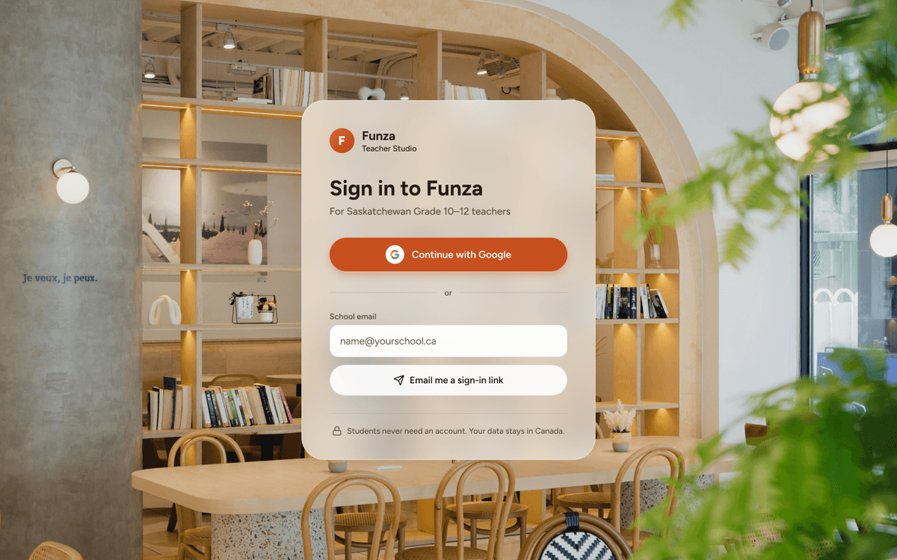
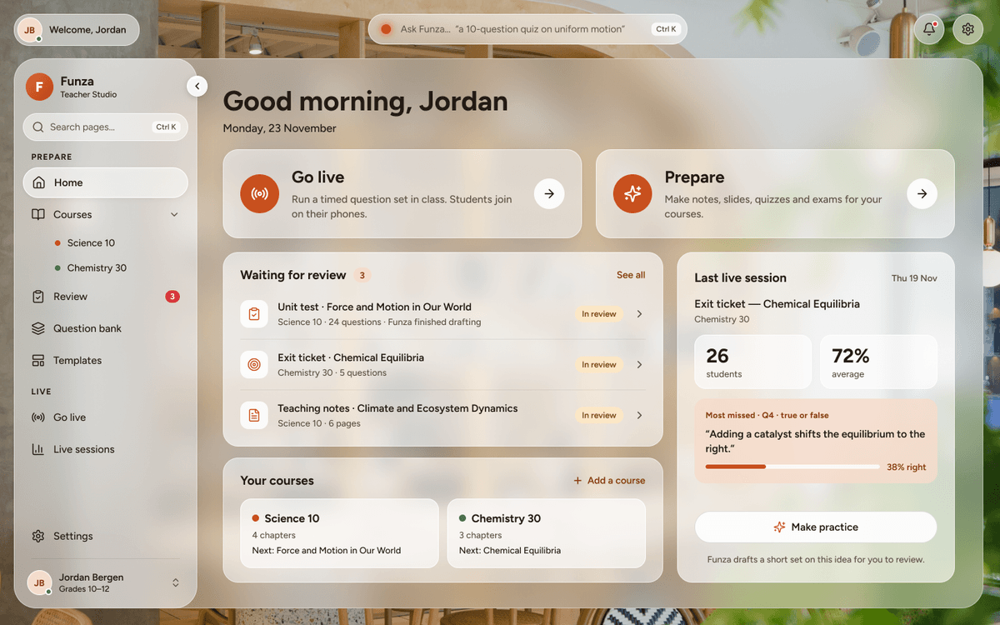
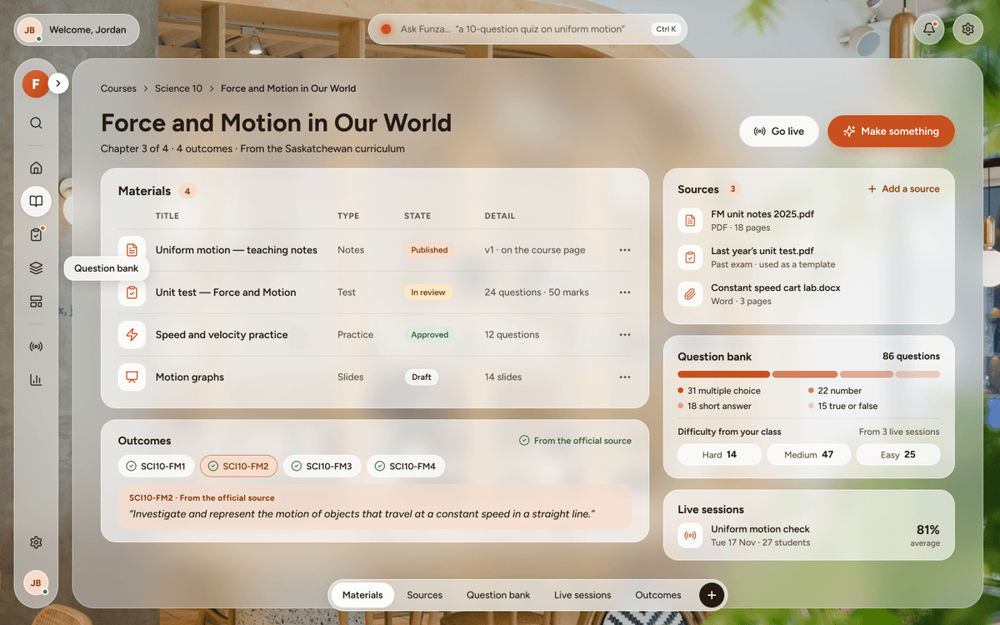
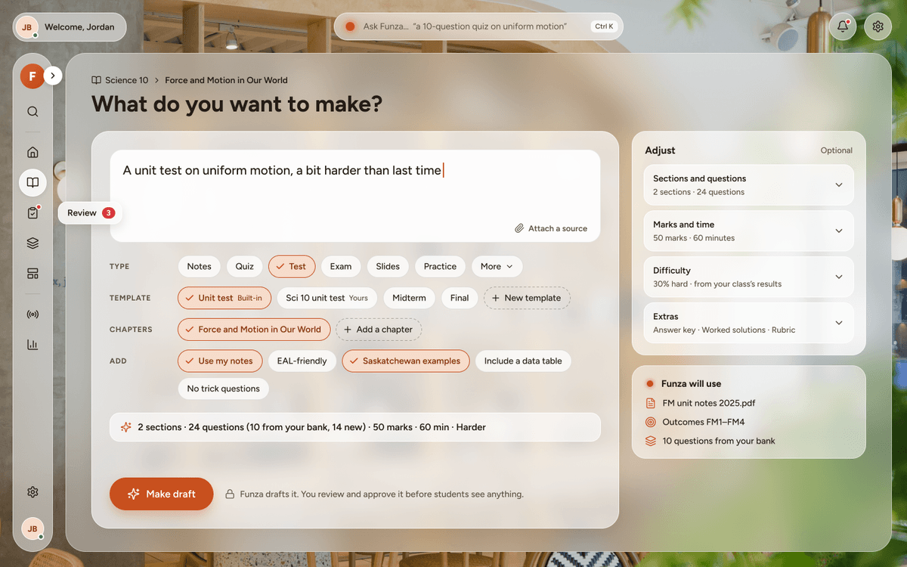
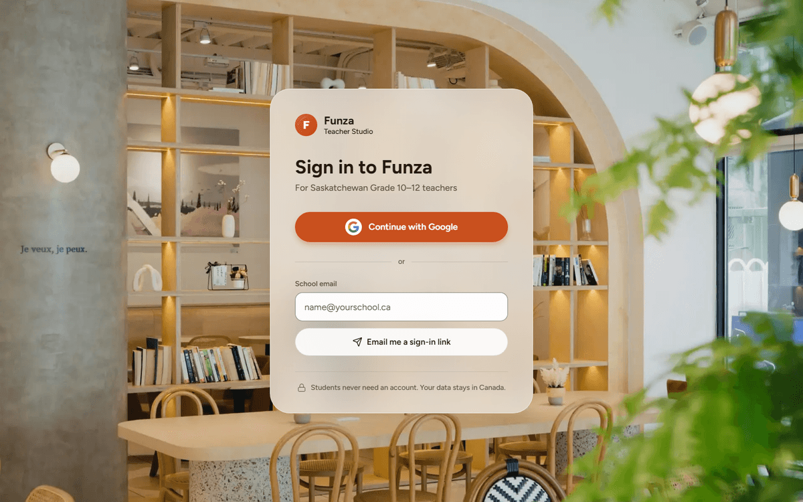
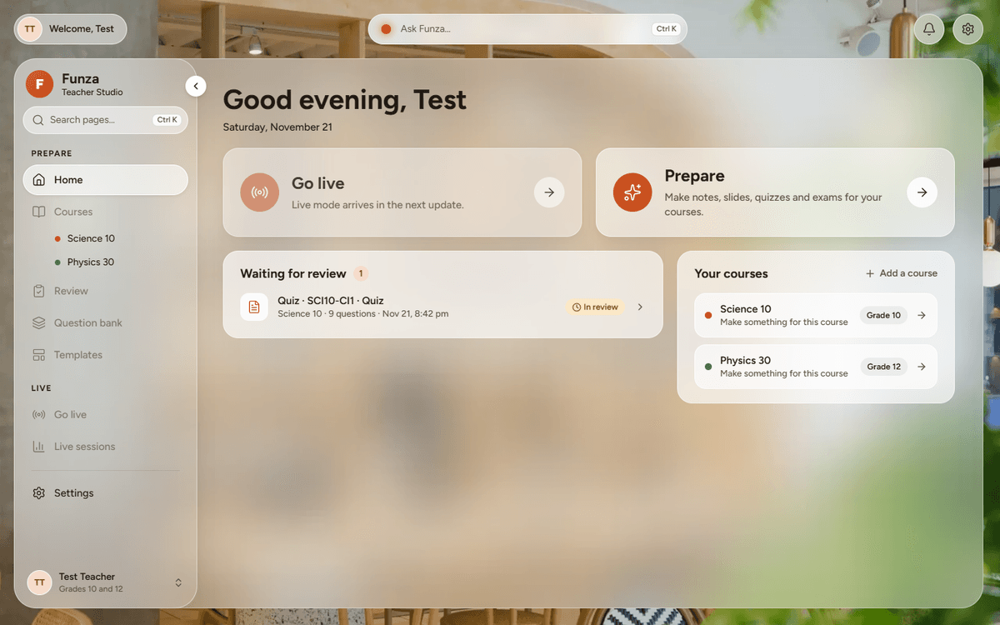
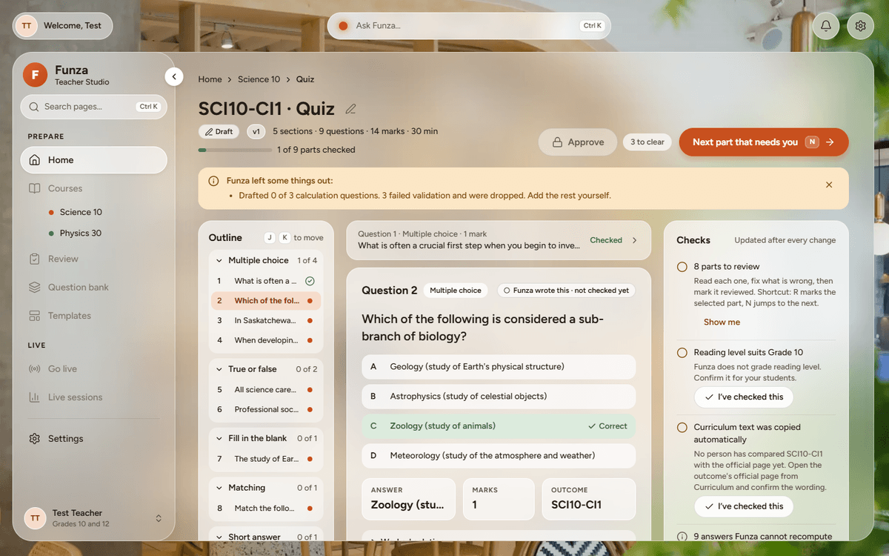

# UI design: F · Oak

**Funza Teacher Studio · v0.1 · 21 November 2026**

This is the design Funza is built on, and how the app turns it into code. The team picked **F · Oak** on 21 November from eight directions (`01_ui_directions.pdf` in this folder). This version covers the tokens, the shared parts and the screens of development step 3 (sign-in, first-time setup, Home, Make, review and Settings). The Live and student screens are added when they are built (steps 5 and 6).

- **Figma file:** [Funza UI directions](https://www.figma.com/design/FIMcX0HYeZurSRrgxJygxz), page "★ F · Oak (picked)" plus the pages "F · Account and students", "F · Prepare screens" and "F · Live screens".
- **In the code:** the tokens are in `app/src/app/globals.css`, the shared parts in `app/src/components/ui/`, and the page shell in `app/src/components/shell/`.

## 1. The direction

> Warm and grounded: a sunlit school library, oak shelves and terracotta chairs, behind soft frosted glass. It feels like working in a calm reading room. *(Figma, direction frame 24:2)*

- **Background:** a full-bleed photo of a wood library café, by Raymond Yeung on Unsplash (Unsplash License). The credit is in `app/public/backgrounds/CREDITS.md`.
- **Workspace:** one large frosted glass panel holds the work. White translucent cards sit inside it.
- **Around it:**
  - a collapsible glass sidebar on the left;
  - a top bar with "Welcome, {name}", a centred "Ask Funza…" command bar (Ctrl K), notifications and settings;
  - on pages with sections, a tab dock at the bottom.
- **Accent and status:** terracotta for primary actions; sage green and amber for status.
- **Type:** Figtree.

## 2. Tokens

The Figma file defines no variables or styles. The tokens below are the values the frames actually use. Each is defined once in `globals.css` as a Tailwind 4 theme token, and components use the token names, never hex values.

### Colour

| Token | Value | Use |
|---|---|---|
| `ink` | `#241B14` | Main text, icons |
| `ink-2` | `#5E5046` | Secondary text, placeholders |
| `accent` | `#C8501E` | Primary buttons, selected chips, focus ring |
| `accent-hover` / `accent-pressed` | `#B8441A` / `#A33C17` | Not drawn in Figma; `#B8441A` is the logo gradient's end colour |
| `accent-ink` | `#8A3410` | Terracotta text, on the tint and on glass |
| `accent-tint` | `#F6DCCB` | Selected chips, avatar, count pills |
| `sage`, `sage-ink`, `sage-tint` | `#3D7A55`, `#2F5E41`, `#DCEBDD` | Checked, approved, connected |
| `amber-ink`, `amber-tint` | `#7A4A00`, `#FBE7C6` | In review, needs you |
| `red`, `red-ink`, `red-tint` | `#B4321F`, `#9A2A19`, `#F8DCD6` | Failed checks, errors |
| `dot` | `#D6353B` | Count badges and dots |
| Logo | `linear-gradient(135deg, #E0662F, #B8441A)` | The "F" circle (`bg-logo`) |

### Material states

| State | Background | Text | Border |
|---|---|---|---|
| Draft | white 70% | `ink` | 1px ink 16% |
| In review | `amber-tint` | `amber-ink` | none |
| Approved | `sage-tint` | `sage-ink` | none |
| Published | `accent-tint` | `accent-ink` | none |

Each chip also shows an icon and its word, so colour never carries the meaning alone.

### Glass

| Surface | Fill | Border | Radius | Shadow |
|---|---|---|---|---|
| Workspace panel | white 40% | white 40% | 32 | `0 24 64` brown 10% |
| Sign-in and setup panel | white 62% | white 45% | 36 | `0 24 32` brown 12% |
| Sidebar | white 50% | white 45% | 32 | `0 16 24` brown 10% |
| Card | white 65% | white 50% | 22 | none |
| Top-bar pills | white 50% (Ask bar 72%, see 7) | white 60% | pill | none |
| Tab dock | white 60% | white 70% | 26 | `0 10 15` brown 14% |

Shadows use warm brown (`rgb(58 36 20)`), never black.

**How the glass is drawn.** Figma blurs what is behind each surface (CSS `backdrop-filter`, 15 to 28 px). A live blur over a full-screen photo is slow on school Chromebooks. So the glass surfaces show a small pre-blurred copy of the photo (`oak-library-blur.webp`, 3 KB) instead:
- The copy is fixed to the viewport, so it lines up with the sharp photo behind it.
- It sits under the surface's white tint, which reproduces the frosted look with no blur filter at all.
- Phones and tablets ignore fixed backgrounds, so there the tint is raised to 72% instead.

The utilities are `frost` plus `frost-panel`, `frost-auth`, `frost-sidebar`, `frost-bar` and `frost-dock`.

### Type (Figtree)

| Role | Size / line height | Weight |
|---|---|---|
| Home greeting | 40 / 48 | Bold |
| Page title | 36 / 44 | Bold |
| Sign-in and setup heading | 34 / 40 | Bold |
| Review title | 30 / 38 | Bold |
| Card title | 18 / 24 or 16 / 22 | Bold |
| Row title | 15 / 20 | SemiBold |
| Body | 14 / 20 | Medium |
| Meta | 13 / 18 | Medium |
| Badge | 12 / 16 | SemiBold |
| Overline | 12, uppercase, tracking 0.72 px | Bold |
| Button | 15 (16 for the large one) | SemiBold |

On phones, page titles drop to 28 / 34.

### Shape and size

- **Buttons** are pills. The primary is 46 tall (52 for the main action on a screen); secondary buttons are 46; icon buttons are a 44 circle.
- **Chips:** 36 for choices, 32 for quick prompts, 30 for small ones.
- **Fields** are 52 tall with radius 14.
- **Touch:** on a touch screen every control grows to at least 44 px.
- **Icons** are [Lucide](https://lucide.dev) (`lucide-react`), 14 to 20 px, which is the set the Figma frames use.

## 3. Shared parts

| Part | Variants and states | File |
|---|---|---|
| Button | primary, secondary, ghost; sm / md / lg; with icon; loading; disabled (also as a link that explains why) | `ui/Button.tsx` |
| Chip | status (the four states); choice and quick-prompt (selected = tint + terracotta border + check); tag; count | `ui/Chip.tsx` |
| Card | card, card header, overline, keyboard key | `ui/Card.tsx` |
| Field | input, textarea, select, checkbox; label, hint, error | `ui/Field.tsx` |
| Disclosure | collapsed row with a live summary (the Adjust panel) | `ui/Disclosure.tsx` |
| Dialog | modal on the native `<dialog>` | `ui/Dialog.tsx` |
| Misc | logo, Google "G", empty state, tooltip, setup stepper, progress bar | `ui/Misc.tsx` |
| Page shell | photo, panel, sidebar, top bar, Ask Funza dialog, page header, tab dock, toasts | `shell/` |

**No coloured vertical bars.** No frame has a coloured stripe or thin pill in front of a row, card, chip or field, and none is used in the code. Selection is shown with a tint and a border. Status is shown with an icon, a word and colour.

## 4. Screens in step 3

### Sign in (A1, 45:625)

- **Card:** a centred 472 px glass card with no app chrome. "Continue with Google" comes first, and an email link is the fallback. The copy is as drawn.
- **Google mark:** the drawn one is an imitation, so it is replaced with Google's official "G".
- **Added states (not drawn):**
  - "Check your email"
  - errors from the sign-in callback (cancelled, expired link, link opened in another browser)
  - "You're signed out"
  - a spinner on the buttons
- **Phone:** the card spans the width with 12 px margins.

### First-time setup (A2, 47:2)

Three steps under the drawn stepper. Only step 2 is drawn; steps 1 and 3 use its parts.

1. **Grades and subjects:**
   - a name field (email sign-ins arrive without a name) and an optional school;
   - grade chips;
   - subject chips taken from the Saskatchewan courses taught in those grades. Courses with no subject count as "Other".
2. **Your courses (as drawn):**
   - search, grade filter chips and a checkbox list with grade tags;
   - each row is one course at one level, so there is no separate level picker. A course offered at several levels, such as "Accounting 10, 20, 30", becomes one row per level ("Accounting 20", Grade 11).
3. **Google Classroom (optional):** connect now, or finish and do it later in Settings.

Each step is saved as the teacher moves on, so a teacher who stops halfway comes back to setup and finds their answers kept.

### Home (F1, 24:58)

- **Kept as drawn:** the greeting with the date, and the two mode cards. "Go live" is shown but disabled until Live mode (step 5).
- **Waiting for review:** lists this teacher's drafts that aren't approved yet, with an empty state.
- **Your courses:** shows the courses chosen in setup. Each one opens Make for that course.
- **Left out until Live exists:** "Last live session" and "Most missed".

### The page shell (F2, 27:531)

- **Sidebar:**
  - Desktop (1024 px and wider): 264 px expanded or 64 px collapsed; the setting is remembered.
  - Expanded, it overlaps the panel, which pads its content instead of moving, as in F1.
  - It lists the drawn items. Those not built yet (Courses, Review, Question bank, Templates, Go live, Live sessions) are shown disabled, with a note saying when they arrive.
- **Ask Funza (Ctrl K):** opens a command dialog. Typed text starts a Make brief; the other entries go to Home, Make or Settings, or sign out. Chatting with Funza is Release 2.
- **Sign out:** in the account menu on the sidebar's profile row, and in the Ask Funza dialog.
- **The chapter screen itself** comes with courses and chapters in step 4.

### Make (F3, 28:159)

- **Main area:** "What do you want to make?" with a free-text request, "Attach a source", then rows of chips:
  - **Type:** Notes, Quiz, Test, Exam, Slides.
  - **Chapters:** the course's curriculum units at its level. Courses whose curriculum has no units show their outcomes instead.
  - **Add:** the quick prompts: "Use my notes", "EAL-friendly", "Saskatchewan examples", "Include a data table", "No trick questions".
- **Below the chips:** a live summary line, then "Make draft" with the promise line.
- **Adjust column:** starts with every row collapsed (sections and questions, marks and time, difficulty, extras). "Funza will use" lists the source and the outcomes.
- **Left out for now:**
  - The **Template** row waits for templates (built-in ones with step 4, the teacher's own in step 8).
  - "Practice" and "More" have no matching kind yet.
- **Added (not drawn):** the drafting state, which shows Funza's five stages with Cancel, and errors with Retry or "Start from the question bank".

### Review (P1, 47:226)

- **Columns:** an outline (J/K to move), the current part, and checks.
- **Header:** the status, version, "X of Y parts checked", "Next part that needs you" (N), and Approve. Approve stays locked until every part is reviewed and every check passes.
- **Each question:**
  - shows its answer, marks and outcome;
  - a multiple-choice question shows the right option in green with a check and the word "Correct", as in P3;
  - the "Redo" chips (Easier, Harder, Different context) ask Funza for a new version shown next to the original;
  - "Mark reviewed" is also the R key; Edit opens the question in place.
- **Checks:** only "passed" is drawn. "Failed", "needs you" and "changed" use the same row with red or amber icons and their fix buttons.
- **Approve:** opens a confirmation in the P2 style. Its "Publish to" options arrive with steps 4 and 6.
- **Funza chat** (P1's right column) is Release 2 (FR-22).

### Settings (A3, 47:1882)

- **Profile:** can be edited in place.
- **Google Classroom:** connect or disconnect.
- **Student data:** the three fixed facts.
- **Sign out of this browser.**
- **The tab dock** jumps between these sections.
- **Left out:** "Funza today" (the daily AI allowance arrives in step 4) and "Theme" (no dark design exists).
- **Course list:** choosing a class per course arrives with course pages.

## 5. Phones (added; not drawn for teacher screens)

Only the student phone (F5, 32:220) is drawn. Teacher screens below 768 px follow its rules:
- **Background:** a full-screen frosted layer instead of a floating panel, with cards on top.
- **Top bar:** the welcome pill, Ask Funza and notifications.
- **Bottom bar:** a glass bar (Home, Make, Ask, You) replaces the sidebar. "You" holds Settings and Sign out.
- **Layout:** 12 px side margins, single-column cards, and the main action full width where it matters.
- **Touch:** every tap target is at least 44 px.

The team should review this before the bazaar.

## 6. Gaps filled and inconsistencies settled

**Not drawn, built from the same parts:**
- hover, pressed and focus states;
- empty states and toasts (in the style of F5's "Saved" pill);
- the sign-in sent and error states;
- setup steps 1 and 3;
- Make's drafting state and open Adjust rows;
- failed and waiting checks;
- inline editing.

**Settled where frames disagree:**

| Difference in the frames | Settled as |
|---|---|
| Two badge reds (`#D6353B`, `#E5484D`) | `#D6353B` |
| Three ways to show "selected" | Tint plus a solid terracotta border and a check |
| Draft border at 14% and 16% | 16% |
| Card fill 55% and 65% | 65% |
| Primary buttons 40 to 54 tall | 46 and 52 |
| A book icon on F3's breadcrumb only | Removed |

## 7. Accessibility (WCAG 2.2 AA)

- **Text contrast:**
  - Ink on cards is about 12:1.
  - Secondary text (`#5E5046`) on cards is 5.2:1 or more.
  - White on terracotta is 4.54:1, which passes for the 15 px SemiBold button text. Terracotta is never used for small text on glass; `#8A3410` is used instead.
  - All four status chips are above 6:1.
- **Changed from Figma:**
  - **Field and checkbox edges:** ink at 12–14% measures about 1.3:1, below the 3:1 needed for a control's edge. They are now ink at 50% (3.3:1).
  - **Secondary text placement:** it never sits on the bare 40% panel, where dark wood could show through.
  - **Ask Funza bar:** its tint was raised from 55% to 72% so its placeholder passes.
- **Keyboard:** every control works from the keyboard, with a visible 2 px terracotta focus ring. There is a "Skip to content" link, Ctrl K opens Ask Funza, and the review keys are N, J, K and R.
- **Touch:** tap targets are at least 44 px on touch screens.
- **Motion:** animation is turned off when the device asks for reduced motion.

## 8. The built screens (21 November)

These screenshots come from the app on branch `sign-in`. They were taken with a test teacher and a real Gemini draft.

| Sign in | Home |
|---|---|
|  |  |

| Make | Review |
|---|---|
|  |  |

## 9. Not in this version

Live mode (lobby, console, reveal, results), the student join and answer screens, the student course page, the chapter page, the question bank and templates. Each is drawn in Figma and gets its section here when it is built.
