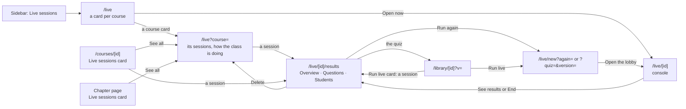

# Live history: past sessions, their quizzes, students' answers and results
**Funza Teacher Studio · v0.1 · 24 November 2026**

*The plan, before building. Asked for on 24 November 2026: Live mode keeps every past session, the quiz that was run, what each student answered and how the class did.*

Live mode already ends each session on a results page (FR-14, FR-15). This plan makes those results a **history** the teacher can come back to:
- the **Live sessions** page opens on a card per course, like the Library;
- each course shows its sessions and how the class is doing across them;
- each session shows its whole quiz, every student's answers, and the class's results;
- the course page, the chapter page and the Library link to the sessions that belong to them.

The privacy rule stays: names and answers are deleted 30 days after a session. What changes is that the **results stay exactly as they were**, without names, for good.

## 1. Decisions

Decided by the team on 24 November 2026:

| Question | Decision |
|---|---|
| How long names and answers are kept | **30 days after the session, then anonymous** (unchanged, NFR-15). For those 30 days, the teacher sees and exports who answered what. After that, Funza keeps the whole quiz, each question's answer breakdown, the class average and the score spread, with no names and no typed answers. |
| The same student across sessions | **Per session only.** Each session shows every student's answers and score. Performance over time is the **class's**, per course (by outcome and by session). No names or student numbers are matched across sessions. |
| Deleting a past session | **Allowed, and its bank stats are taken back out.** The session, its students and their answers go for good. The answer counts it added to each bank question are subtracted, so question difficulty counts only the sessions the teacher keeps. |
| A session left open | **Ended after 24 hours untouched**, as if the teacher pressed End. A session still in its lobby (never started) is deleted instead, because nothing was answered. |

Defaults set in this plan (same patterns as the rest of the app; change them if wrong):

| Question | Default |
|---|---|
| Layout of Live sessions | Two steps, like the Library: course cards first, then that course's sessions. |
| A session's page | One results page with three views (chips): **Overview**, **Questions**, **Students**. |
| Cancel in the lobby | Deletes the session instead of ending it, so the history holds only sessions that ran. |
| Changing marks after the session ends | Still not possible (unchanged). The kept results can then never go out of date. |

## 2. What exists today, and what's missing

| Area | Today | Missing or wrong |
|---|---|---|
| Live sessions page (`/live`) | "Open now" and "Past sessions" in one list, the latest 100 | No grouping by course, no class average, no search. Dates use the server's time zone, not Saskatchewan's. |
| Results page (`/live/[id]/results`) | Class average, by outcome, Funza's summary, the 3 most-missed questions, a score per student, CSV export | The other questions aren't shown. What each student answered isn't shown (only in the CSV). No way to delete. |
| After the 30-day clean-up | `live_questions` keeps `answer_count` and `correct_count` | **The numbers change.** Class average becomes "—" and students become 0, because both are worked out from the deleted students. Percent right switches from "of everyone who joined" to "of those who answered". Option bars and the common wrong answer disappear. |
| Sessions never ended | Stay "open" until the 30-day clean-up ends them | They never reach the history, the bank never learns from them, and two of them block **Go live** (limit of 2 open sessions). Both sessions in the database today are like this: revealed, then left open. |
| Cancel in the lobby | Ends the session | An empty session lands in "Past sessions". |
| Links between screens | The chapter page lists its 5 latest sessions | The course page and the Library don't show sessions. A session doesn't link to its quiz in the Library. No "Run again". |
| Go live from a saved quiz (`?quiz=`) | Uses the quiz's *current* version | A newer draft (not approved) has no questions. The quiz list skips published quizzes and quizzes with a draft after approval. |

## 3. Logic

### What counts as a past session
A session that **ended after it was started** (`state = 'ended'` and `opened_at` is set). Open sessions stay at the top under "Open now", with their console. A session cancelled in the lobby is deleted, so it never appears.

### What is kept, and for how long

| Kept | For how long |
|---|---|
| The session: title, course, chapter, the quiz version it came from, its times, the timer | Until the teacher deletes the session (or its course) |
| The quiz as it was run: each question, its options, its answer key, its marks and outcome (`live_questions.content`, a snapshot) | Until the session is deleted |
| The results, without names: students who joined, each student's percent (no name), class average, and per question the counts of right, partly, wrong and answered, how many chose each option, and the most common wrong option | Until the session is deleted |
| Funza's one-line notes from marking short answers | Until the session is deleted |
| Students' names and student numbers, every answer, every mark, who marked it | **30 days after the session ends**, then deleted by the nightly job (unchanged) |

### The numbers never change when names are deleted
Every number on the results page is worked out **once, when the session ends**, from the answers, and stored. The results page reads those stored numbers for every ended session, before and after the 30-day clean-up. While names are kept, the per-student views are worked out from the answers with the same rules.

Definitions (the same as the console and projector use today):
- **Joined:** students in the session when it ended. A student removed during the session isn't counted; their answers went with them.
- **Right:** full marks on the question (marks at least the question's marks). **Partly:** some marks, not full. **Wrong:** 0 marks. **Not marked:** a short answer no one marked. **No answer:** joined minus answered.
- **Percent right** of a question: right ÷ joined. A student who didn't answer counts as not right.
- **A student's percent:** their marks ÷ the set's total marks, rounded to a whole percent.
- **Class average:** the mean of the students' percents, rounded. "—" when nobody joined.
- **By outcome:** for each outcome, the right answers on its questions ÷ (joined × its number of questions).
- **Most common wrong answer:**
  - *Multiple choice and true or false:* the option chosen most often by students who didn't get it right. A tie goes to the option listed first.
  - *Number:* the typed answer most often marked wrong (ignoring case and spaces), shown only while answers are kept, because typed text is never kept.
  - *Short answer:* none.
- **Score spread:** how many students fall in each band: under 50%, 50–59, 60–69, 70–79, 80–89, 90–100.
- The **bank's difficulty** is a different number and doesn't change: right ÷ *answered*, over every revealed session, shown after 10 answers.

### Ending a session
Ending, from the console, the hourly job or the nightly clean-up, always does the same steps, once:
1. Store each question's counts: answered, right, partly, per option, and the most common wrong option.
2. Store the session's joined count, each student's percent (sorted, no names) and the class average.
3. If the answers were revealed, add the question's counts to its bank question (as today).
4. Mark the session ended.

Running it again does nothing.

### Sessions left open
Every hour, a database job looks for sessions that haven't ended and haven't changed for 24 hours. "Changed" means created, started, closed or revealed.
- **Never started (still in the lobby):** the session is deleted, with anyone who joined.
- **Started:** it is ended with the steps above. If answers were never revealed, students never saw their results and the bank doesn't learn; the results page says so.

The "Open now" card says: "A session left untouched for a day is ended on its own."

### Cancel in the lobby
**Cancel session** deletes the session: nothing was answered, and the names of anyone who joined go with it. Phones in the lobby get "This phone isn't in the session." with **Join again**, as today.

### Deleting a past session
Only an ended session can be deleted; an open one is cancelled or ended from its console. Deleting it:
1. If its answers were revealed, takes its counts back out of each bank question: answered, right and times used, never below 0. A bank question that was deleted since is skipped.
2. Deletes the session. Its questions, students and answers go with it (`on delete cascade`).

The quiz it came from stays in the Library. Copies of the CSV already downloaded stay where they are; the dialog says so.

### How the class is doing, per course
Worked out from the stored numbers of the course's past sessions, filtered by the chapter chip and search:
- **Class average across sessions:** the mean of each session's class average, over sessions where someone joined.
- **By outcome across sessions:** for each outcome, all right answers on its questions ÷ (joined × its questions), summed over sessions, weakest first, with "in N sessions".

### Run again
**Run again** opens Go live with `?again={session}`:
- the session's course, chapter, title and timer;
- its questions already kept, read again from the bank by their bank ids (`live_questions.question_id`), in the same order.

Two limits:
- A question no longer in the bank (deleted, retired, or a chapter deleted) is left out, with the note "2 questions are no longer in the bank and were left out."
- The new session links to the same quiz version only when the old one did and every question is still there. A session only links to a version when all its questions came from one saved quiz, or all were new and saved as one.

**Run again** is hidden when none of the session's questions is still in the bank.

The Library's **Run live** works the same way for a version: `?quiz={material}&version={version}`. Go live also changes to match the Library:
- The quiz list offers every quiz, test or exam with an approved version: its latest approved version, including published ones and ones with a newer draft.
- `?quiz=` alone uses the latest approved version.
- A `version` that isn't an approved version of that material is ignored.

### When names are deleted
The nightly clean-up runs at 02:15 Saskatchewan time and deletes the students of sessions that ended more than 30 days before. The deletion date shown is the first 02:15 after the session's end plus 30 days, in Saskatchewan time.

## 4. How the screens connect

Every screen gets what it needs from the address (`course`, `chapter`, `q`, `view`, `student`, `quiz`, `version`, `again`) and reads its data on the server with the teacher's own session. No state is passed between screens in the browser, so Back, reload and a shared link all show the same thing. The filters update the address as they change (`replaceState`), as in the Library.

| From | Action | To |
|---|---|---|
| Sidebar or Ctrl K, "Live sessions" | | `/live` |
| `/live` | A course card | `/live?course={id}` |
| `/live`, Open now | A row | `/live/{id}` (console) |
| `/live?course=` | A chapter chip or search | Same page, `&chapter={id}&q=…` |
| `/live?course=` | A past session | `/live/{id}/results` |
| `/live?course=` | **Go live** | `/live/new?course={id}` (and `&chapter=` when a chip is on) |
| `/live?course=` | **Open course** | `/courses/{id}` |
| Console | **See results** (Reveal) or **End early**, then results | `/live/{id}/results` (as today) |
| Console, lobby | **Cancel session** | Deletes it, then `/live` |
| Results | View chips | `?view=questions`, `?view=students&student={participant}` |
| Results | Crumb "{course}" | `/live?course={id}` |
| Results | "From {quiz} v2" | `/library/{material}?v=2` |
| Results | **Run again** | `/live/new?again={session}` |
| Results | **Delete this session** | Dialog, then `/live?course={id}` |
| Results | "Open question bank" | The chapter page (as today) |
| Course page, Live sessions card | A session / **See all** / **Go live** | Results or console / `/live?course={id}` / `/live/new?course={id}` |
| Chapter page, Live sessions card | A session / **See all** | Results or console / `/live?course={id}&chapter={id}` |
| Library view (quiz, test, exam), Run live card | A session | `/live/{id}/results` |
| Library view | **Run live** | `/live/new?quiz={id}&version={version on screen}` |

A results page for a session that hasn't ended goes to its console, and a console for an ended session goes to its results (both as today). Another teacher's session id gives "not found".

## 5. UI (F · Oak)

Same parts as the Library and the current Live screens: `PageHeader`, `Card`, `CardHeader`, `CountPill`, `ChoiceChip` and `ChipLink`, `EmptyState`, `Dialog`, `Disclosure`, `StatusChip`-style pills, the results page's percent bars and `RevealOptions`. No accent bars; a chosen row is shown with a tint and weight.

### Live sessions (`/live`), in two steps
1. **Courses** (`/live`):
   - **Header:** "Live sessions", "Every quiz you ran in class, by course. Names and answers are kept 30 days; the results stay. Choose a course.", and the primary **Go live**.
   - **Open now** (only when a session is open), above the cards, as today: each row with its state and "Open console · K7QM4P", and the line "A session left untouched for a day is ended on its own."
   - **Cards:** one per course, in the teacher's course order, in the same grid and style as the Library's cards:
     - the course's dot and name;
     - the number of past sessions in large type ("3 sessions");
     - a line "Last Nov 24 · class average 72%";
     - **Open**.

     A course with none shows "0 sessions" in grey.
   - **No courses:** "No courses yet" with **Add a course**. **No sessions anywhere:** one line above the cards: "No live sessions yet. Run a quiz in class: students join on their phones with a code."
2. **A course's sessions** (`/live?course={id}`):
   - **Header:** crumbs "Live sessions › {course}", the course name, "N sessions · names and answers kept 30 days after each", **Open course** (secondary) and **Go live** (primary).
   - **Filters:** "Search titles", then chapter chips with counts ("All 6 · Kinematics 4 · Forces 2"; "No chapter" when a session's chapter was deleted). They're kept in the address.
   - **How the class is doing** (a card, for the sessions the filters show):
     - "Class average across N sessions: 71%";
     - **By outcome:** code, bar, % right and "in N sessions", weakest first. The first six are shown, the rest under "Show all N outcomes".

     Without outcomes: "These questions aren't tied to curriculum outcomes."
   - **Sessions** (a card), newest first:
     - Open sessions of this course come first, with their state and "Open console".
     - Then past sessions, each with:
       - the title, and "Tue, Nov 24 · {chapter} · 8 questions · 28 students";
       - a tag when answers weren't revealed ("Not revealed") or names were deleted ("Names deleted");
       - the class average in bold on the right ("72%", with "average" under it).

       The row opens the results.
   - **Empty:** "No live sessions in this course yet" with **Go live**. **No match:** "Nothing matches" with **Clear filters**.

### A session (`/live/[id]/results`)
- **Header:**
  - Crumbs "Live sessions › {course} › {title}".
  - "{title} · results", with the line it has today (date, course, chapter, questions, marks, timer).
  - Actions: **Export CSV** and **Run again** (secondary; Run again only while some of its questions are still in the bank), and **Make practice** (disabled until Release 2, as today).
- **Notice** (one line):
  - While names are kept: "Names and answers are kept until Dec 24. The results on this page stay after that."
  - After the clean-up, in amber: "Names and answers were deleted on Dec 24. The results stay; who answered what is gone."
  - When answers weren't revealed: "Answers weren't revealed, so students didn't see their results and the bank didn't learn from this session."
- **View chips:** **Overview** · **Questions 8** · **Students 28**.
- **Overview** (today's page, kept):
  - The cards it has today: class average, by outcome, Funza's summary, most missed (3), and the bank line.
  - New **Score spread** card: the six bands, each with a bar and a count.
  - The right column keeps **Student scores**, with "See each student's answers" (opens the Students view).
  - New **Details** card under it:
    - "From {quiz title} · v2", opening the Library (when the session came from one saved quiz);
    - the chapter;
    - "Started 10:05 · ended 10:14 · 5:00 for the set";
    - at the bottom, **Delete this session**, a plain red button.
- **Questions:** every question in order, in one card:
  - "Q3", its type, marks and outcome code, then the question.
  - Multiple choice and true or false: each option with how many chose it and a bar, the correct one in sage with "Correct answer" (the `RevealOptions` look, at the normal size). Number and short answer: "Answer: {key}".
  - A line "18 right · 3 partly · 5 wrong · 2 no answer · 64% right", then "Common wrong answer: False · 25%" and Funza's note for short answers.
  - **Each student's answer (28):** collapsed. Each row has the name, their answer, "2 of 3" and, when the teacher changed the mark, "Changed by you · Funza gave 1". Read only. After the clean-up it's replaced by "Who answered what was deleted on Dec 24."
- **Students:** two columns, like the console's Check marks screen.
  - **Left:** the students, A to Z (chips **A–Z** · **Lowest first**). Each row has the name, the student number in grey, "75%" and "7 of 8 answered". The chosen row is tinted.
  - **Right:** the chosen student, with their name, student number, "6 of 13 marks · 46%" and "Answered 7 of 8". Then each question:
    - "Q#" and the question;
    - "Their answer: …" and "Answer: …";
    - a result pill with the phone's words: Right, Partly · 2 of 3, Not quite, No answer, Not marked.
  - The first student is chosen when none is in the address. On narrow screens the list comes first, then the student.
  - After the clean-up: "Who answered what was deleted on Dec 24", and the score spread.
- **Delete dialog:**
  - Title: "Delete this session?"
  - Text: "'{title}' on Nov 24 is deleted for good, with its 28 students, their answers and its results. The question bank forgets this session's answers, so difficulty counts only the sessions you keep. The quiz stays in the Library, and CSV files you downloaded aren't affected."
  - Buttons: **Cancel**, **Delete session** (red).
  - After: a toast, "Session deleted", then the course's sessions.

### Course page (`/courses/[id]`)
A **Live sessions** card in the right column, under Materials:
- open sessions first ("Answering · Open console");
- then the 5 latest past sessions, each with its title, "Nov 24 · 28 students" and its class average;
- **See all** in the header. **Empty:** "No live sessions yet" with **Go live**.

### Chapter page
The **Live sessions** card it has:
- its rows gain the class average;
- the header gains **See all**, which opens the course's sessions with this chapter's chip on.

### Library view of a quiz, test or exam (`/library/[id]`)
- **Run live** in the header is offered for any approved version on screen (not only the current one). It runs that version.
- A **Run live** card in the right column, between Versions and Details:
  - each session that ran any version of this material: "v2 · Nov 24 · 28 students · 72%", opening its results;
  - **Empty:** "Not run live yet."

### Go live (`/live/new`)
No visual change. The quiz chip lists every approved quiz, test or exam. **Run again** opens on the session's course and chapter with its questions already kept, its title and timer filled in, and the note when some were left out.

### Console
- Lobby, **Cancel session** dialog: "The lobby closes, the join code stops working, and nothing from this session is kept."
- Nothing else changes.

## 6. Data

### Schema changes (one migration, only additions)

`live_sessions`:

| Column | Type | What it holds |
|---|---|---|
| `joined_count` | integer, ≥ 0 | Students when the session ended. Null until it ends. |
| `class_average` | smallint, 0–100 | The class average. Null until it ends, or when nobody joined. |
| `scores` | smallint[] | Each student's percent, sorted low to high, no names. Its length equals `joined_count`. |

`live_questions` (`answer_count` and `correct_count` already exist):

| Column | Type | What it holds |
|---|---|---|
| `partly_count` | integer, ≥ 0 | Answers with some marks, not full. Right + partly never exceeds answered. |
| `choice_counts` | jsonb | Multiple choice and true or false: `{"<option id>": count}` (`"true"`, `"false"` for true or false). Null for number and short answer. |
| `common_wrong` | jsonb | Multiple choice and true or false: `{"choice": "<option id>", "count": n}`, or null. |

None of these hold a name, a student number or anything a student typed. They are covered by the existing row-level security on both tables.

### Database functions
| Function | Who runs it | What it does |
|---|---|---|
| `keep_live_results(session)` | Internal | Steps 1 and 2 of ending a session: stores the per-question counts and the session's numbers. |
| `finish_live_session(session)` | Internal | `keep_live_results`, then the bank (only if revealed), then ended. Does nothing if already ended. |
| `end_live_session(session)` | The teacher (unchanged name and checks) | Checks the session is theirs, then `finish_live_session`. |
| `delete_live_session(session)` | The teacher | Only an ended session of theirs. Takes its revealed counts out of the bank, then deletes it. |
| `end_stale_live_sessions()` | The database owner, hourly | Deletes lobbies untouched for 24 hours; finishes started sessions untouched for 24 hours. |
| `purge_student_data()` | The database owner, nightly (unchanged schedule) | For a session not yet finished, finishes it first; then deletes its students as today. It no longer recounts finished sessions, whose numbers are already kept. |

The internal functions run as the caller (`security invoker`), so a teacher can only ever touch their own rows. Every function sets `search_path = ''`. Execute rights:
- `end_live_session` and `delete_live_session`: granted to signed-in teachers only.
- The jobs: the database owner only.

### Jobs (pg_cron)
- `funza-end-stale-live-sessions`, at 5 minutes past every hour.
- The nightly clean-up (`funza-purge-student-data`, 02:15 Saskatchewan time) is unchanged.

### Data already in the database
The migration:
1. Fills in the kept numbers for ended sessions that still have their students (`keep_live_results`, without touching the bank again).
2. Deletes ended sessions that never started (ended from the lobby).

Today there are 2 sessions, both revealed on 24 November but never ended. The hourly job ends them 24 hours after their Reveal. Their answers were revealed, so the bank learns from them, and they become the first two past sessions.

### Queries per screen
All run with the teacher's own session, so row-level security returns only their rows. The existing indexes cover them: `live_sessions (course_id, teacher_id)`, `(chapter_id, teacher_id)`, `(resource_version_id, teacher_id)`, `live_questions (session_id, teacher_id)`, and the per-session indexes on participants and answers.

| Screen | Reads |
|---|---|
| `/live` | `live_sessions` (id, course, state, opened, ended, class average) and the teacher's courses |
| `/live?course=` | That course's `live_sessions` (title, chapter, times, state, code, joined, class average, revealed, cleaned up, question count), their `live_questions` (session, right count, outcome), and chapter names |
| Results | As today (the session, questions, students, answers, course, chapter), plus the quiz's material id, title and version number |
| Course page card | The course's 5 latest past sessions and its open ones |
| Library view | Sessions whose `resource_version_id` is one of the material's versions |

PostgREST returns at most 1,000 rows a query: about five sessions a school day for a year. Paging is added if a teacher gets near it.

## 7. Privacy and security
- **Nothing new about students is kept.** The kept results are counts and percents with no names, no student numbers and no typed answers. Option ids are Funza's, not the student's.
- **30 days still holds** for names, numbers, answers and marks (NFR-15). The CSV with names can be downloaded only while they're kept; afterwards it has the question rows only.
- **Only the teacher sees names** (results page, CSV), as today. The projector never shows names.
- **Deleting is immediate.** Deleting a session removes its students and answers at once, without waiting for the 30 days.
- **No new public endpoint.** Phones are unchanged, and every new read and delete is the teacher's own, behind row-level security.

## 8. Cases to get right
1. **A student removed during the session** isn't counted in joined, and their answers are gone.
2. **Ended without Reveal:** results show, with the notice. The bank didn't learn, so deleting takes nothing out of it.
3. **Nobody joined:** class average "—", questions show "No answers". The session stays in history until deleted.
4. **Short answers never marked** count as not right and show as "Not marked".
5. **The course is deleted:** its sessions go with it (as today).
6. **The chapter is deleted:** the session stays under "No chapter".
7. **The quiz is deleted from the Library:** the session keeps its questions (the snapshot), and the quiz link is hidden. Run again still works while its questions are in the bank. Deleting a quiz retires its questions unless another material uses them, so usually it hides Run again too.
8. **A bank question is deleted or retired:** results are unaffected. Deleting the session skips a deleted question and still subtracts from a retired one.
9. **Marks are locked once the session ends**, so the kept numbers can't go out of date.
10. **The hourly job ends a session while its console is open:** the console's next update sees "ended" and moves to the results (as today).
11. **Two tabs delete the same session:** the second gets "That session was already deleted."
12. **Dates and times** are in Saskatchewan time everywhere (the Library's `shortDate` and `longDate`), on the server and in the browser.
13. **A large class** (60 students × 30 questions = 1,800 answers): answers are read in pages, as the CSV already does.

## 9. Code

| File | Change |
|---|---|
| `db/supabase/migrations/…_live_history.sql` | New: the columns, the functions, the hourly job, the clean-up's new step, existing data |
| `db/supabase/tests/database/09_live_history.test.sql` | New pgTAP tests (section 10) |
| `src/lib/db/types.ts` | Regenerated |
| `src/lib/live/types.ts`, `store.ts`, `store-supabase.ts`, the in-memory test store | The kept numbers on sessions and questions; `deleteSession` used by Cancel |
| `src/lib/live/results.ts` | Ended sessions read the kept numbers; the common-wrong tie rule; score spread |
| `src/lib/live/history.ts` | New, pure and tested: course cards, a course's rows and filters, by outcome across sessions, a student's answers, the deletion date |
| `src/lib/live/history-data.ts` | New, server only: the reads for `/live`, a course's sessions, a course page card and a material's sessions |
| `src/lib/live/actions.ts` | New: `deleteLiveSession(id)` (server function, calls `delete_live_session`) |
| `src/lib/live/handlers/teacher.ts` | End in the lobby deletes the session |
| `src/lib/live/setup-data.ts`, `src/app/(studio)/live/new/page.tsx`, `LiveSetup.tsx` | `again` (a session's questions, title and timer), `version`, approved versions, the quiz list by approved version |
| `src/app/(studio)/live/page.tsx`, `SessionsBrowser.tsx` | The two steps; search and chapter chips in the browser |
| `src/app/(studio)/live/[id]/results/page.tsx`, `QuestionsView.tsx`, `StudentsView.tsx`, `DeleteSession.tsx` | The three views, the details and the delete dialog |
| `src/app/(studio)/live/[id]/Console.tsx` | Cancel wording |
| `src/components/live/LiveSessionsCard.tsx` | New: the card on the course and chapter pages |
| `src/app/(studio)/courses/[id]/page.tsx`, the chapter page | The card |
| `src/app/(studio)/library/[id]/page.tsx` | Run live card; Run live for any approved version |

## 10. Tests
- **`tests/live-history.test.ts`** (new), using one fixture session:
  - every definition in section 3;
  - the same numbers before and after the clean-up;
  - the tie rule for the common wrong answer and the score bands;
  - course cards, chapter filters and by outcome across sessions;
  - a student's answers;
  - the deletion date around midnight and the 02:15 run.
- **`09_live_history.test.sql`** (pgTAP), on the same fixture:
  - ending stores those same numbers;
  - running it twice changes nothing;
  - the bank learns only when revealed;
  - the hourly job deletes an old lobby and finishes an old started session, but leaves a recent one;
  - deleting subtracts the bank counts once and refuses an open session or another teacher's;
  - the clean-up deletes names and keeps the results.
- **Existing tests:** Cancel in the lobby deletes; Go live picks the latest approved version, accepts a valid `version`, and `again` keeps the session's questions still in the bank, in order.

## 11. Documents to update when it's built
- **Requirements and architecture:**
  - FR-14, results across sessions;
  - a new FR-33, Live history: past sessions by course, the quiz, each student's answers for 30 days, results kept without names, delete;
  - NFR-15, "results without names stay";
  - section 10, data rules.
- **UI design:** section 4c (Live sessions, results views) and 4b (the course page card).
- **Development steps:** step 5.
- **The app's README:** routes and jobs.
- **This document** (marked built), the document tracker (row 4.7) and `04_development/README.md`.

## 12. Done when
- **Live sessions:** opens on a card per course with its number of past sessions; a card opens that course's sessions, with search, chapter chips and how the class is doing.
- **Results:** a past session shows all its questions with their breakdown and every student's answers. After the 30-day clean-up it shows the same class average, percents and option bars, without names.
- **Ending:** ending a session from the console, by the hourly job or by the clean-up stores the same numbers. A lobby left for a day disappears, and a started session left for a day ends.
- **Cancel:** cancel in the lobby leaves nothing in history.
- **Deleting:** deleting a past session removes it and its students, and the bank question's answer counts go back to what they were before it.
- **Links:** the course page, the chapter page and the Library link to their sessions. **Run again** opens Go live with the same questions, title and timer.
- **Privacy:** another teacher's session id gives "not found", and their sessions never appear.
- **Checks:** `npm test`, `npm run lint`, `npx tsc --noEmit`, `npm run build` and the database tests pass; the deploy is checked live.

## 13. Not in this version
- Following one student across sessions (decided: per session only).
- Keeping names longer than 30 days, or a setting for it (decided: 30 days).
- Changing marks after a session has ended.
- Practice from weak spots (FR-17, Release 2), and a course's whole history as one CSV.
- Restoring a deleted session.
