# Funza — System Architecture

**Project:** AI Learning Environment (app name: Funza) · ENSE 400/477 capstone, University of Regina
**Team:** Aubin Chriss Izere · Chop Kur · **Instructor:** Dr. Tim Maciag
**Version:** 1.0, 17 November 2026 · describes the system as built on that date, and the planned Winter 2027 architecture

---

## 1. Purpose and scope

This document describes how Funza is built: its parts, where data lives, how the parts talk to each other, and why it is built that way. It covers the running prototype in `app/` (deployed at https://funza-lemon.vercel.app) and the architecture planned for the Winter 2027 release (ENSE 477).

It replaces the architecture sketched in the Project Requirements and Scope Statement (Workshop 3), which assumed an Electron desktop app with a SQLite database. Section 12 records each change from that plan and the reason for it, and section 11 checks every technical and performance requirement against what is built.

### 1.1 The product in one paragraph

Funza teaches university students one concept at a time from lecture material, with questions and hints instead of answers. It works in two ways:

- **Classes (main path).** A professor uploads a lecture PDF, Funza drafts the study material, the professor reviews and approves every concept, and publishes it. Students join with a six-character class code and study only what the professor approved.
- **Own courses.** A student adds their own PDFs and studies lessons generated from them, by simple rules on their device or, if they choose, by an AI provider.

### 1.2 Architecture at a glance

| Aspect | Choice |
|---|---|
| Application type | Web app (responsive, desktop and phone browsers) |
| Framework | Next.js 16 (App Router), React 19, TypeScript, Tailwind CSS 4, Motion for React |
| Rendering | Pages are client components; the server serves the shell and the API |
| Client storage | Browser `localStorage` (own courses, lessons, progress, settings) |
| Server storage | Vercel Blob, private JSON objects (classes, survey responses) |
| Server logic | Next.js route handlers (Node.js runtime) under `/api/*` |
| AI | One server-side interface with adapters for Anthropic, Groq, OpenRouter and Gemini; keys only on the server |
| PDF reading | pdf.js in the browser; files are never uploaded |
| Voice and screen | Browser Web Speech API (text to speech), Screen Capture API (optional, student-started) |
| Hosting | Vercel (serverless functions + static assets) |
| Accounts | None yet: classes are edited with a secret edit key held by the professor's browser |

---

## 2. Architectural drivers

### 2.1 Requirements that shape the design

| Driver | Source | Architectural consequence |
|---|---|---|
| Keys never reach the client | TR-5 | Every AI call goes through a server route that holds the key |
| AI output must be checked before it is shown | TR-7 | Every model reply is parsed and validated against a schema on the server |
| Course files stay with their owner | TR-3, TR-6, FR-10 | PDFs are read in the browser; only extracted text is sent, and only after a confirmation |
| Model-independent AI layer | TR-4 | One `complete()` interface with a provider adapter per vendor |
| Students should see only material the professor approved | Model 2 decision (Nov 2026) | Draft and published content are stored separately; students read a published snapshot only |
| Free to run | Charter budget (≤ 150 USD), free tiers | Serverless hosting, a blob store instead of a database server, free AI tiers by default |
| Two developers, 8–10 hours a week each | Charter | Few moving parts; one codebase for client and server; no separate backend service |

### 2.2 Constraints

- **Copyright.** Lecture notes belong to professors and publishers. The class model makes the professor the one who uploads and approves; publisher material is out of scope.
- **Privacy.** Some free AI tiers may use prompts for training. Funza sends text to an AI provider only on an explicit action (planning a lesson, drafting a lecture, asking the tutor) and says which provider before it does.
- **No accounts in Fall 2026.** Accounts and payments are Winter 2027 work (TR-8), so the Fall design must work without sign-in.

---

## 3. System context

Who and what Funza interacts with.

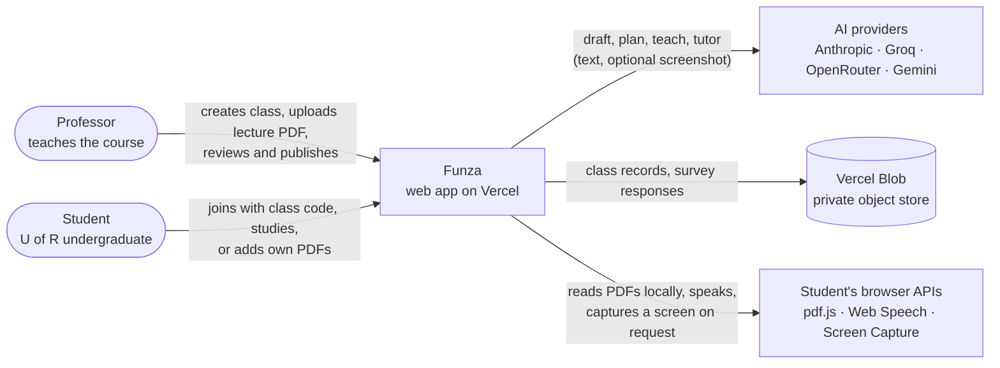

| External system | What Funza uses it for | Data that crosses the boundary |
|---|---|---|
| AI providers | Drafting lecture material, planning and teaching AI lessons, evaluating answers, answering tutor questions, reading a shared screenshot | Extracted note text, the question, the student's answer, a structured description of the screen, at most one screenshot per request |
| Vercel Blob | Storing classes (drafts and published snapshots) and usability survey responses | Class content, hashed edit key, anonymous survey answers |
| Browser APIs | Reading PDFs, text-to-speech, screen capture | Nothing leaves the device through these |

---

## 4. Containers

The deployable and runtime parts.

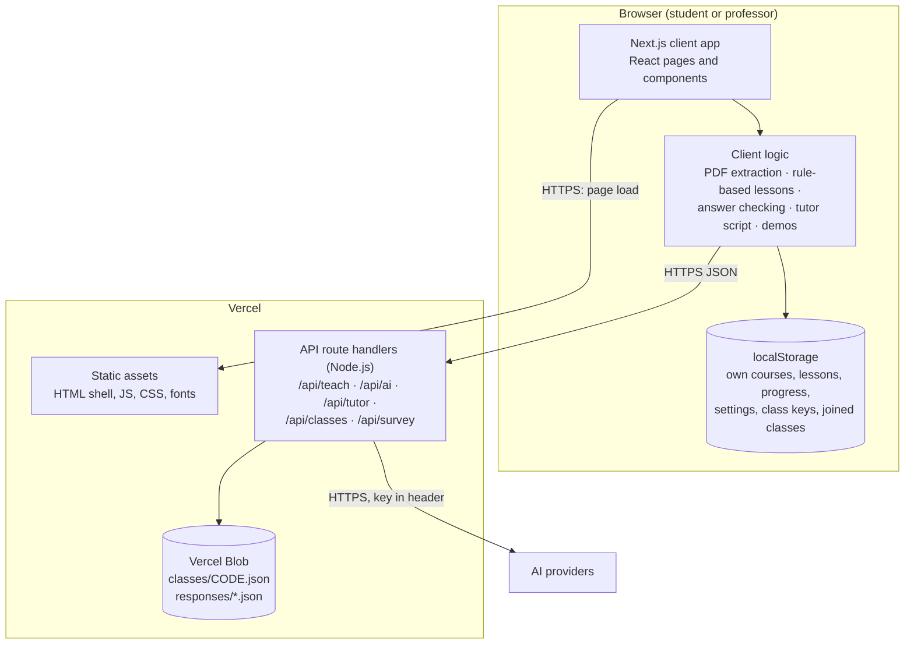

| Container | Technology | Responsibility |
|---|---|---|
| Client app | React 19 client components in the Next.js App Router | All screens; reads and writes browser storage; calls the API |
| Client logic | TypeScript modules in `src/lib/` | PDF text extraction, rule-based lesson generation, answer checking, tutor script, visual demonstrations, retrieval of note sections |
| localStorage | Browser key-value store | Everything that belongs to one student on one device |
| API route handlers | Next.js route handlers, Node.js runtime | Hold AI keys, call providers, validate model output, store and serve classes and survey responses |
| Vercel Blob | Managed object store, private access | Shared data that must reach other devices: classes and survey responses |
| AI providers | External HTTPS APIs | Language model completions; image understanding for screenshots |

---

## 5. Components

### 5.1 Client side

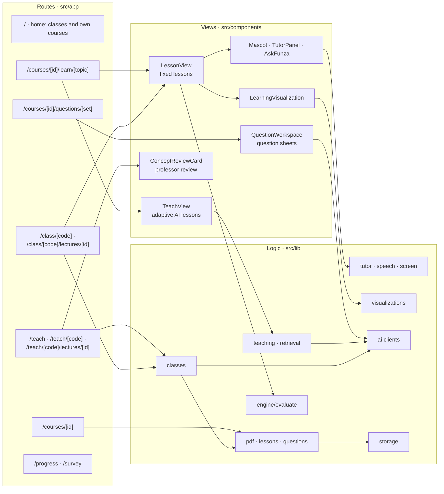

| Module | Path | Responsibility |
|---|---|---|
| PDF extraction | `src/lib/pdf/extract.ts` | Reads a PDF with pdf.js in the browser: lines, font sizes, page numbers |
| Rule-based lessons | `src/lib/lessons/generate.ts` | Turns extracted text into topics and concepts: headings become concepts, questions are fill-in-the-blank or short answer built from the section's own terms. No AI, no network |
| Import and provider | `src/lib/lessons/import.ts`, `provider.ts` | Classifies each PDF as notes or a question sheet, stores lessons, and serves topics from sample or PDF sources behind one `LessonProvider` interface |
| Question sheets | `src/lib/questions/*` | Detects numbered questions, matches them to note passages, builds a step plan by question type |
| Retrieval | `src/lib/retrieval/retrieve.ts` | Picks the note sections a concept should be taught from (linked sections first, then word overlap, within a character budget) |
| Adaptive teaching | `src/lib/teaching/*` | Plans an AI topic and runs the teach, ask, evaluate, hint or reteach, verify loop |
| Answer checking | `src/lib/engine/evaluate.ts` | Checks multiple-choice answers and keyword groups for short answers, on the device |
| Tutor | `src/lib/tutor/*` | The mascot's script for each lesson moment, Tutor Mode, and "Ask Funza" (five suggested questions answered locally; free questions go to the AI) |
| Speech | `src/lib/speech/useSpeech.ts` | Text to speech through the Web Speech API, chunked and interruptible |
| Screen sharing | `src/lib/screen/useScreenShare.ts` | Student-started Screen Capture; one still frame (JPEG, ≤ 1280 px wide) only when the student sends it |
| Visual demonstrations | `src/lib/visualizations/*` | A closed registry of eight demo types; configs are data, validated; a small expression language that is parsed, never `eval`-ed |
| Classes | `src/lib/classes/*` | Class data model and rules (review, publishing, validation), lecture drafting, API client, and the hooks behind the professor and student pages |
| Storage | `src/lib/storage.ts` | Typed localStorage stores that React subscribes to with `useSyncExternalStore` |
| AI clients | `src/lib/ai/*-client.ts` | Thin `fetch` wrappers for the API routes; never see a key |

### 5.2 Server side

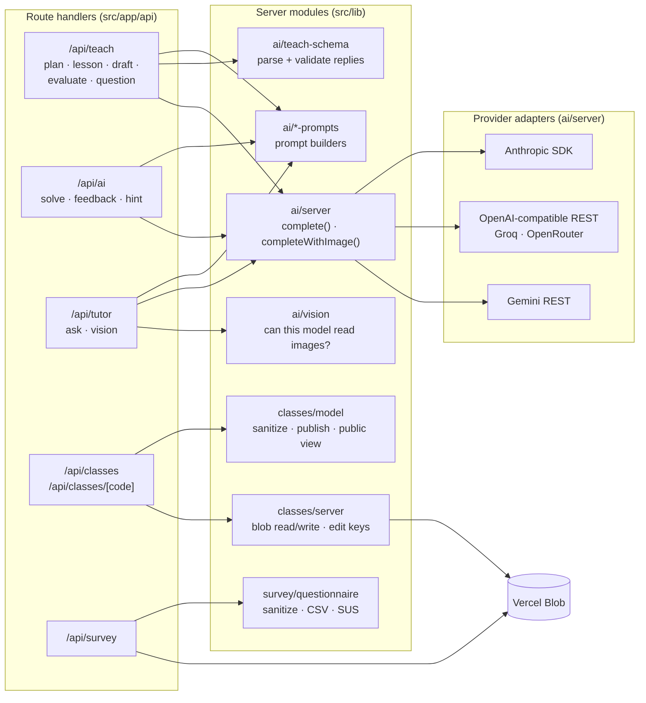

---

## 6. Data architecture

### 6.1 Where each piece of data lives

| Data | Store | Key or path | Leaves the device? |
|---|---|---|---|
| Own courses and their file list | localStorage | `funza.courses.v1` | No |
| Lessons generated from own PDFs | localStorage | `funza.lessons.v1` | No |
| Question sets from question sheets | localStorage | `funza.questions.v1` | No |
| Extracted note sections (for AI teaching later) | localStorage | `funza.sources.v1` | Only the sections needed, when an AI lesson is planned or taught |
| AI-generated lessons, cached per concept | localStorage | `funza.ai-lessons.v1` | No (they came from the AI) |
| Progress per concept (own courses and classes) | localStorage | `funza.progress.v1` | No |
| Voice on/off, screenshot local-only setting | localStorage | `funza.voice.v1`, `funza.screen-local-only.v1` | No |
| Classes this browser teaches, with edit keys | localStorage | `funza.teaching.v1` | The key is sent in a header to the API on each edit |
| Classes this browser joined | localStorage | `funza.joined-classes.v1` | No |
| Class: details, lectures, drafts, published snapshots | Vercel Blob (private) | `classes/<CODE>.json` | Stored on the server |
| Usability survey responses | Vercel Blob (private) | `responses/<time>-<id>.json` | Stored on the server |
| PDF files | Nowhere | — | Never uploaded |
| AI prompts and replies | Nowhere | — | Sent to the provider for one request; the server does not log them |

### 6.2 Data model: own courses (browser)

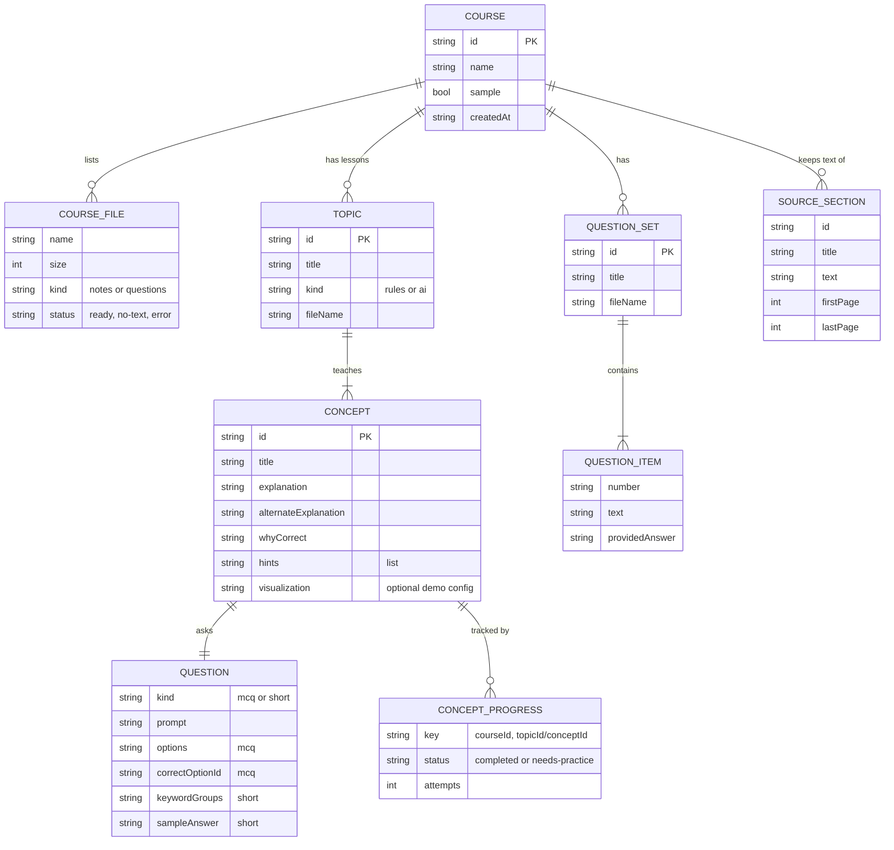

### 6.3 Data model: classes (Vercel Blob)

One JSON object per class. The professor's view has everything; students receive a public view built from published snapshots only (section 7).

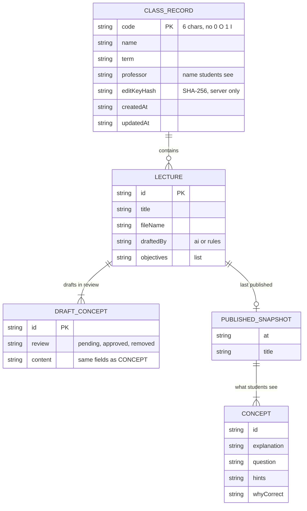

Limits enforced on the server: 50 lectures per class, 15 concepts per lecture, field lengths capped, request body ≤ 1.5 million characters.

### 6.4 Review and publishing states

A concept moves through review; a lecture's state follows from its concepts and its last published snapshot.

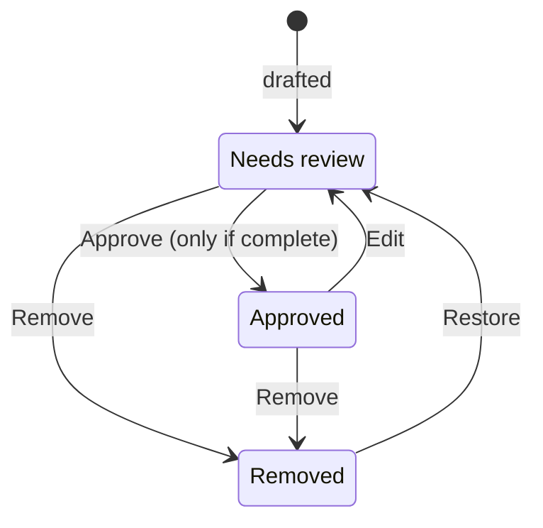

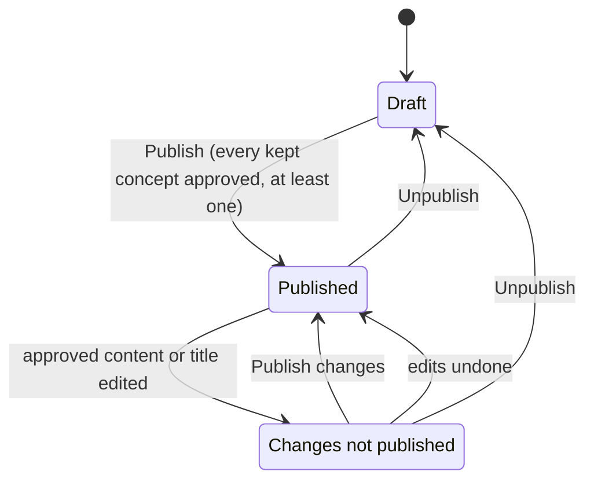

Publishing copies the approved concepts into a snapshot. Students always read the snapshot, so a professor can keep editing without students seeing half-finished work.

---

## 7. API design

All endpoints take and return JSON over HTTPS. Errors return `{ ok: false, reason, message }`; `message` is written for the person using the app.

| Endpoint | Method | Who calls it | Purpose | Protection |
|---|---|---|---|---|
| `/api/teach` | POST `task=plan` | Student (own course) | Plan an AI topic from a PDF's outline | Input capped (outline 16,000 chars) |
| | POST `task=lesson` | Student | Write one concept's lesson, question and optional demo | Source capped at 8,000 chars; reply validated |
| | POST `task=draft` | Professor | Draft one concept in full for review | Reply validated; options shuffled |
| | POST `task=evaluate` | Student | Judge an answer's reasoning; hint or reteach | Answer capped at 3,000 chars |
| | POST `task=question` | Student | A new verification question | Reply validated |
| `/api/ai` | GET | Client | Is an AI provider configured (never the key) | — |
| | POST `task=solve, feedback, hint` | Student (question sheets) | Help on a question from a sheet | Inputs capped |
| `/api/tutor` | GET | Client | Tutor available, can it read images | — |
| | POST `task=ask` | Student | Free question about the screen (text only) | Question 600 chars, context 8,000 |
| | POST `task=vision` | Student | Same, with one screenshot the student chose to send | Image ≤ 6 MB base64; refused if the model cannot read images |
| `/api/classes` | POST | Professor | Create a class; returns the class and its edit key once | Name and professor name required |
| `/api/classes/[code]` | GET | Student | Public view: published lectures only | Code normalized and validated |
| | GET + `x-funza-edit-key` | Professor | Full class with drafts | Edit key checked against stored hash |
| | PUT + `x-funza-edit-key` | Professor | Save the class | Edit key; body ≤ 1.5 M chars; every field sanitized; code and creation date kept from storage |
| `/api/survey` | POST | Participant | Store one questionnaire response | Answers sanitized |
| | GET `?key=` | Team | Download all responses as CSV | Admin key, constant-time compare |

---

## 8. Key flows

### 8.1 Student studies their own PDF (on the device)

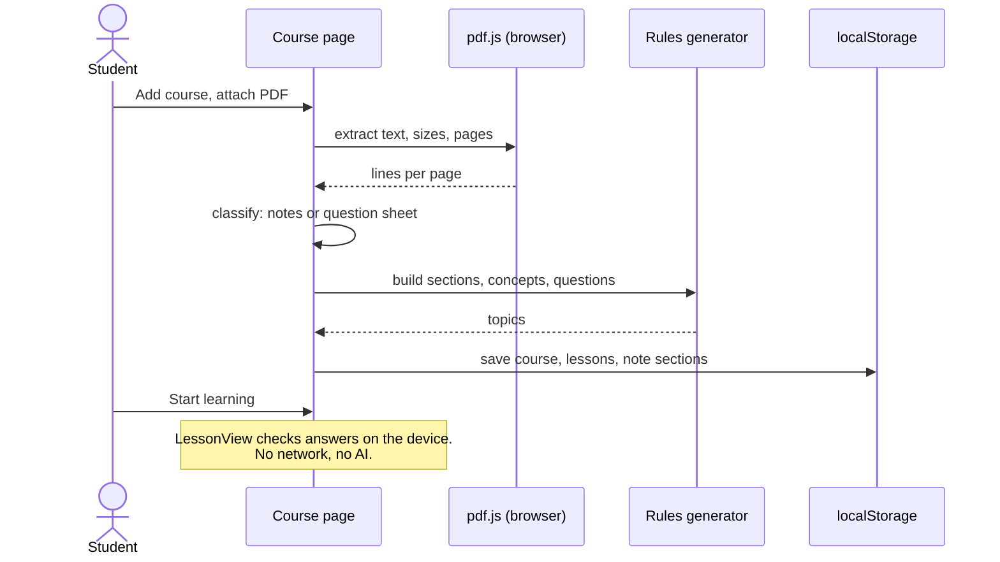

### 8.2 Adaptive AI lesson (own course, on request)

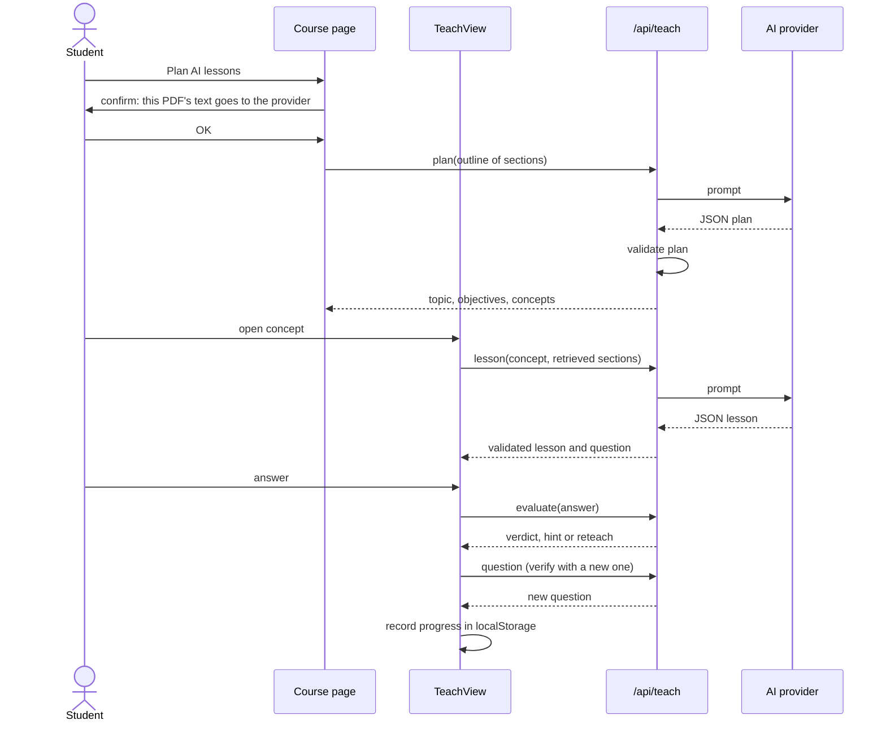

### 8.3 Professor drafts, reviews and publishes a lecture

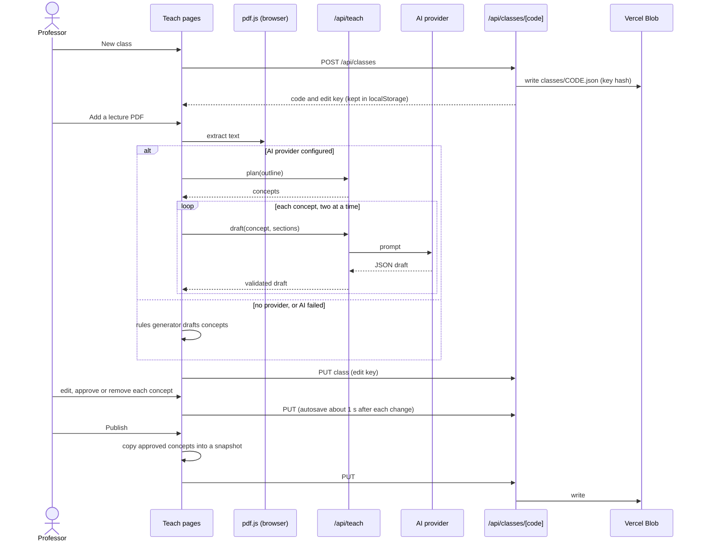

### 8.4 Student joins a class and studies

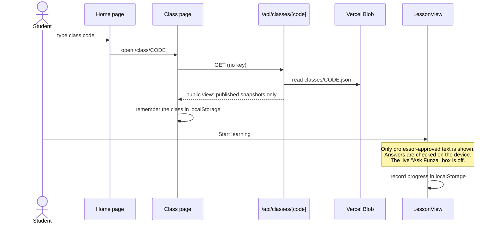

### 8.5 Ask Funza about the screen

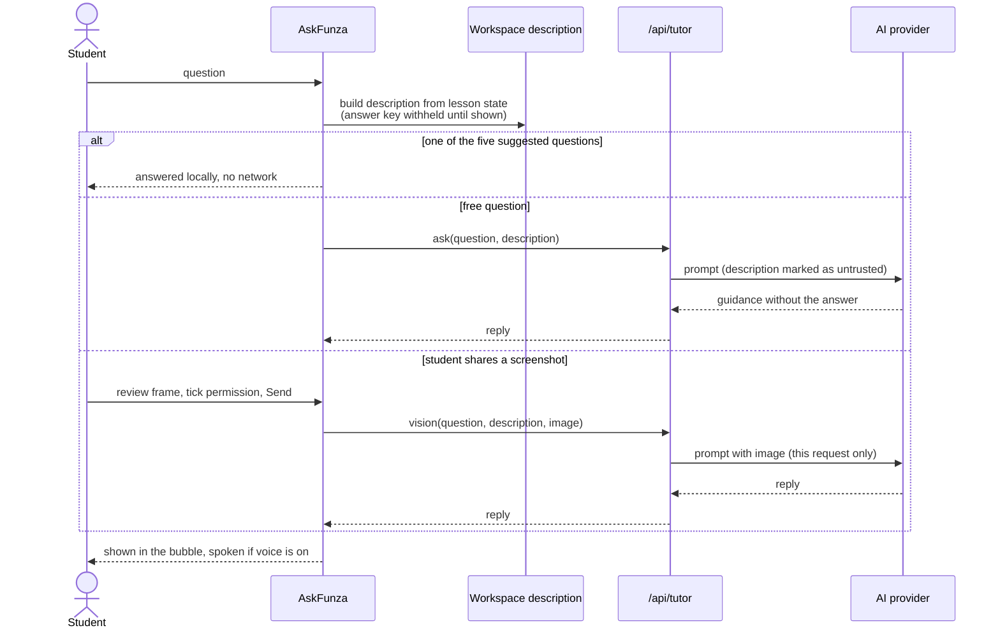

---

## 9. AI layer

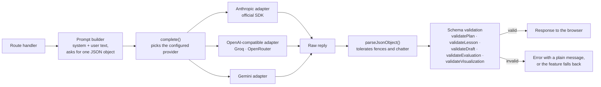

**Configuration.** One provider is active at a time, set by environment variables on the server: `FUNZA_AI_PROVIDER`, `FUNZA_AI_API_KEY`, optional `FUNZA_AI_MODEL`, or a provider's own variable (`ANTHROPIC_API_KEY`, `GROQ_API_KEY`, `OPENROUTER_API_KEY`, `GEMINI_API_KEY`). Defaults: Groq `llama-3.3-70b-versatile`, OpenRouter `meta-llama/llama-3.3-70b-instruct:free`, Gemini `gemini-2.5-flash`, Anthropic `claude-opus-5-5`.

**Grounding.** Prompts give the model the note sections that retrieval picked for the concept and tell it to treat the notes as the authority. Anything from general knowledge goes in a separate field that the interface labels as not from the notes.

**Validation.** No model reply reaches the screen unchecked. Plans, lessons, drafts, evaluations and questions are parsed and checked field by field; lengths are capped; a multiple-choice draft needs 3–6 distinct options and a valid answer index, and its options are shuffled so the correct one is not always first. Visual demonstrations are requested by name with data; unknown types, unknown fields, bad formulas or out-of-range numbers make the demo fall back to none.

**Failure handling.** Each adapter maps provider errors (bad key, rate limit, refusal, empty reply) to one error type with a plain message. Anthropic models that support it use server-side refusal fallback to a sibling model. Lecture drafting falls back to the rule-based generator if the AI plan fails; concepts that fail to draft are left out and counted.

**When there is no provider.** The app still runs: own-course lessons and class drafts come from rules, question sheets get rule-based hints, and the tutor answers the five suggested questions locally.

---

## 10. Security and privacy

### 10.1 Controls

| Concern | Control |
|---|---|
| AI keys | Only in server environment variables; the browser calls `/api/*`, and status endpoints never return a key |
| Editing a class without accounts | A 24-byte random edit key is returned once at creation and kept in the professor's browser; the server stores only its SHA-256 hash and compares in constant time. The private edit link carries the key after `#`, so it is never sent in a request URL or logged, and the page removes it from the address bar |
| Students seeing drafts | The public endpoint builds its response from published snapshots only; drafts, review flags and the key hash never leave the server without the key |
| Malformed or hostile input | Every write is rebuilt field by field on the server (types, lengths, allowed values, safe ids); the class code and creation date always come from storage |
| Prompt injection | Note text, screen descriptions and screenshots are marked as untrusted data in prompts; replies are plain text that is only displayed or spoken, never executed |
| Code execution from AI output | Demos are data in a closed registry; formulas are parsed by a small interpreter, never passed to `eval` |
| PDFs | Read in the browser; never uploaded or stored on the server |
| Text sent to AI | Only on an explicit action, after a confirmation that names the provider (planning an AI topic, drafting a lecture); the tutor sends text only when the student asks |
| Screenshots | Student-started only; reviewed before sending with a warning about personal and restricted content; a local-only switch disables sending entirely; never stored |
| Survey data | Anonymous by design; downloaded only with an admin key |

### 10.2 Threats and residual risk

| Threat | Current mitigation | Residual risk / next step |
|---|---|---|
| Someone guesses a class code | 32⁶ ≈ 1.07 billion codes; codes only reveal published material | Acceptable for published content; add rate limiting (Winter) |
| A professor's edit link is shared or leaked | Link is labelled private; anyone with it can edit | Replace edit keys with professor sign-in (Winter) |
| Abuse of the AI routes (cost) | Input caps; free tiers by default | No rate limiting yet (TR-5 gap); add per-IP limits |
| Abuse of class creation (storage) | Size limits per class | No limit on the number of classes; add rate limiting |
| Two tabs editing the same class | Autosave sends the whole class | Last write wins; add version checks (the Blob store supports conditional writes) |
| Known Next.js vulnerability | — | Next.js 16.4.0 has a critical advisory; upgrade to 16.4.6 |

---

## 11. Requirements traceability

How the built system stands against the Workshop 3 technical (TR) and performance (PR) requirements.

| Req. | Requirement (short) | Status | Notes |
|---|---|---|---|
| TR-1 | Electron desktop app, Windows and macOS | **Changed** | Web app instead (ADR-1); runs on any modern browser, including phones |
| TR-2 | pdf.js renders pages and extracts text with page numbers | **Met** (extraction) | Text and page numbers are extracted; an in-app page reader is not built |
| TR-3 | SQLite on the device | **Changed** | localStorage for personal data, Vercel Blob for classes (ADR-2, ADR-5) |
| TR-4 | Model-independent AI interface with adapters | **Met** | Four providers behind `complete()` |
| TR-5 | Keys only on a server proxy that rate-limits | **Partly met** | Keys are server-only; rate limiting is not built |
| TR-6 | Only the selected text is sent | **Changed** | AI planning and lecture drafting send a PDF's extracted text after confirmation; tutor and evaluation send only what is needed |
| TR-7 | JSON output checked against a schema | **Met** | Every AI reply is validated (section 9) |
| TR-8 | Accounts and payments (ENSE 477) | **Planned** | Section 13 |
| TR-9 | GitHub, changes reviewed by the other member | Process | Not an architecture property |
| PR-1 | First words within 3 s (streamed) | **Not yet** | Replies are returned whole; streaming is planned |
| PR-2 | Practice set in ≤ 20 s | **To measure** | Drafting runs two concepts in parallel; not yet timed |
| PR-3 | 100-page PDF opens in ≤ 2 s | **To measure** | Extraction runs in the browser |
| PR-4 | 200-PDF folder listed in ≤ 10 s | **N/A** | Folder scanning belonged to the desktop design |
| PR-5 | < 500 MB memory with a 300-page PDF | **To measure** | |
| PR-6 | Every explanation carries a page reference; ≥ 85 % accurate | **Partly met** | Sections keep page ranges; explanations do not show page references yet |
| PR-7 | Retry on another free provider on failure | **Not yet** | One provider at a time; only Anthropic refusal fallback exists |
| PR-8 | SUS ≥ 70 | Usability testing | Measured in the usability bazaar analysis, not by the architecture |

---

## 12. Architecture decisions

Each decision records what was chosen, what it replaced, and why.

**ADR-1 · Web app on Next.js instead of an Electron desktop app.**
*Context:* TR-1 planned Electron. A browser app lets usability testers and pilot users start with nothing to install, and under Model 2 professors and students on different devices must see the same class. *Decision:* one Next.js codebase for pages and server routes, hosted on Vercel. *Consequences:* no install, one deploy, works on phones; the trade-off is that reading local course folders directly (FR-1, PR-4) is not possible in a browser, so PDFs are attached instead.

**ADR-2 · Browser storage instead of SQLite for personal data.**
*Context:* TR-3 planned SQLite in the desktop app. *Decision:* typed localStorage stores with React subscriptions. *Consequences:* zero setup and private by default; data is per browser and per device, and limited to a few megabytes. Accounts in Winter move synced data to a server database.

**ADR-3 · AI behind server route handlers, one provider at a time.**
*Context:* TR-4 and TR-5. *Decision:* route handlers in the same Next.js app act as the proxy; `complete()` picks the configured provider. *Consequences:* keys are safe and switching providers is a config change; the missing pieces are rate limiting, streaming and cross-provider fallback.

**ADR-4 · Every AI reply is structured JSON, validated on the server.**
*Context:* TR-7 and the risk of wrong or unsafe output. *Decision:* prompts ask for one JSON object; schema validators decide what reaches the browser; demos are named data in a closed registry. *Consequences:* the interface never shows malformed output, and features degrade to rules or "no demo" instead of breaking.

**ADR-5 · Classes as JSON objects in Vercel Blob, edited with a secret key.**
*Context:* classes must be shared across devices before accounts exist. *Decision:* one private blob per class; a random edit key whose hash is stored; a public view of published snapshots for students. *Consequences:* no database to run and nothing to pay; no sign-in, last-write-wins editing, and anyone with the edit link can edit. Planned to move to a database with professor accounts.

**ADR-6 · Students in a class see only professor-approved, pre-written material.**
*Context:* professors own their notes and must trust what students see. *Decision:* drafts are reviewed concept by concept; publishing makes a snapshot; class lessons run in the fixed lesson view with answers checked on the device, and the live "Ask Funza" box is turned off there. *Consequences:* no unreviewed AI text reaches students, and AI cost scales with lectures, not students; the trade-off is no live, adaptive reteaching inside classes.

**ADR-7 · Visual demonstrations as a closed registry of data-driven types.**
*Context:* AI-chosen demos must be safe and correct. *Decision:* eight registered types; configs are validated data; formulas are parsed by a hand-written interpreter. *Consequences:* the AI can pick and fill a demo but cannot inject code; new demo types need code.

**ADR-8 · Rules first, AI optional.**
*Context:* free tiers have limits and some students or professors will not want text sent to a provider. *Decision:* every AI feature has a no-AI path (rule-based lessons and drafts, rule-based hints, local tutor answers). *Consequences:* the app always works; rule-based drafts are rough and need more review.

---

## 13. Planned architecture (Winter 2027, ENSE 477)

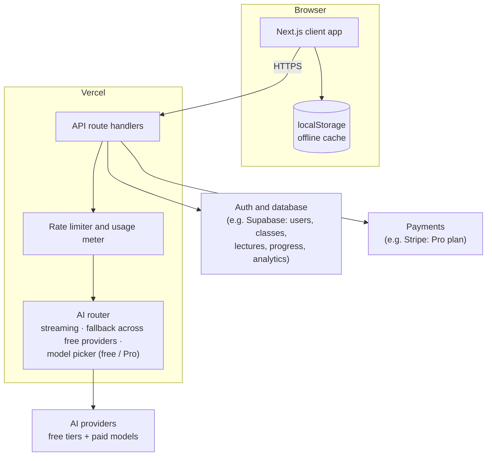

| Change | Replaces | Why |
|---|---|---|
| Professor and student accounts | Edit keys and per-browser joined classes | Secure editing, progress on every device, revoking access |
| Relational database (classes, lectures, concepts, progress) | JSON blobs per class | Concurrent edits, queries for class analytics, versioning |
| Class insights: most-missed questions per lecture | — | The main reason a professor would keep using Funza |
| Flashcards and a study guide from approved concepts | — | Model 2 scope for 1 December |
| Streaming replies | Whole replies | PR-1 |
| Rate limiting and usage metering | Input caps only | TR-5, cost control |
| Fallback across free providers | One provider | PR-7 |
| Model picker and Pro plan with payments | Single configured model | Business model; TR-8 |
| Page references shown with explanations | Page ranges kept but not shown | PR-6 |

---

## 14. Deployment and operations

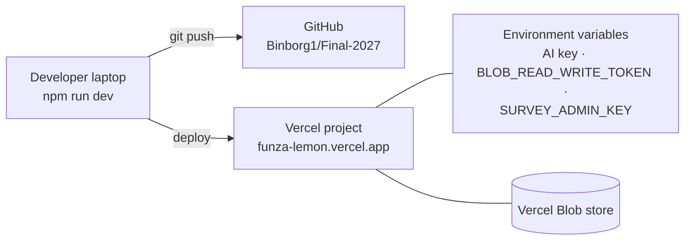

| Topic | Practice |
|---|---|
| Environments | Local development (`npm run dev`, keys in `app/.env.local`, never committed) and the Vercel deployment (keys in the Vercel project settings) |
| Checks | `npm test` (Node test runner, 68 tests over the pure logic: class rules, AI draft validation, visualization registry, demo player, tutor script, survey), `npm run lint`, `npm run build` |
| Configuration | AI provider and model by environment variables; without a key the app runs in rules-only mode |
| Data | Vercel Blob holds classes and survey responses; there is no other server state; deleting a blob deletes that class |
| Monitoring | Server errors are written to the Vercel function logs without prompt or note content |
| Cost | Vercel and Blob free allowances; AI on free tiers by default |

---

## 15. Risks and technical debt

| Item | Impact | Plan |
|---|---|---|
| No accounts; edit keys can be shared | Anyone with a professor's link can change the class | Accounts in Winter |
| Last-write-wins class saves | Two open tabs can overwrite each other | Conditional writes now, database later |
| No rate limiting on AI and class routes | Cost and abuse exposure on a public URL | Add before wider pilots |
| No streaming | Slower-feeling AI features (PR-1) | Stream tutor and lesson replies |
| Single AI provider | An outage or quota stops AI features (PR-7) | Provider fallback chain |
| Rule-based drafts are rough | More review work without an AI key | Configure a free AI key on the deployment |
| Class progress is per browser | Students lose progress on a new device; professors see no results | Accounts and database |
| Next.js 16.4.0 security advisory | Known critical vulnerability in the framework version | Upgrade to 16.4.6 |
| Requirements still describe the desktop design | Documents disagree with the system | Update TR-1, TR-3, TR-6 to match ADR-1, 2 and 6 |

---

## 16. Glossary

| Term | Meaning |
|---|---|
| Concept | One idea taught at a time: explanation, second explanation, question, hints, why the answer is right |
| Topic / lecture | A group of concepts; in a class, one lecture comes from one PDF |
| Draft | A concept the professor has not approved yet |
| Published snapshot | The approved concepts as they were when the professor last pressed Publish; what students study |
| Class code | Six characters (letters and digits without 0, O, 1, I) that students type to join |
| Edit key | A secret that lets one browser change one class; only its hash is stored |
| Rules mode | Lessons and drafts generated from a PDF's headings and sentences, without AI |
| Provider | A company whose language model Funza calls (Anthropic, Groq, OpenRouter, Google Gemini) |
