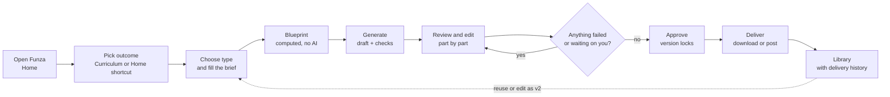

# 01 · Product Experience

**Purpose:** what the Funza teacher workspace is for, who it serves, the journeys it supports, and the design decisions behind it.
**Status:** Stage A design for team review, 18 November 2026. Nothing in this package changes the production app. The prototype runs at `/prototype` (see `08_implementation_plan.md`, section 1).
**Reads with:** `docs/architecture-evolution/` (the technical plan written on 17 November) and `docs/07_system_architecture/` (the system as built for the university audience).

Legend used across this package: **EXISTING** (in the code and working), **MODIFY** (exists, needs change), **NEW** (does not exist), **PLANNED** (designed here, not in the first build), **SIMULATED** (shown in the prototype without a real service behind it).

---

## 1. In one paragraph

Funza is a workspace where a Saskatchewan Grade 10–12 teacher picks an official curriculum outcome, says what they need (notes, a quiz, an exam, a lesson plan, a worksheet), and gets a draft they can trust because Funza shows its work: every outcome is quoted from curriculum.gov.sk.ca with its verification status, every answer Funza can calculate is recalculated, and every AI-written part stays marked until the teacher reviews it. The teacher edits, approves, and delivers through the platform their school already uses, or simply prints. **Funza creates. Teachers approve. Existing school platforms deliver.**

---

## 2. Where Funza is today

Read from the code on 18 November 2026 (commit `f0640b0` plus the uncommitted UI work). This is the starting point the design builds on, not a wish list.

### 2.1 What exists and works

| Capability | Where | What it gives the teacher workspace |
|---|---|---|
| Curriculum catalog with provenance | `app/src/lib/curriculum/catalog.ts` | Four Science 10 outcomes (SCI10-FM1 to FM4), copied from the official page on 17 Nov 2026, each with source URL, retrieval date and SHA-256 fingerprint. Status `source-checked`; second check and indicators **pending** |
| Outcome-constrained AI drafting | `/api/teach` tasks `curriculum-lesson`, `curriculum-block`; `app/src/lib/ai/teach-schema.ts` | The server re-checks the outcome and rejects any reply citing an id it did not supply |
| Structural, factual and judgment checks | `app/src/lib/curriculum/checks.ts` | Answers recomputed by code; judgment items listed, never scored; a content fingerprint clears confirmations after any edit |
| Lesson builder with alignment panel | `app/src/components/curriculum/LessonBuilder.tsx`, `BlockWorkspace.tsx`, `AlignmentPanel.tsx` | A three-pane review screen for one resource type: the five-block interactive lesson |
| Approve and publish rules | `app/src/lib/classes/model.ts` (`canPublish`, `publishLecture`) | Only approved content reaches students; a published snapshot is immutable |
| Printable alignment report | `app/src/app/teach/[code]/lectures/[lectureId]/report/page.tsx` | Print CSS already works for one document |
| Visualization registry | `app/src/lib/visualizations/*`, `app/src/components/activity/ActivityStage.tsx` | Eight safe, data-driven interactive types; the distance–time graph is used live in the prototype |
| AI provider layer | `app/src/lib/ai/server.ts` | One `complete()` over Anthropic, Groq, OpenRouter and Gemini; no key is configured in `app/.env.local`, so only the template fallback runs locally |
| PDF text extraction in the browser | `app/src/lib/pdf/extract.ts` | The path for "start from my own notes" |
| Brand assets | `app/public/brand/funza-logo.png`, `app/src/components/FunzaLogo.tsx`, `app/src/app/icon.svg` | A raster logo and a traced SVG with a live-text wordmark (uncommitted) |

### 2.2 What exists but needs to change

| Today | Why it must change |
|---|---|
| Only one resource type: a five-block interactive lesson, and only for SCI10-FM2 (the template exists for no other outcome) | Teachers need notes, quizzes, exams, lesson plans and worksheets with marks, rubrics and answer keys |
| Lessons live inside a Funza "class" with a join code; students open them at `/class/[code]` | The new direction delivers through the school's LMS. Funza-managed classes and the student join path become legacy (decision D1) |
| Assessment is one multiple-choice question per block | No marks per question, no question types beyond multiple choice, no rubric |
| The navigation offers "Insights" (marked Planned) | Student analytics are out of scope for a teachers-only MVP |
| Violet primary colour, navy-to-violet hero bands | The brand direction is navy, teal and a small gold spark (see `03_design_system.md`) |
| Confirmations use `window.confirm` | Not styleable, not consistent; replaced by an accessible dialog |

### 2.3 What does not exist

A resource library; search; question types other than multiple choice; marks, difficulty and rubrics; blueprints; per-question regeneration; versioned approval of non-lesson resources; Word export; any LMS integration; teacher accounts. Several of these are proposed in `docs/architecture-evolution/` (accounts C03, database C02); the rest are new in this package.

### 2.4 Notes on the existing documents

- `docs/architecture-evolution/08_first_slice_implementation.md` names `CurriculumReview.tsx` and `CurriculumBlockCard.tsx`; the code has `LessonBuilder.tsx`, `BlockWorkspace.tsx`, `BlockNav.tsx`, `BlockEditors.tsx` and `AlignmentPanel.tsx` instead.
- `docs/architecture-evolution/05_classroom_analytics.md` and changes C08–C10 (rosters, student responses, insights) assume Funza delivers to students. Under the teachers-only direction they are out of scope for the MVP.
- `docs/architecture-evolution/` does not follow the repository's `NN_name` folder convention. Renaming it is the team's call; this package does not touch it.

---

## 3. Who it is for

No Saskatchewan teacher has been interviewed for this direction yet, so these are working assumptions to test in the first pilot, not research findings.

| Who | Situation | What they need from Funza | What would make them stop |
|---|---|---|---|
| **The subject teacher** (primary) | Teaches Science 10 in two sections and one Grade 12 course; one prep period a day; already uses Google Classroom or Teams | A quiz or worksheet for tomorrow, aligned to the outcome they are on, in one prep period, that prints cleanly | One factual error in front of students; having to rewrite most of a draft |
| **The early-career teacher** | First or second year; building materials from scratch | Structure: what a good unit test looks like, mark allocation, rubrics | A blank prompt box; jargon |
| **The experienced teacher with a binder** | Twenty years of notes and old tests | Turning existing material into a current, outcome-tagged version without losing their voice | Funza replacing their material with generic text |
| **Principal or division technology lead** (stakeholder, not a user in the MVP) | Decides whether teachers may use it | Evidence that content is checked, student data is not collected, and the school's platform stays in charge | Unclear data handling; claims of curriculum "compliance" |

---

## 4. Jobs the workspace must do

1. **"I need a quiz on what we did this week."** Outcome → assessment with a sensible mark split → answer key → students get it tomorrow.
2. **"I need a unit exam."** Several outcomes, several question types, a marking guide, a cover page, a separate key.
3. **"Turn my old notes into something I can hand out."** Start from an uploaded file; keep the teacher's content; align it to the current outcome.
4. **"Give me practice for the kids who missed it."** A worksheet or homework at a lower difficulty, from the same outcome.
5. **"Plan tomorrow's lesson."** Timed phases that add up to the class length, materials, adaptations.
6. **"Get it to students."** Post to the school's platform as a draft, or print, without retyping anything.

---

## 5. Goals and how we will know

| Goal | Measure (pilot) | Target to test |
|---|---|---|
| Classroom-ready in one prep period | Time from opening Create to approval for a 20-mark quiz | Under 15 minutes |
| Drafts worth keeping | Share of AI-written questions approved without edits; share rewritten from scratch | Most kept or lightly edited; few rewritten |
| Errors caught before students | Failed checks fixed before approval, per resource | Recorded, not targeted |
| Trust in alignment | Teacher answers "I know which outcome this assesses and why" (pilot interview) | Yes for every approved resource |
| Delivery without retyping | Resources delivered by post or download after approval | Most approved resources are delivered |

Non-goals for this phase: student accounts, student dashboards, rosters, grading, analytics, school-division reporting, and anything that makes Funza a learning management system.

---

## 6. Design principles

| Principle | What it means on screen |
|---|---|
| **Curriculum is the spine** | Every resource carries its outcome codes everywhere: on cards, in the document header, in the alignment view. You cannot create without choosing a catalog outcome |
| **Show the work, never a score** | Checks say what was checked and the result: "420 km ÷ 3.5 h = 120 km/h, but the key says 140 km/h". No confidence percentages, no "92 % aligned" |
| **The teacher holds the pen** | AI-written parts carry the gold spark until reviewed; regenerating shows old and new side by side; nothing is replaced silently; approval is the teacher's act |
| **Structure, not prompts** | The brief is choices (type, outcome, question mix, marks, difficulty). A free-text box exists but is optional and cannot widen the outcomes |
| **What you see is what prints** | The editor is the page. Three lenses (student copy, answer key, alignment) show the same document, not three copies |
| **Honest states** | Simulated, sample, planned and pending are always labelled. A post is "delivered" only when the platform confirms it |
| **Quiet chrome, expressive content** | Navy frame, warm paper, one teal primary action per screen, gold only for "needs your eyes" |

---

## 7. The core journey

### 7.1 A realistic session

Tuesday, second period prep. Alex teaches Science 10 and is two days into constant-speed motion.

1. **Home** shows the quiz started yesterday ("3 of 12 parts reviewed · 1 check failed"). Alex leaves it and chooses **Worksheet** with the outcome already set to SCI10-FM2.
2. **Create** opens with the worksheet preset: a worked example, four calculations, one short answer, 40 minutes. Alex lowers difficulty to **Review** and adds "Use Saskatchewan examples where they fit." The blueprint updates: 5 questions, 11 marks, answer key as a separate file.
3. **Generate.** Progress names the real steps: outcome checked, blueprint fixed, drafting, validating, recomputing. About half a minute.
4. **Review.** One calculation fails its recomputation; the inline callout offers "Use 2 m/s²". Alex reads each question, presses R to mark it reviewed and N to jump to the next. Editing a reviewed question puts it back to "changed".
5. **Approve** confirms what is being locked: outcomes, marks, checks passed, checks Funza could not do and Alex confirmed.
6. **Deliver.** Alex prints the student copy for the class without devices and posts the same version to both Science 10 periods in Classroom **as drafts**, to release after the lab.

Time at the table: about twelve minutes. The pilot will tell us whether that is real.

---

## 8. Design decisions

| # | Decision | Why | Alternatives considered |
|---|---|---|---|
| D1 | Teachers are the only users. **Decided 18 Nov 2026:** every student-facing feature (class codes, `/class/*`, own courses, tutor, Insights) is removed, not hidden | The brief, confirmed by Chop: "exclusively for teachers; everything they publish goes to the LMS" | Keep the class path as legacy (rejected: it is a student feature) |
| D2 | The library is organised by course and unit from the curriculum, not by Funza classes | Teachers think "Science 10, Force and Motion", and classes now live in the LMS | Folders the teacher makes (adds work); tags only (weak structure) |
| D3 | Creation is **Brief → Blueprint → Draft**, a structured form, not a chat | Teachers should not need prompting skills; structure makes output predictable and checkable | Chat-first (rejected by the brief); a step-by-step wizard (slower for repeat use) |
| D4 | The blueprint is computed by code before any AI call | Gives a useful preview without inventing results; becomes the contract the AI fills and the review compares against | AI-written outline preview (costs a call, can be wrong) |
| D5 | Gold means "AI drafted this; it needs your eyes". Teal is action and trust. Neither is decoration | One meaning per colour keeps the screen readable; gold comes from the logo's spark | Gold as a general highlight (dilutes the signal) |
| D6 | Checks have five states: Passed, Failed, Not verified, Needs you, Changed. No percentages anywhere | The brief forbids misleading confidence; teachers need to know what was and was not checked | A single alignment score (misleading); pass/fail only (hides what was not checkable) |
| D7 | Review is per part, tied to a content fingerprint; any edit returns that part to review | Reuses the proven pattern in `checks.ts`; makes "teacher reviewed this" true for the exact words approved | Review once per document (too coarse); no review state (no accountability) |
| D8 | Approval locks a version. Editing later creates version 2; the approved one stays as delivered | What students received must stay reconstructable | Editable after approval (breaks trust); duplicate the resource (clutters the library) |
| D9 | The editor is the page, with three lenses: student copy, answer key, alignment | One source of truth; printing never surprises | Separate edit and preview screens (constant switching) |
| D10 | Posting defaults to "save as a draft in Classroom" | Teachers keep control of timing in their own tool; a mistaken post is never public | Post immediately by default |
| D11 | Answer keys are never attached to student posts | Removes the most damaging possible mistake | A warning only |
| D12 | Download and print work with no connection at all | Many schools will not allow an integration on day one | LMS-only delivery |
| D13 | **Decided 18 Nov 2026:** nothing reaches students from Funza directly. Interactive graphs are for the teacher to show in class; what students get is the Google Doc posted to the LMS | Everything published goes to the LMS; no student-facing Funza pages | A public read-only Funza link (rejected: a student-facing page) |
| D14 | Teal replaces violet as the primary colour; the token names become semantic | Matches the logo and brief; the current names (`coral` meaning violet) mislead | Keep violet |
| D15 | No new runtime dependency for the first Stage B phases; Word export will need one (`docx`) | Keep the bundle and maintenance small | `googleapis` SDK (large; plain `fetch` is enough) |
| D16 | The prototype is one route (`/prototype?s=…`) with a module-level store | The root layout re-mounts pages on every path change, which would wipe the journey's state; production files stay untouched | Separate routes per screen (state lost); editing the root layout (touches production) |

---

## 9. Decisions needed before Stage B

1. **D1:** confirm the class-code path becomes legacy, and whether `/` should open the teacher workspace.
2. **D13:** confirm interactive resources may be delivered as a public, read-only link.
3. **Storage before accounts:** build the library on the existing Blob-plus-edit-key pattern for the demo, or wait for accounts (C02, C03)? See `08_implementation_plan.md`, section 5.
4. **First LMS:** Google Classroom is the illustrative design target. Ask pilot divisions which platform they use before building any integration.
5. **Curriculum data:** a second team member must verify FM1–FM4 and copy the SCI10-FM2 indicators (`06_curriculum_ux.md`, section 3) before any teacher-facing pilot.
