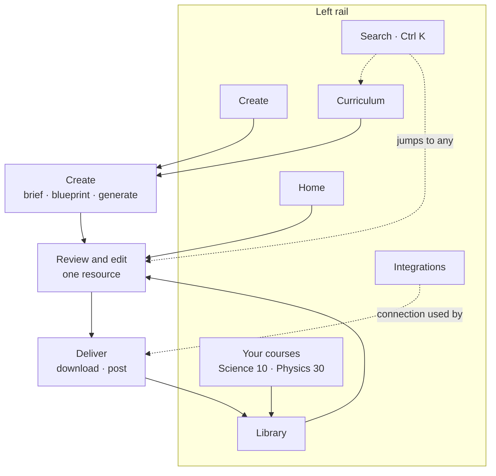
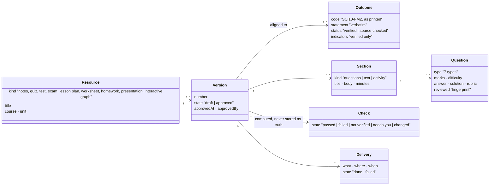
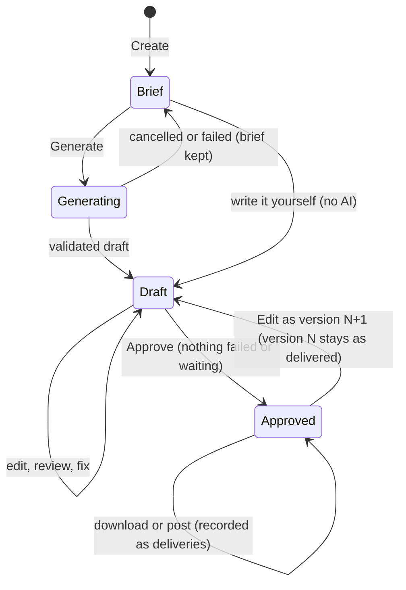

# 02 · Information Architecture

**Purpose:** the navigation, screens, objects and URLs of the teacher workspace, and how they map onto the routes that exist today.
**Status:** Stage A design for review, 18 November 2026.

---

## 1. Navigation model

Two layers, the same on every screen.

| Layer | Contents | Behaviour |
|---|---|---|
| **Left rail** (navy) | Funza logo and scope line ("Saskatchewan · Grades 10–12") · **Create** (the one bright button) · Search (Ctrl K) · Home · Library · Curriculum · *Your courses* (quick filters into the library) · Integrations (with a status dot) · Keyboard shortcuts · Teacher name and school | 248 px on desktop, a 76 px icon rail on tablet, a top bar with a menu sheet on phones. Never scrolls with the page |
| **Top bar** (per screen) | Breadcrumb on the left; the screen's own actions on the right (for example the lens switch and **Approve** in the editor) | Sticky, translucent, 56 px |

Everything a teacher does starts from three questions the rail answers at a glance: *what am I working on* (Home), *what do I want to make* (Create), *where are my materials* (Library, Your courses).

---

## 2. Screens

| Screen | Answers | Entry points | Leads to |
|---|---|---|---|
| **Home** | What am I working on? What do I want to make? | Logo, rail | Create (with type and outcome set), Review, Library, Curriculum |
| **Curriculum** | Which official outcome is this about, and can I rely on it? | Rail, Home "Browse outcomes", search | Create (one or several outcomes) |
| **Create** | What will Funza make, before it makes it? | Rail, Home type tiles, Curriculum, Library "Reuse", search | Review (the new draft) |
| **Review and edit** | Is this right, aligned and ready? | Home, Library, Create, search | Deliver |
| **Deliver** | How do students get exactly this version? | Review (after approval), Library | Library |
| **Library** | Where is everything I made? | Rail, Your courses | Review, Deliver, Create (reuse) |
| **Integrations** | Which school platform is connected and what can it do? | Rail, Home "Manage connections", Deliver | Deliver |

---

## 3. Routes (built 18 November 2026)

| Route | Screen | Replaced |
|---|---|---|
| `/` | **Home** | The student home ("What are we learning today?") |
| `/curriculum` | **Curriculum** | `/teach/curriculum`, `/teach/[code]/curriculum` |
| `/create` | **Create** (`?type=quiz&outcome=sk-sci10-fm2`, `?from=file`) | — |
| `/library` | **Library** (`?course=Science%2010`, `?reuse=1`) | `/teach` class dashboard |
| `/resources/[id]` | **Review and edit**, all resource types | `/teach/[code]/lectures/[lectureId]` |
| `/resources/[id]/deliver` | **Publish** to Google Classroom; print for the teacher | Class-code publishing |
| `/integrations` | **Integrations** | — |
| `/survey` | Usability questionnaire (research tool, no navigation) | Unchanged |

Removed with no replacement, because they served students: `/class/**`, `/courses/**`, `/progress`, `/teach/**` (classes, join codes, insights), `/api/classes/**`, `/api/tutor`, `/api/ai`.

Deep links: `o` on `/curriculum` focuses an outcome; `type`, `outcome` and `from=file` on `/create`; `reuse=1` and `course` on `/library`; `lms` on the publish and integrations pages carries Google's sign-in result.

---

## 4. Objects teachers see

Words used in the interface, and only these:

| Word | Means | Not |
|---|---|---|
| **Outcome** | An official curriculum outcome, by its printed code | "Standard", "objective" |
| **Indicator** | An official indicator under an outcome, shown only when verified | — |
| **Resource** | Anything a teacher makes in Funza | "Content", "asset" |
| **Blueprint** | The structure Funza will fill, computed from the brief | "Prompt", "plan" |
| **Draft** | A version not yet approved | — |
| **Review** | The teacher reading and confirming a part | "Accept" |
| **Approve** | Locking a version as ready for students | "Publish" |
| **Deliver** | Getting an approved version to students: **download** a file or **post** to a platform | "Publish" (ambiguous between the two) |
| **Verified** | Copied from the official source *and* checked by a second person | Never used for anything else |

---

## 5. Resource lifecycle

---

## 6. Search (Ctrl K or /)

One palette searches three things and keeps them labelled: **resources** (title), **outcomes** (code and official wording), and **actions** ("Create quiz", "Open curriculum"). Arrow keys move, Enter opens, Esc closes. Outcomes open the Curriculum screen focused on that outcome; resources open the editor. Empty query shows actions and recent resources. The prototype implements this over its sample data.

---

## 7. Responsive structure

| Width | Rail | Editor panels | Curriculum panes |
|---|---|---|---|
| ≥ 1280 px | 248 px, labelled | Outline, page and checks side by side | Courses, outcomes, detail |
| 1024–1279 px | 248 px | Outline and checks narrower; either can be hidden (`[`, `]`) | Courses, outcomes; detail below |
| 768–1023 px (tablet) | 76 px icon rail | Page only; Outline and Checks open as side sheets | Courses beside outcomes |
| < 768 px (phone) | Top bar and menu sheet | Page only; sheets for Outline and Checks; reading and light edits | One column |

Desktop is the priority: teachers build resources at a desk. Phones are for checking, approving and delivering.
