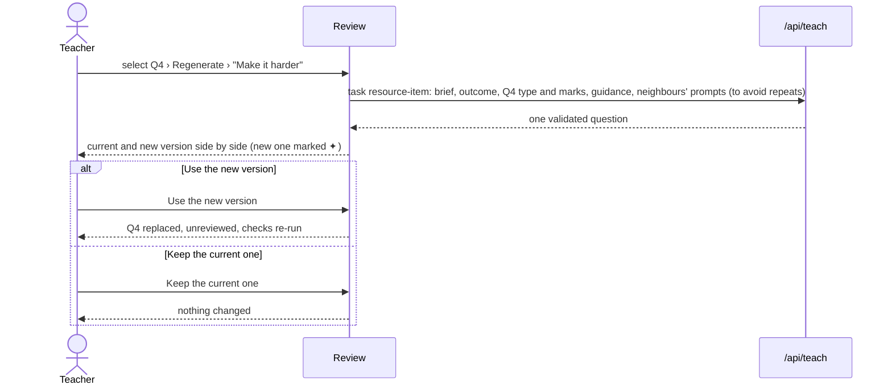
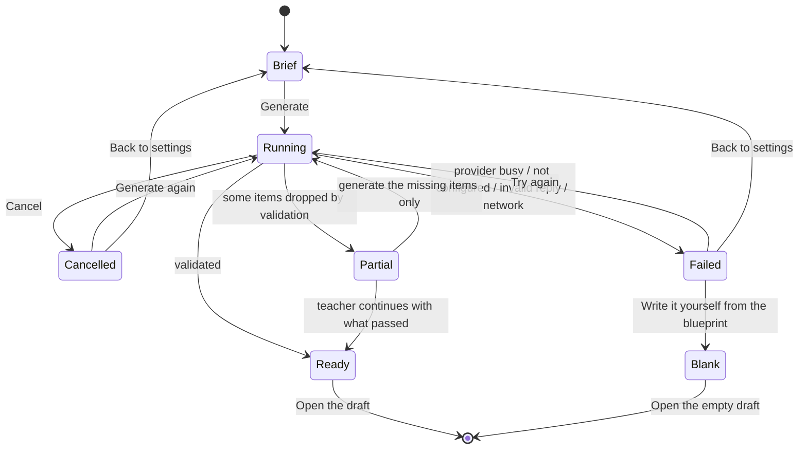
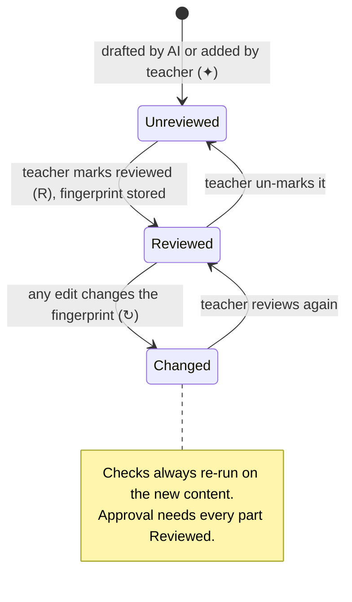
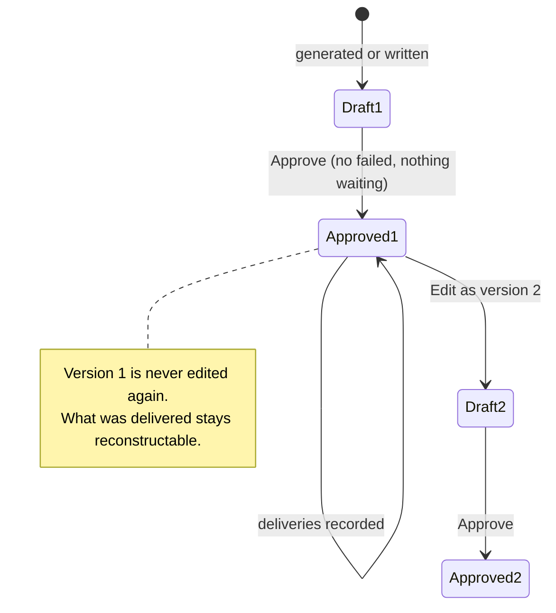

# 05 · Interaction Flows

**Purpose:** the main teacher journey end to end, the alternative flows the brief asks for, the state machines behind them, and the edge cases.
**Status:** Stage A, 18 November 2026. Each flow can be walked in the prototype; the journey map (`/prototype?s=journey`) links to every one.

---

## 1. Main journey

```mermaid
sequenceDiagram
  actor T as Teacher
  participant H as Home
  participant C as Curriculum
  participant B as Create
  participant API as /api/teach (server)
  participant AI as AI provider
  participant R as Review
  participant D as Deliver
  participant L as Classroom

  T->>H: opens Funza
  H-->>T: current draft, waiting drafts, recent outcomes
  T->>C: Science 10 › Force and Motion › SCI10-FM2
  C-->>T: official wording, "Official source · 2nd check pending", indicators pending
  T->>B: Create from this outcome · Quiz
  B-->>T: blueprint: 12 questions, 20 marks, 30 min (computed, no AI)
  T->>B: Generate
  B->>API: brief + outcome id
  API->>API: re-check outcome against catalog and fingerprint
  API->>AI: blueprint + verbatim statement, allow-list [SCI10-FM2]
  AI-->>API: JSON draft
  API->>API: validate schema, counts, marks, outcome ids
  API-->>B: validated draft
  B->>B: recompute answers, run checks
  B-->>T: "Your draft is ready to review"
  T->>R: open the draft
  R-->>T: page + checks: 1 failed, 9 to review
  T->>R: fix Q10 (Use 120 km/h), review each part (R, N), confirm reading level
  R-->>T: nothing failed or waiting
  T->>R: Approve version 1
  T->>D: Deliver
  T->>D: Print student copy; post to 2 classes as drafts
  D->>L: upload PDF to Drive (Funza folder), create draft posts
  L-->>D: confirmed per class
  D-->>T: "Classroom confirmed 2 of 2"; recorded in history
```

Every arrow from the teacher is one deliberate action. Nothing reaches students without **Approve** and then a **Deliver** action, and the default post is a Classroom draft that the teacher releases in Classroom.

---

## 2. Alternative flows

### 2.1 Starting from uploaded notes

1. Home › "Start from a file you already have" (or Library › Upload) opens Create with the file step ready.
2. The teacher drops a PDF, Word or PowerPoint file. It is read **in the browser** (`app/src/lib/pdf/extract.ts` today handles PDF; Word and PowerPoint text extraction are NEW). The file name and size show; nothing is uploaded yet.
3. The teacher chooses **Stick to it** (Funza writes from the file and flags anything it adds from general knowledge, the existing grounding rule) or **Use as ideas**.
4. Outcomes are still required. The blueprint notes "Uses your file … as the source".
5. On Generate, only the extracted text travels to the server with the brief.
6. In review, parts that come from the file are marked "From your file, p. 3" (EXISTING page ranges in `SourceSection`); additions from general knowledge carry a **Not verified** mark.

### 2.2 Reusing an existing resource

1. Library › "Reuse a resource" (or Home › Reuse) opens the library in reuse mode.
2. **Reuse** copies the resource's brief (type, outcomes, mix, settings) into Create with the title "… (copy)". The original is untouched.
3. The teacher changes what differs (for example Review difficulty for a retake) and generates.
4. Alternative inside the same resource: an approved resource offers **Edit as version 2**. Version 1 stays exactly as delivered.

### 2.3 An exam with several question types

1. Create › Exam. The preset is a cover page plus seven parts: multiple choice, true or false, fill in the blank, matching, calculation, short answer, long answer.
2. The teacher adds a second outcome (SCI10-FM3). The blueprint's planned-marks table splits marks across both outcomes by the difficulty preset.
3. The blueprint estimates the work by a stated rule of thumb (the preset comes to about 42 minutes for a 90-minute sitting). If the teacher raises the counts past the time allowed, a warning appears: "About 96 minutes of work for a 90-minute sitting. Consider fewer questions."
4. The draft arrives with rubrics on written answers. Checks confirm each rubric adds up to its question's marks; a mismatch fails with "Make it worth N".
5. Deliver offers **Printable exam** and a separate **Answer key** with rubrics.

### 2.4 Regenerating only one section



The rest of the document, its reviews and its approvals are untouched. Text sections regenerate the same way. The existing `regenerateBlock()` already does this for lesson blocks; it replaces immediately today, and the side-by-side step is NEW.

### 2.5 Changing curriculum outcomes

- **Before generating:** add or remove chips in Create; the blueprint and its planned-marks table update.
- **After generating:** Review › Alignment › **Change**. The dialog explains the effect, then:
  - an **added** outcome with no questions fails coverage: "Nothing covers SCI10-FM4", with **Add a question** (or, for text resources, **Remove SCI10-FM4**);
  - a **removed** outcome still cited by a question fails structure: "Cites an outcome this resource does not use", and the question's outcome selector lists it as "(not in this resource)";
  - every check re-runs; reviews are untouched because the questions did not change.
- **After approval:** outcomes are locked with the version; changing them means **Edit as version 2**.

### 2.6 Publishing without an LMS connection

Deliver works fully with no connection: print or save the student copy and the answer key, choose **No platform**, and upload the file to Teams, Canvas, Moodle or anything else by hand. Planned platforms are visible but disabled, so nobody is promised what does not exist. If the school's admin blocks Classroom, the panel says so, offers a ready-to-send note for the admin, and points to the downloads.

### 2.7 Handling generation errors



| Error (from `AiError` codes in `app/src/lib/ai/server.ts`) | Message | Offered |
|---|---|---|
| `rate-limit` | The AI provider is busy. Nothing was saved. Your settings are kept, so you can try again in a minute. | Try again · Write it yourself · Back |
| `not-configured` | AI drafting is not set up on this Funza server. You can still write this one yourself from the blueprint. | Write it yourself (primary) · Back |
| `invalid-response` | The draft did not pass validation: the model's reply cited an outcome code Funza did not supply, so Funza rejected the whole reply. | Try again · Write it yourself · Back |
| `auth`, `provider`, `refused`, `empty` | The AI request failed: *provider's plain reason*. Nothing was saved. | Try again · Write it yourself · Back |
| Network lost | Funza lost the connection before the draft arrived. Nothing was saved. | Try again when online |
| Partial | Drafted 6 of 10 multiple-choice questions. 4 were dropped because they failed validation. | Continue · Generate the 4 missing |

The brief is never lost. No unvalidated text is shown.

### 2.8 Handling incomplete curriculum verification

Every outcome in the catalog today is **Official source · 2nd check pending**, and no indicators are verified. The interface therefore:

1. Lets teachers create from these outcomes (they are copied word for word from the official page) and shows the pending check on every screen where the outcome appears.
2. Aligns to the **outcome statement only**, says so in Create, in the Alignment tab and in the approval summary, and asks the teacher to confirm it once per resource ("Indicators are not verified yet").
3. Shows indicators read from the official page as **Awaiting team review**, never selectable and never sent to the AI.
4. Refuses outcomes not in the catalog. Courses not copied yet show "Not in Funza yet" and link to the official site.

See `06_curriculum_ux.md` for the full verification model.

---

## 3. Review state machine (per part)



## 4. Version state machine



---

## 5. Edge cases

| Case | Behaviour |
|---|---|
| The teacher edits a question after reviewing it | It shows ↻ "changed after you reviewed it"; checks re-run; approval is blocked until it is reviewed again |
| A fix is applied (Use 120 km/h) | The key and worked solution update; the part becomes "changed" if it had been reviewed |
| All questions of a part are deleted | The empty part disappears |
| The marks of a written question change | The rubric check compares totals and offers "Make it worth N" |
| A lesson plan's phases no longer add up to the class length | Structure check fails with the two totals |
| The official wording of an outcome changes after approval | The resource shows "Curriculum updated: review alignment"; delivered versions stay as they were (see `06_curriculum_ux.md`, section 7) |
| Two tabs edit the same resource (Stage B) | The save carries a base revision; the second save gets a conflict and shows "Changed in another tab: reload to see it" (the gap noted in `docs/07_system_architecture/` §10.2) |
| The teacher leaves during generation | Stage B keeps the request server-side and shows the result on return; until then the screen says "Keep this tab open" (true today) |
| A Classroom post fails for one class | That row shows the reason and Retry; the others stay confirmed; history records both |
| A post is retried after a timeout | Each delivery carries an idempotency key, so a retry cannot create a duplicate post (`07_lms_publishing_ux.md`, section 6) |
| The connection expires | "Reconnect Google Classroom", then the same post continues |
| Printing on A4 | The `@page` size switches; layout reflows |
| Screen reader | Every state mark has text ("A check failed.", "Reviewed by you."); progress and toasts are live regions |
