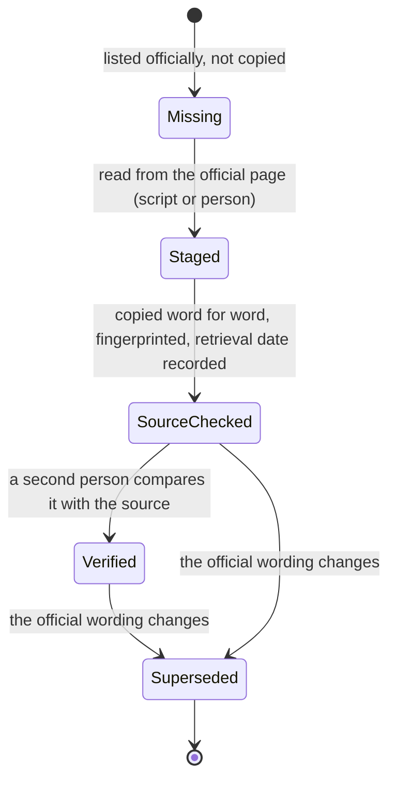

# 06 · Curriculum Verification and Alignment Experience

**Purpose:** how curriculum data is shown, how its verification status reaches the teacher, and how a resource's alignment is evidenced without scores.
**Status:** Stage A, 18 November 2026, updated the same day when the full curriculum was imported (section 3.1). Builds on `docs/architecture-evolution/03_curriculum_verification.md`, which defines the data pipeline; this document defines what teachers see.

---

## 1. Rules

1. **Funza never writes curriculum.** Codes and wording appear exactly as printed on curriculum.gov.sk.ca. The interface quotes them (quotation marks, navy rule) and never makes them editable.
2. **Status is always visible.** Wherever an outcome appears (explorer, chips, document header, alignment panel, approval summary) its mark comes with it.
3. **"Verified" means two people.** Copied from the official page *and* compared with it by a second team member. Nothing else may use the word.
4. **Unverified is never usable; automatic copies say what they are.** Staged records can be shown for transparency, never selected, never sent to the AI. Outcomes the importer copied from the official page can be used, but every screen marks them "Imported", and approval waits until the teacher confirms the curriculum text (section 3.1).
5. **Alignment is evidence, not a verdict.** Funza shows which parts address which outcome and verb, with marks. It never says "aligned", "compliant" or a percentage.
6. **The teacher decides.** Funza proposes tags and checks; the teacher confirms what only a person can judge.

---

## 2. Verification states and what the interface does with each

| State | Mark | Browse | Select / create | Sent to the AI | Shown in documents |
|---|---|---|---|---|---|
| Missing | "Not in Funza yet" | Course listed; empty state with official link | No | No | No |
| Staged | "Awaiting team review" (dashed) | Yes, greyed, inside the outcome detail | No | No | No |
| Imported | "Imported · no second source" (dashed) | Yes, with the importer's note | Yes; the review checklist asks the teacher to confirm the text | Yes (id, verbatim statement, indicators) | Yes, code in header |
| Cross-checked | "Imported · matches the Ministry CSV" | Yes | Yes; same confirmation | Yes | Yes |
| Source-checked | "Official source · 2nd check pending" (half shield) | Yes | **Yes** | Yes (id + verbatim statement) | Yes, code in header |
| Verified | "Verified" (teal shield ✓) | Yes | Yes | Yes | Yes |
| Superseded | "Wording changed on the official page" | Old version visible from affected resources | No for new resources | No | Delivered versions keep it, flagged |

---

## 3. What is real today (18 November 2026)

### 3.1 The full import (supersedes the table in 3.2 where they differ)

Later on 18 November 2026 every Saskatchewan 10-, 20- and 30-level curriculum was imported by `app/scripts/curriculum/import-sk.mjs` into `app/src/data/curriculum/sk.json`. Counts and every anomaly are in `app/src/data/curriculum/sk-report.md`; how to re-run it is in `app/README.md` ("Curriculum data").

| What | Result |
|---|---|
| Courses | 134 curricula from the site's course list and menus. 100 publish outcomes; 34 do not: Biology, Chemistry and Physics 20/30 (combined versions), Practical & Applied Arts 10–30, the 2026 preliminary drafts, and the older Social Studies, History, Geography and Native Studies curricula, whose pages list unit names only and say the rest is in the curriculum document |
| Outcomes | 3,219, each with its code, verbatim wording, unit, level, own official page and SHA-256 fingerprint |
| Indicators | 24,382, verbatim, from each outcome's own page |
| Second source | The Ministry's CSV files on EDonline. 3,208 outcomes have the same words (cross-checked). The other 11, all in Construction and Carpentry, are worded differently in the CSV; they are "imported", with the CSV wording in a note |
| Checked by a person | None. FM1 to FM4 keep their hand-copied status and gain the imported indicators |
| Not imported | French immersion and Fransaskois versions; Kindergarten to Grade 9; K-12 frameworks; 109 Practical & Applied Arts "Extended Study" modules, which teachers design and which have no official outcome |

What this changes for the teacher: every course that publishes outcomes shows them with their indicators (the others say why they are empty); search covers all of them; any outcome can start a resource. The AI receives the statement and its indicators. Because no person has checked the imported text, the review checklist shows "Curriculum text was copied automatically" until the teacher confirms it. The FM2 duplicate "(b)" and similar printing issues are listed in the report and shown on the outcome as "Check the note".

What it does not change: the team still has to verify outcomes (now in bulk, by course), decide what to do with the preliminary 2026 curricula and the older "Renewal" versions shown beside current ones, and ask the Ministry about reuse terms.

### 3.2 Before the import

| Data | Status | Source | Notes |
|---|---|---|---|
| SCI10-FM1 to FM4 statements | **Source-checked** (second check pending) | https://curriculum.gov.sk.ca/CurriculumOutcomeContent?id=63, copied 17 Nov 2026, in `app/src/lib/curriculum/catalog.ts` with SHA-256 fingerprints | Re-read on 18 Nov 2026: all four statements match the catalog word for word |
| SCI10-FM2 indicators | **Staged** in the prototype only; **pending** in the catalog | https://curriculum.gov.sk.ca/CurriculumOutcomeContent?id=63&oc=110477 (the per-outcome page; the unit page lists outcomes only) | Nine items are printed. Three were captured verbatim on 18 Nov 2026 ((a), (g) and the last item); the others need copying. **The last item is printed as a second "(b)".** It is a likely labelling error on the source, which a person must confirm before Funza assigns it a label |
| Indicators for FM1, FM3, FM4 | Missing | Per-outcome pages not yet read | — |
| Science 10 version label | None shown on the outcome page | The only "2014" seen is in a textbook description, so the catalog records "unlabelled; retrieved 2026-11-17" | Keep pinning by retrieval date and fingerprint |
| Course list (Science and Mathematics, levels 10/20/30) | Read from the official home page, 18 Nov 2026 | https://curriculum.gov.sk.ca/ | 19 names shown in the explorer as "Not in Funza yet" (except Science 10). **The site's search menu lists Biology, Chemistry and Physics 20 and 30, while the home-page list shows only the 30-level courses for those subjects**. Unresolved; the explorer footnote says so |
| Other Science 10 units | Missing | — | Not listed by name until copied, to avoid inventing unit names |
| Reuse terms for curriculum text | Not stated on the source | — | Ask the Ministry before any commercial use (the catalog's `outcomeLimitations()` already says so) |

The prototype shows exactly these states; it adds nothing to the production catalog.

**Before any teacher-facing pilot the team must:** (1) have a second person verify FM1–FM4 and record it (`secondCheck: "done"`); (2) copy the SCI10-FM2 indicators verbatim, resolve the duplicate "(b)" with a note, and verify them; (3) decide on the Biology, Chemistry and Physics 20 question; (4) ask the Ministry about reuse terms.

---

## 4. Browsing and choosing

- **Path:** Saskatchewan (fixed; the only jurisdiction) → grade (10, 11, 12, mapped from course levels 10, 20, 30) → course → unit → outcome.
- **Search** covers outcome codes ("FM2"), words in the official wording ("constant speed") and course names. It searches only the catalog, and says so when nothing matches.
- **Selection:** a checkbox on each outcome; a tray collects one or several; "Create from N outcomes" carries them into the brief.
- **Recently used** outcomes sit above the list and on Home.
- **Detail panel:** official wording; indicators in their true state; publisher, page, version label, fingerprint, reuse terms; a three-step timeline (copied ✓, second check, indicators); "What to know before relying on it" (from `outcomeLimitations()`).

---

## 5. How an outcome travels through the product

| Step | What happens to the outcome | Where it shows |
|---|---|---|
| Brief | Chosen as catalog ids; the official wording is shown in full | Create, step 2 |
| Blueprint | Planned marks per outcome and difficulty | Create, blueprint |
| Generation | The server re-reads the catalog entry, checks its fingerprint, sends id and verbatim statement only, and rejects any reply citing another id (EXISTING rule in `/api/teach`) | Progress: "found in Funza's catalog, wording intact" |
| Draft | Every question and section carries outcome ids and suggested verb tags | Alignment lens |
| Checks | Structure: only chosen outcomes cited; wording intact. Coverage: every chosen outcome is addressed | Checks tab |
| Approval | The version pins the outcome ids and their fingerprints | Approve dialog: "statement only; indicators pending" |
| Delivery | Codes in the document header; nothing curricular is posted beyond what is printed | Student copy, Classroom post |

---

## 6. Alignment evidence

The Alignment tab and lens answer three questions with evidence only.

**1. Is every outcome addressed, and how much?**
"SCI10-FM2 · 12 questions · 20 of 20 marks." An outcome with nothing fails coverage. Marks are counts, not a quality score.

**2. Are students asked to do what the outcome's verbs say?**
SCI10-FM2 reads "**Investigate** and **represent** …". Each question carries verb tags suggested with the draft and editable by the teacher. The panel lists, per verb, the parts that ask for it:

| Verb | Covered by | Shown as |
|---|---|---|
| Represent | Q1, Q2, Q3, Q6, Q8, Q12 (in the default 12-question quiz) | Covered |
| Investigate | nothing in the default quiz | **Weak**, with a plain suggestion: "No part asks students to investigate. On paper, a long answer that plans an investigation, or a data table to analyse, would cover it." |

This is honest about a real limit of paper quizzes, as `docs/architecture-evolution/07_migration_roadmap.md` §3.4 already noted for "represent".

**3. Does the draft match the plan?**
Blueprint against draft: marks, and marks per difficulty, planned and actual. Differences are highlighted, not judged.

**Indicators.** Until indicators are verified, every resource aligns to the outcome statement only, and the teacher confirms that once per resource. When verified indicators exist, questions can cite them, coverage lists them, and the generation prompt includes them (the validator already rejects unverified indicator ids: `allowedIndicatorIds()`).

---

## 7. When the official wording changes

1. A re-fetch finds a new fingerprint; the old outcome becomes **superseded** (pipeline in `03_curriculum_verification.md` §8).
2. Every resource pinned to it shows a banner: "The official wording of SCI10-FM2 changed on *date*. Review the alignment." with **Compare wording** (old and new side by side) and **Edit as new version**.
3. Delivered versions are never changed. New resources cannot select the superseded record.
4. The Curriculum screen shows the change in the outcome's timeline.

---

## 8. Words to avoid and use

| Avoid | Use |
|---|---|
| "Aligned ✓", "92 % aligned", "Curriculum compliant" | "SCI10-FM2 · 12 questions · 20 marks"; "Represent: Q1, Q2 …" |
| "Verified" for one person's copy | "Official source · 2nd check pending" |
| Paraphrased outcomes ("Learn about speed") | The official wording, quoted |
| "Standards" | "Outcomes" (the Saskatchewan term) |
