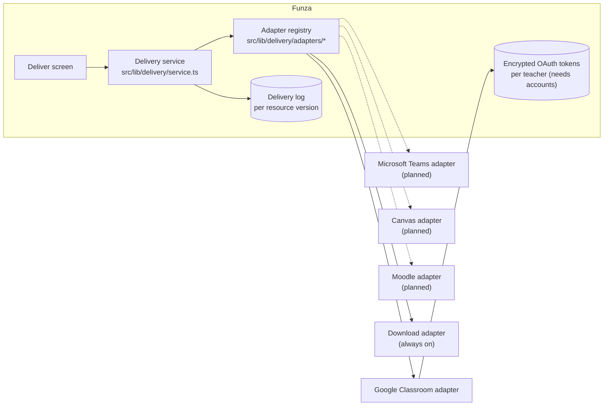
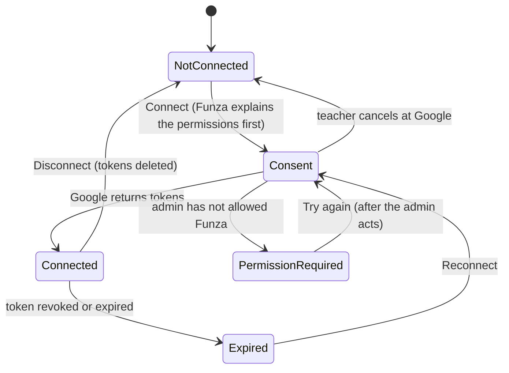
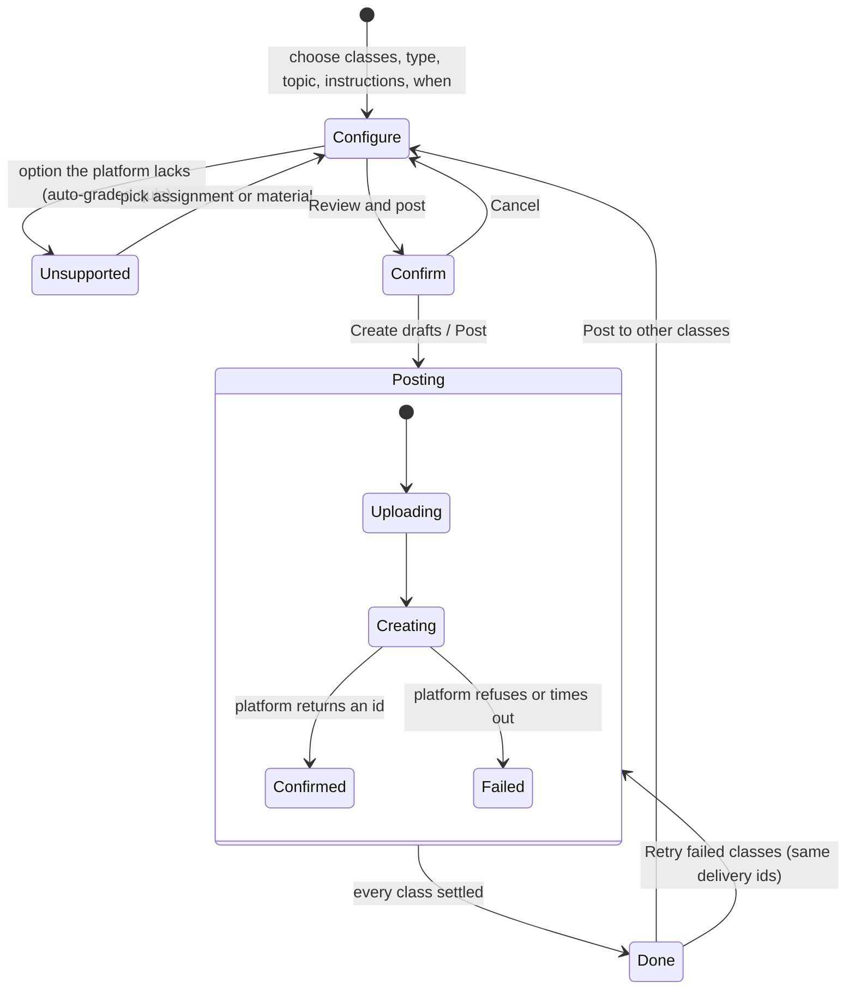

# 07 · Publishing and Export

**Purpose:** how an approved resource reaches students: downloads that always work, and posting to the school's platform through a modular integration, starting with Google Classroom as the illustrative design target.
**Status:** built in Stage B, 18 November 2026 (`app/src/lib/lms/`, `app/src/app/api/lms/google/*`). The API contracts in section 4 were checked against Google's reference pages that day; the integration has not yet been run against a real Google Workspace account. Setup steps are in `app/README.md` ("Google Classroom setup"). What was built differs from this design in two ways: students receive a Google Doc (not a PDF), and there is no "No platform" option, because everything teachers publish goes to the LMS; printing remains for the teacher's own copies.

---

## 1. Principles

1. **Funza creates, teachers approve, existing platforms deliver.** Funza is not an LMS: no rosters, no grades, no submissions.
2. **Only approved versions leave Funza.** Drafts can be printed only as a proof stamped "Draft · not approved · not for students".
3. **Downloads always work.** No school should need an integration to use Funza.
4. **Delivered means confirmed.** A post counts as delivered only when the platform confirms it, per class.
5. **Least access.** Ask only for what posting needs. Never read rosters, student names, grades or work.
6. **Safe defaults.** Post as a draft in the platform; never attach the answer key to a student post.
7. **No promises for what does not exist.** Planned platforms are visible and disabled, with the download route offered instead.

---

## 2. Exports

| Export | Now (Stage B first build) | Later |
|---|---|---|
| Student copy (PDF) | Browser print of a dedicated print layout (`@page` Letter or A4); the teacher chooses "Save as PDF". EXISTING technique (the alignment report already prints) | Server-rendered PDF for a one-click download and for attaching to posts |
| Printable exam | The student copy with name, date and class lines, part headers, answer spaces and marks | Cover page; A/B versions with shuffled options |
| Answer key (PDF, separate) | Keys, worked solutions, rubric tables; "teacher only" in the header | Combined marking guide |
| Word (.docx) | PLANNED: needs the `docx` package (new dependency, decision in `08_implementation_plan.md`) | Teacher template support |
| Quiz files for LMS import | PLANNED: QTI (Canvas, and others that import it), Moodle XML or GIFT | Per-platform tests |
| Presentation | PDF now | PowerPoint and Google Slides PLANNED |
| Interactive graph | A read-only Funza link (decision D13) and a PDF snapshot | Classroom add-on (to assess) |

Every download is recorded in the resource's delivery history ("Opened the print dialog", with time). Funza cannot know whether the teacher then saved the file, so it does not claim to.

---

## 3. The integration model



```ts
// src/lib/delivery/types.ts (proposed)
type Capability = "material" | "assignment" | "draft" | "schedule" | "topics" | "pdf-attachment" | "link-attachment" | "auto-graded-quiz";

interface LmsAdapter {
  id: "google-classroom" | "microsoft-teams" | "canvas" | "moodle";
  name: string;
  capabilities: ReadonlySet<Capability>;
  connection(teacherId: string): Promise<"not-connected" | "permission-required" | "connected" | "expired">;
  connectUrl(teacherId: string, returnTo: string): Promise<string>;   // OAuth start
  listClasses(teacherId: string): Promise<{ id: string; name: string; section?: string }[]>;
  listTopics(teacherId: string, classId: string): Promise<{ id: string; name: string }[]>;
  post(teacherId: string, req: PostRequest): Promise<PostResult>;     // one class per call
}

type PostRequest = {
  deliveryId: string;              // idempotency key, one per (version, class, attempt group)
  classId: string;
  kind: "material" | "assignment";
  title: string;
  instructions: string;
  attachments: { kind: "pdf" | "link"; name: string; url?: string; bytes?: Uint8Array }[];
  state: "draft" | "publish" | { scheduleAt: string };
  topicId?: string;
  dueAt?: string;
};

type PostResult =
  | { ok: true; externalId: string; externalUrl: string; state: "draft" | "published" | "scheduled" }
  | { ok: false; reason: "permission" | "not-teacher" | "expired" | "rate-limit" | "unsupported" | "platform"; message: string; retryable: boolean };
```

The Deliver screen reads `capabilities` to decide what to offer. An option the adapter lacks is shown as unsupported with an alternative, never hidden silently.

---

## 4. Google Classroom: the design target (to confirm)

| Need | Assumed API surface | Confirm before building |
|---|---|---|
| List the teacher's classes | `courses.list` with `teacherId=me`, scope `classroom.courses.readonly` | Scope name; filtering archived courses |
| List topics | `courses.topics.list`, scope `classroom.topics.readonly` | — |
| Post a material | `courses.courseWorkMaterials.create`, scope `classroom.courseworkmaterials` | Draft state and scheduling support for materials |
| Post an assignment | `courses.courseWork.create` with `workType: ASSIGNMENT`, scope `classroom.coursework.students` | `state: DRAFT`, `scheduledTime`, `dueDate`/`dueTime` |
| Attach the PDF | Upload to the teacher's Drive in a "Funza" folder with scope `drive.file` (only files Funza creates), then attach as a Drive file | Attachment sharing mode; size limits |
| Attach the interactive link | `link` material | — |
| Auto-graded quiz | Not available: Classroom quizzes are Google Forms, which the Classroom API does not create | Whether the Forms API could be a later, separate integration |
| Edit after posting | Only the developer project that created an item can modify it | Behaviour when the teacher edits in Classroom |
| Admin control | Workspace for Education admins can block or allow third-party apps | The exact error returned when blocked, to map to "Permission required" |

Scopes **not** requested: rosters (`classroom.rosters*`), student submissions, grades, profile emails beyond the signed-in teacher, full Drive access.

---

## 5. States, flows and copy

### 5.1 Connection



### 5.2 Posting



### 5.3 Copy deck

| State | Interface text | Actions |
|---|---|---|
| Not connected | **Connect Google Classroom.** Sign in with your school Google account once. Funza then posts approved resources to the classes you choose, as drafts you finish in Classroom. | Connect Google Classroom |
| Consent explainer (dialog) | **What Funza will ask Google for.** Funza will: see the names of the classes you teach; see your class topics; create posts and materials you approve; put the files it creates in a Funza folder in your Drive. Funza will not: read your rosters or student names; read or change grades or student work; open any other file in your Drive; post anything without your confirmation. | Continue to Google · Cancel |
| Permission required | **Your school has not allowed Funza yet.** Google said your Workspace admin must approve Funza before teachers can connect it. Downloads above still work in the meantime. | Copy a note for your admin · Try again · (Show the note) |
| Connected | Connected as *name*. | Disconnect |
| Unsupported | **Classroom can't take this as an auto-graded quiz.** Auto-graded quizzes in Classroom are Google Forms, which need a separate integration Funza does not have. Post it as an assignment with the PDF attached, or as a material. | (switch post type) |
| Confirm (draft) | **Create a draft in 2 classes?** Students will not see anything until you post the drafts from Classroom. | Create drafts · Cancel |
| Confirm (now) | **Post to 2 classes?** Students will see this as soon as Classroom confirms each post. | Post · Cancel |
| In progress (per class) | Uploading the student copy to a Funza folder in your Drive → Creating a draft post | — |
| Confirmed (per class) | Classroom confirmed the draft was created. | Open in Classroom ↗ |
| Failed (per class) | Classroom refused the request: *platform's reason*. | Retry |
| Summary | Classroom confirmed 2 of 2 · Posted to 1 of 2; 1 failed · Nothing was posted | Post to other classes |
| Expired | Your Classroom connection has expired. Reconnect to continue; nothing was posted. | Reconnect |
| Planned platform | Microsoft Teams · Planned. Not built. Until then, download the PDF and upload it yourself. | (disabled) |
| No platform | **Use any platform.** Download the student copy above and upload it to Teams, Canvas, Moodle or any other system your school uses. Keep the answer key to yourself. | — |

The prototype shows every state; its Classroom responses are simulated and labelled "(simulated)", and "Open in Classroom" stays disabled there because no real post exists.

---

## 6. Reliability

| Risk | Design |
|---|---|
| Double posts after a timeout or a double click | Every class post has a `deliveryId`; the service records it before calling the platform and, on retry, first looks for an existing item it created (stored external id, or a lookup by title and creation time) |
| Partial failure | Each class settles independently; the summary counts both; retry targets only failed classes |
| Token expiry mid-run | The run stops at the first `expired`, marks the remaining classes "not attempted", and asks to reconnect |
| Rate limits | Classes are posted one after another with back-off; the progress shows "Waiting for Classroom" |
| The teacher edits in Classroom afterwards | Funza does not overwrite. The delivery history links to the external item; a new Funza version is posted as a new item |
| Audit | History entries record version, destination, time, result and the platform id. This is the "accountability for published content" item C18 in the architecture plan |

---

## 7. Privacy and prerequisites

- **Accounts first.** OAuth tokens must be stored server-side, encrypted, per teacher. That needs teacher accounts and a database (C02, C03 in `docs/architecture-evolution/02_target_architecture.md`). Until then, downloads are the delivery path.
- **Division consent.** Many divisions must approve an app before teachers connect it. The "Permission required" state and the admin note exist for that.
- **Data residency.** Funza stores only the teacher's tokens, the resource and the delivery log. No student data passes through Funza.
- **Interactive links (D13).** A read-only page shows the approved snapshot with no login and no tracking. This reuses the existing published-snapshot rule (`app/src/app/api/classes/[code]/route.ts` serves published content only) and needs a privacy review before release.

---

## 8. Other platforms

| Platform | What to assess (not yet researched) | First step |
|---|---|---|
| Microsoft Teams | Microsoft Graph's education assignments API: draft assignments, resource attachments, tenant admin consent | Ask pilot divisions; read the current Graph documentation |
| Canvas | REST API for assignments, pages and files; LTI 1.3; QTI import for quizzes | QTI export first: it needs no integration |
| Moodle | Web services and LTI; quiz import as Moodle XML or GIFT | Quiz-file export first |
| Division-specific systems | Some Saskatchewan divisions may use platforms not listed here | Ask each pilot division which platform it uses |

The order of work follows what pilot schools use, not this table.
