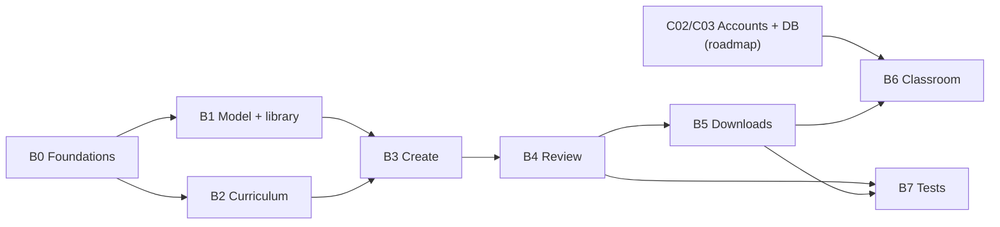

# 08 · Implementation Plan

**Purpose:** how Stage B turns the approved design into the product: what to reuse, what to add and where, dependencies, build order, tests and risks.
**Status:** Stage B started on 18 November 2026 at Chop's direction ("exclusively for teachers; everything they publish goes to the LMS"). Section 0 records what was built; the rest of this plan is kept as written for the remaining work.

---

## 0. What Stage B built (18 November 2026)

| Done | Where |
|---|---|
| Teachers-only app: the student home, join-a-class, own courses, `/class/*`, `/courses/*`, `/progress`, the tutor and mascot, Insights and class join codes were removed. The questionnaire at `/survey` stays (research tool, outside the navigation) | `app/src/app/`; the removed code is in git history and in the stash entry "backup before teacher-only rebuild" |
| The five screens and the library at real routes, from the Stage A design | `/`, `/curriculum`, `/create`, `/library`, `/resources/[id]`, `/resources/[id]/deliver`, `/integrations`; `app/src/components/workspace/` |
| Resource model, blueprint, starter question bank (Science 10, FM2 and FM3, hand-written), check engine, validation of untrusted input | `app/src/lib/resources/` |
| AI drafting of whole resources and single questions through the existing provider layer, with the outcome allow-list and whole-reply rejection | `app/src/app/api/teach/route.ts`, `app/src/lib/ai/resource-prompts.ts`, `app/src/lib/resources/ai-reply.ts` |
| Publishing to Google Classroom: OAuth with an encrypted cookie (no accounts needed), class and topic lists, the student copy as a Google Doc (`drive.file`), materials or assignments as drafts by default, per-class progress and retry, history recorded only on confirmation | `app/src/lib/lms/`, `app/src/app/api/lms/google/*` |
| Printing the student copy and the answer key for the teacher's own use | Publish screen |
| The curriculum database: every Saskatchewan 10-, 20- and 30-level curriculum (courses, units, outcomes, indicators) imported from curriculum.gov.sk.ca and cross-checked against the Ministry's CSV files, with source pages, fingerprints and statuses; served by `/api/curriculum/*`, searched and browsed on `/curriculum`, used by drafting. PostgreSQL schema ready for a hosted database. 134 courses, 3,219 outcomes, 24,382 indicators; tests now 73. Details in `06_curriculum_ux.md` section 3.1 | `app/scripts/curriculum/`, `app/src/data/curriculum/`, `app/src/lib/curriculum/` |
| Tests: 64 passing (catalog, resources, LMS helpers, visualizations, survey); lint and types clean; production build passes | `app/tests/` |

**Interim choices.** Resources are saved in the teacher's browser (option A in section 5, without the Blob store) until accounts and a database exist. The Stage A prototype route was removed because the app now implements it; `09_mockups/` keeps the Stage A captures.

**Not yet done:** running the Classroom integration against a real Google Workspace for Education account (needs a Google Cloud OAuth client; steps in `app/README.md`), accounts and database (C02, C03), Word export, Teams, Canvas and Moodle, Next.js 16.4.6 upgrade (C01), committed browser tests (B7).

---

## 1. The Stage A prototype (removed in Stage B)

| | |
|---|---|
| Run it | `cd app && npm run dev`, then http://localhost:3000/prototype. Start at the journey map: http://localhost:3000/prototype?s=journey |
| Location | `app/src/app/prototype/` (`layout.tsx`, `page.tsx`, `prototype.css`) and `app/src/app/prototype/_components/` (`_` keeps the folder out of routing) |
| Production impact | None. No existing file was changed. Styles are scoped to `.fz-proto` / `.fz-layer`; the production sidebar is hidden only while the prototype is on screen (`body:has(.fz-proto)`) |
| Deploy guard | `layout.tsx` returns 404 in a production build unless `FUNZA_PROTOTYPE=on`, so pushing this branch cannot expose the prototype on Vercel |
| State | A module-level store (`_components/store.ts`); nothing is saved to a server; reload or "Reset everything" starts over |
| Reviewer controls | The **PROTOTYPE** button (bottom right) chooses what the simulated AI and Classroom do: AI works, busy, not configured or bad reply; Classroom not connected, blocked or connected; publish works, one fails or all fail |

| File | Lines | Holds |
|---|---|---|
| `_components/types.ts` | 178 | The proposed resource model (section 4) |
| `_components/data.ts` | 675 | Curriculum (from the real catalog), course list, staged indicators, sample teacher, library and the hand-written question pool |
| `_components/model.ts` | 632 | Blueprint, simulated draft assembly, fingerprints, the check engine, alignment helpers |
| `_components/store.ts` | 637 | State and actions, simulated generation, connection and publishing |
| `_components/ui.tsx`, `icons.tsx`, `parts.tsx` | 989 | Design-system primitives and icons |
| `_components/shell.tsx` | 601 | Rail, top bar, search palette, shortcuts, toasts, prototype controls |
| `home.tsx`, `curriculum.tsx`, `create.tsx`, `review.tsx`, `deliver.tsx`, `more.tsx` | 4,391 | The screens |
| `prototype.css`, `layout.tsx`, `page.tsx`, `app.tsx` | 329 | Scoped tokens and styles, the deploy guard, the single route |

**Verified in Stage A:** `npx tsc --noEmit` clean, `npx eslint src` clean, `npm test` 79 of 79 passing. A scripted headless-Chrome run over the DevTools protocol walked the main journey and the failure paths: generate, fix the failed check, review with the keyboard (an edit cleared that question's review), approve, connect, post as drafts (2 of 2 confirmed, recorded as simulated), the rate-limit failure, cancel, multi-outcome selection, and 390 px and 900 px layouts with no horizontal overflow. It logged no console errors or warnings. The script lives outside the repository; committing a repeatable version is task B7.

**What carries into Stage B:** the token values, the check engine's generalisation (`model.ts` → `src/lib/resources/checks.ts`), the blueprint (`src/lib/resources/blueprint.ts`), the screen structures and copy. **What is dropped:** the sample data, the simulated store, the prototype controls and the route itself (delete `app/src/app/prototype/` when Stage B screens replace it).

---

## 2. Reuse map

| EXISTING module | Use in Stage B |
|---|---|
| `src/lib/curriculum/catalog.ts` (`CATALOG`, `usableOutcome`, `outcomeProblems`, `outcomeLimitations`, `allowedIndicatorIds`) | Unchanged as the source of truth; extend the type with `superseded` and staged indicators only once the ingestion pipeline exists |
| `src/lib/curriculum/checks.ts` | Generalise: block checks become section and item checks; keep the three kinds and the fingerprint rule |
| `src/lib/curriculum/lesson.ts` (`blockFingerprint`, `motionVisualization`, sanitizers) | The interactive-graph section; sanitizer patterns for the new item types |
| `src/lib/curriculum/generate.ts` (`generateCurriculumLesson`, `regenerateBlock`) | Pattern for resource and single-item generation; template fallback |
| `src/lib/ai/server.ts` (`complete`, `AiError`) | Unchanged. All new prompts go through it (the brief's "reuse the existing AI provider layer") |
| `src/lib/ai/teach-prompts.ts`, `teach-schema.ts` | Add `resourcePrompt(kind, brief)` and `validateResourceDraft()`; the allow-list rule carries over |
| `src/app/api/teach/route.ts` | Add tasks `resource-draft` and `resource-item`, with the same outcome re-check before any call |
| `src/lib/classes/model.ts` (`canPublish`, snapshot rules), `server.ts`, `useEditableClass.ts` | Approval and immutable versions; Blob storage and autosave as the interim store (section 5) |
| `src/lib/visualizations/*`, `src/components/activity/ActivityStage.tsx` | Unchanged; interactive graphs in notes and the interactive resource type |
| `src/lib/visualizations/expr.ts` (`compileExpr`, `formatNumber`) | Answer recomputation for calculation items |
| `src/lib/pdf/extract.ts` | "Start from a file" (PDF) |
| `src/components/FunzaLogo.tsx`, `icons.tsx`, `EmptyState.tsx`, `Spinner.tsx`, `Button.tsx` | Restyle with the new tokens; extend |
| `src/components/curriculum/*` | Logic moves into the new review screen; files retire once `/teach/resources/[id]` replaces the lesson builder |

---

## 3. New modules and paths

| Path | What |
|---|---|
| `src/lib/resources/types.ts` | Resource, Version, Section, Item, Brief (from the prototype's `types.ts`) |
| `src/lib/resources/blueprint.ts` | Deterministic blueprint (from `model.ts`), with tests |
| `src/lib/resources/checks.ts` | Structure, answers, coverage and review checks; `approvalBlockers()` |
| `src/lib/resources/convert.ts` | Existing curriculum lectures → resources (kind `interactive-lesson`), so nothing already made is lost |
| `src/lib/resources/store.ts`, `client.ts` | Persistence behind a repository interface (Blob now, Postgres later) |
| `src/lib/export/print.tsx` | Print layouts: student copy, exam, answer key |
| `src/lib/export/docx.ts` | Word export (B5, new dependency) |
| `src/lib/delivery/*` | Adapter interface, service, delivery log; `adapters/google-classroom.ts` (B6) |
| `src/app/api/resources/**`, `src/app/api/delivery/**` | Route handlers (`{ ok, … }` convention of `src/app/api/`) |
| `src/app/teach/{create,library,resources/[id],resources/[id]/deliver,settings/integrations}/page.tsx` | The screens (`02_information_architecture.md`, section 3) |
| `src/components/ui/*`, `src/components/shell/*`, `src/components/status/*` | Primitives and shell from the prototype |

---

## 4. Data model

```ts
type ResourceKind = "notes" | "quiz" | "test" | "exam" | "lesson-plan" | "worksheet" | "homework" | "presentation" | "visualization" | "interactive-lesson";

type Resource = {
  id: string;
  ownerKey: string;               // edit-key hash now; teacher id after accounts
  kind: ResourceKind;
  title: string;
  courseId: string;               // catalog course
  unitId: string;
  brief: Brief;                   // what produced version 1; reuse copies it
  versions: Version[];            // append-only once approved
  deliveries: Delivery[];
  createdAt: string; updatedAt: string; revision: number;   // optimistic concurrency
};

type Version = {
  number: number;
  status: "draft" | "approved";
  outcomes: { id: string; fingerprint: string }[];          // pinned catalog wording
  sections: Section[];
  draftedBy: "ai" | "template" | "teacher";
  provider?: string;                                       // which AI provider, when AI
  approved?: { at: string; by: string; checksSummary: string };
};

type Item = {
  id: string; type: "mcq" | "tf" | "fill" | "match" | "calc" | "short" | "long";
  prompt: string; options: { id: string; text: string }[]; correctId: string | null; tf: boolean | null;
  answer: string; pairs: { left: string; right: string }[];
  calc: { expr: string; vars: Record<string, number>; unit: string; show: string } | null;  // recomputed by expr.ts
  solution: string; rubric: { text: string; marks: number }[];
  marks: number; difficulty: "foundational" | "grade" | "extending";
  outcomeIds: string[]; verbs: ("investigate" | "represent" | "explore")[];
  origin: "ai" | "template" | "teacher" | "file"; sourcePages?: [number, number];
  reviewedFp: string | null;      // same rule as checks.ts acknowledgements
};
```

Mapping from today: `Lecture` → `Resource` (kind `interactive-lesson`); `CurriculumBlock` → `Section`; `BlockItem` (+ `ItemFact`) → `Item` with `calc`; `acknowledged` and `approvedFingerprint` → `reviewedFp` and version approval; `published` snapshot → an approved `Version`.

---

## 5. Storage before accounts

| Option | For | Against | Recommendation |
|---|---|---|---|
| **A. Interim:** one private Blob object per teacher workspace with an edit key, reusing `src/lib/classes/server.ts` patterns and `useEditableClass` autosave | Ships the whole create-review-approve-download loop without waiting; no new vendor | Same limits as classes today (edit key in the browser, last write wins unless the revision check is added) | **Yes, for B1–B5**, with the conditional-write check added |
| B. Wait for Supabase accounts and Postgres (C02, C03) | Proper ownership and queries | Blocks all of Stage B behind ~45 h of foundation | Do C02 and C03 in parallel and migrate in B6 |

LMS posting (B6) requires accounts in every case: OAuth tokens cannot live in a browser.

---

## 6. Dependencies

| Need | Decision |
|---|---|
| UI primitives | None added. Dialog, menu, tabs and the others are small local components (as in the prototype) |
| Icons | None added; local SVG set |
| Fonts | None added; Inter and Plus Jakarta Sans already load via `next/font` |
| PDF | None added for B5 (browser print). A server PDF renderer is a later decision |
| Word export | **`docx`** (pure TypeScript, no native code). New runtime dependency; needs approval |
| Google APIs | None: plain `fetch` with OAuth tokens. The `googleapis` SDK is large and unnecessary |
| 3D (Three.js, React Three Fiber) | **Not in the MVP.** No outcome in the catalog passes the learning-benefit test in `docs/architecture-evolution/04_simulation_engine.md` §5 |
| Interaction and accessibility tests | **`@playwright/test` and `@axe-core/playwright`** as devDependencies (B7), or keep a committed DevTools-protocol script with no new dependency. Team decision |
| Framework | Upgrade Next.js 16.4.0 → 16.4.6 first (critical advisory, task C01 in the roadmap) |

---

## 7. Build order

Effort at the team's pace (16–20 h a week combined). S ≈ 4–8 h, M ≈ 10–20 h, L ≈ 25–40 h.

| Phase | Work | Done when | Effort |
|---|---|---|---|
| **B0 · Foundations** | Next.js 16.4.6; tokens into `globals.css` (teal primary, new status colours, `--line-input`, `--gold-500`); primitives (dialog, toast, tabs, segmented, switch, stepper, menu); new shell and rail; `window.confirm` replaced | Existing screens render in the new palette; tests, lint and build pass; no visual regressions in `/`, `/courses/**`, `/class/**` | M (16 h) |
| **B1 · Resource model and library** | `src/lib/resources/*` types, converter from lectures, interim store with revision checks; Library and Home on real data | An existing curriculum lesson appears in the library; Home counts come from real checks | L (30 h) |
| **B2 · Curriculum explorer** | Redesign with grade and subject filters, search, multi-select tray, detail panel; no class needed | Every catalog outcome shows its true status; "Create from" carries outcomes | M (12 h) |
| **B3 · Create and generation** | Brief form, blueprint module with tests, `resource-draft` task with prompts and validators per kind, stages UI, template and "write it yourself" fallbacks | A quiz for SCI10-FM2 generates against a live provider; an invalid reply is rejected in tests; cancel and errors behave as specified | L (40 h) |
| **B4 · Review editor** | Canvas with lenses, seven item editors, outline, checks and alignment panels, `resource-item` regeneration with side-by-side choice, approval and versions | Every check in `04_screen_specifications.md` works on real resources; an edit clears that part's review (test); approval locks the version | L (45 h) |
| **B5 · Deliver: downloads** | Print layouts (student, exam, key), paper size, delivery log; Word export after the `docx` approval | Printing a quiz on Letter and A4 matches the preview; the key is a separate file | M (18 h) |
| **B6 · Accounts and Classroom** | C02/C03 from the roadmap; OAuth; `google-classroom` adapter; draft posts; idempotent retries; the states in `07_lms_publishing_ux.md` | Confirmed against a Google Workspace for Education test domain; a forced failure retries without a duplicate | L (40 h) + C02/C03 |
| **B7 · Tests and accessibility** | Interaction tests for the main journey and failures; axe on each screen; keyboard-only run; 390, 900 and 1440 px snapshots | All pass in CI (or a committed script) | M (16 h) |

Total without C02/C03: about 217 hours, roughly 11–13 weeks at the current pace. A demonstrable loop (B0–B5) needs about 160 hours.



Rules that hold in every phase: nothing that works today breaks (the university paths, samples, tutor, survey and the class-code path keep their tests passing); no production data is changed by hand; no deployment without approval; read `app/node_modules/next/dist/docs/` before writing routes (`app/AGENTS.md`).

---

## 8. Testing

| Level | What | Where |
|---|---|---|
| Unit (Node test runner, as today) | Blueprint totals and splits; every check kind; fingerprint invalidation; converter from lectures; delivery idempotency | `app/tests/resources-*.test.ts`, `delivery.test.ts` |
| AI contract | Synthetic model replies: valid, wrong counts, unsupplied outcome id, wrong arithmetic | `app/tests/resource-draft.test.ts` |
| Interaction | Main journey; each failure in `05_interaction_flows.md` §2.7; editing after review; approval gate; posting with partial failure | Playwright or the DevTools script |
| Accessibility | axe on each screen in each state; keyboard-only journey; focus order in dialogs; reduced motion | Same |
| Responsive | 390 × 844, 900 × 1100, 1440 × 1000 screenshots compared per release | Same |
| Manual | Print on Letter and A4 from Chrome and Edge (Chromebooks are common in schools) | Checklist in the PR |

---

## 9. Risks

| Risk | Mitigation |
|---|---|
| AI quality differs by resource type and provider | Blueprints constrain the output; validators per kind; recomputation; teachers see failures before students do; measure edits per question in the pilot |
| Review burden grows with long exams | Keyboard flow (N, R); reviewing a part covers its non-computable answer; regenerate one part instead of all |
| Classroom API assumptions are wrong | Section 4 of `07_lms_publishing_ux.md` lists each assumption to confirm; downloads cover the gap |
| Curriculum data stays "pending" | Pilot only after the second-person checks; the interface already says what is pending |
| Scope: nine resource types at once | Build order B3 starts with quiz and worksheet (shared question engine), then notes and lesson plan; presentation and interactive types last |
| Two developers | No new services; one codebase; reuse over rewrite |

---

## 10. Approval checklist for Stage B

- [ ] The five screens, their states and copy (`04`) are approved, or changes are listed.
- [ ] D1 (class-code path becomes legacy; what `/` opens) is decided.
- [ ] D13 (interactive resources via a public read-only link) is decided.
- [ ] Interim storage (section 5, option A) is accepted.
- [ ] New dependencies: `docx` (runtime) and the test tooling (dev) are approved or declined.
- [ ] The brand needs listed in `03_design_system.md` §2 have an owner.
- [ ] A team member owns the curriculum verification tasks in `06_curriculum_ux.md` §3.
- [ ] The first LMS is confirmed with a pilot school or division.
