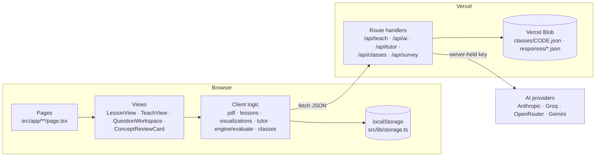

# 01 · Existing System Audit

**Purpose:** establish exactly what Funza is today, from the code, before designing the move to Saskatchewan high schools.
**Basis:** the repository on 17 November 2026: last commit `48d87fd` ("Model 2 build"), plus uncommitted work in the working tree (the brick-style UI restyle and `docs/07_system_architecture/`). Paths are relative to `app/`.
**Evidence used:** source code, the 68 unit tests (`npm test`), the production build, and a scripted headless-Chrome walkthrough of the class flow run on 12 and 14 November 2026. Where something was not exercised, this document says so.

Legend used in all documents: **EXISTING** (in the code and working), **MODIFY** (exists, needs extension or refactoring), **NEW** (does not exist).

---

## 1. Summary

Funza is a single Next.js 16 application (React 19, TypeScript) deployed on Vercel. Pages are client components; the server side is a set of route handlers under `src/app/api/`. Personal data lives in the browser's `localStorage`; shared class data lives as one private JSON object per class in Vercel Blob. All AI calls go through the server, which holds the keys and validates every model reply against a schema.

The strongest assets for the high school direction are:

1. **A teacher review-and-publish workflow that already works**: drafts, per-concept approval, published snapshots, class codes (`src/lib/classes/`).
2. **A safe, data-driven visualization registry** with eight types, a deterministic playback reducer and prediction checkpoints (`src/lib/visualizations/`).
3. **A validated AI layer** with four provider adapters and strict output schemas (`src/lib/ai/`).
4. **A complete student lesson runtime** with hints, second explanations, reveal-after-attempts, a narrating tutor and accessibility work (`src/components/lesson/LessonView.tsx`, `src/lib/tutor/`).

The biggest gaps are identity (no accounts), a queryable data store (no database), curriculum data (none), and any path for student results to reach a teacher (progress never leaves the device).

---

## 2. Current architecture (as built)

---

## 3. Feature inventory

### 3.1 Fully implemented and working

| Capability | Where | Evidence |
|---|---|---|
| PDF text extraction in the browser (pdf.js), with page numbers and font sizes | `src/lib/pdf/extract.ts` | Used by import and drafting; class walkthrough drafted from a real PDF |
| Rule-based lesson generation (headings → concepts, cloze and short-answer questions) | `src/lib/lessons/generate.ts` | Walkthrough; sample usage since October |
| Notes vs question-sheet classification and question extraction | `src/lib/questions/*`, `src/lib/lessons/import.ts` | In use on the course page |
| Fixed lesson runtime: explain, ask, check, hint, second explanation, reveal after 3 attempts, practise missed | `src/components/lesson/LessonView.tsx`, `src/lib/engine/evaluate.ts` | Walkthrough answered a question and saw hint and second explanation |
| Talking tutor: script, Tutor Mode, text-to-speech | `src/lib/tutor/tutorLine.ts`, `useTutorSession.ts`, `src/lib/speech/useSpeech.ts` | `tests/tutor-script.test.ts` |
| Ask Funza: five questions answered locally; free questions and optional screenshot via the AI | `src/lib/tutor/askFunza.ts`, `src/app/api/tutor/route.ts`, `src/lib/screen/useScreenShare.ts` | `tests/ask-funza.test.ts` (local answers) |
| Visualization registry: 8 types, normalize/controls/steps/checkpoints contract, player reducer, safe expression language | `src/lib/visualizations/*`, `src/components/visualizations/*` | `tests/registry.test.ts`, `generic.test.ts`, `player.test.ts`, `expr.test.ts` |
| AI provider layer: one `complete()` with Anthropic SDK, OpenAI-compatible (Groq, OpenRouter) and Gemini adapters; image input with capability check | `src/lib/ai/server.ts`, `src/lib/ai/vision.ts` | Code review; see 3.2 for live testing |
| Strict validation of every AI reply (plan, lesson, draft, evaluation, question, visualization) | `src/lib/ai/teach-schema.ts`, `src/lib/visualizations/registry.ts` | `tests/classes.test.ts` (draft), registry tests |
| Classes: create with code and edit key, draft a lecture, review per concept, publish snapshot, student join and study | `src/lib/classes/*`, `src/app/teach/**`, `src/app/class/**`, `src/app/api/classes/**` | `tests/classes.test.ts` (7 tests); full walkthrough passed, no console errors |
| Edit-key security: key hashed (SHA-256) on the server, constant-time compare, key carried in URL fragment for the edit link | `src/lib/classes/server.ts`, `useEditableClass.ts` | Walkthrough: wrong key refused, edit link worked |
| Usability questionnaire stored in Blob with CSV export | `src/app/api/survey/route.ts`, `src/lib/survey/questionnaire.ts` | `tests/survey.test.ts`; used at the 20 Oct bazaar |
| Brick-style UI (Fredoka headings, studded cards, colour tokens) | `src/app/globals.css`, `src/components/*` | Built and screenshotted 14 Nov; **uncommitted** |

### 3.2 Partially implemented

| Capability | What exists | What is missing |
|---|---|---|
| AI drafting of class lectures | `draftLecture()` in `src/lib/classes/draft.ts`; `task: "draft"` in `src/app/api/teach/route.ts` | Not exercised end to end against a live provider (no key in `.env.local` during testing); the rule-based fallback was the path tested |
| Adaptive AI lessons (plan, teach, evaluate, verify) | `src/lib/teaching/*`, `src/components/teach/TeachView.tsx` | Same: depends on a configured key; not re-tested since the classes work |
| Progress tracking | `recordConceptResult()` in `src/lib/storage.ts`: status and attempt count per concept | Stays on the device; no per-answer record (which option was chosen); `/progress` ignores class lessons |
| Assessment | One question per concept (`Concept.question`) | No multi-item assessments, no item metadata, no misconception tags on distractors |
| Teacher identity | Secret edit key per class in the browser | No accounts, no roles, no recovery if the key is lost, anyone with the edit link can edit |
| Concurrency | Autosave of the whole class (`useEditableClass.ts`) | Last write wins; no version check |
| AI robustness | Error mapping; Anthropic refusal fallback | No rate limiting, no streaming, no cross-provider fallback |
| Source references | `SourceSection` keeps page ranges (`src/lib/types.ts`) | Pages are not shown with explanations |

### 3.3 Exists only in the planned architecture

Accounts and roles, a relational database, flashcards and study guide, class analytics, model picker and Pro plan, streaming, rate limiting, provider fallback, iPad app, voice input. None of these have code today.

### 3.4 Does not exist anywhere (needed for the new direction)

Curriculum data of any kind; grade levels; outcome links on lessons; alignment reports; student response capture; misconception analytics; follow-up assignments; schools or divisions; 3D rendering.

---

## 4. Component-by-component assessment

| Component | Path | Verdict | Notes |
|---|---|---|---|
| PDF extraction | `src/lib/pdf/extract.ts` | **Reuse as is** | Teachers upload existing material through the same path |
| Rule-based generator | `src/lib/lessons/generate.ts` | **Reuse as fallback** | Rough output; keep for no-AI mode, not as the main high school path |
| Lesson provider interface | `src/lib/lessons/provider.ts` | **Reuse** | A curriculum lesson is another provider |
| Lesson runtime | `src/components/lesson/LessonView.tsx` | **Modify** | Add response events, multi-item assessment, outcome banner; keep the flow |
| Answer checking | `src/lib/engine/evaluate.ts` | **Modify (small)** | Return which option was chosen so a misconception can be counted |
| Tutor, speech, Ask Funza | `src/lib/tutor/*`, `src/lib/speech/*` | **Reuse** | Ask Funza stays off in class lessons (reviewed-content rule) |
| Visualization registry and player | `src/lib/visualizations/*` | **Reuse; extend** | Add a `simulation` family; existing 8 types unchanged |
| AI adapters | `src/lib/ai/server.ts` | **Reuse; extend** | Add rate limiting and provider fallback around `complete()` |
| Prompts and schemas | `src/lib/ai/teach-prompts.ts`, `teach-schema.ts` | **Modify** | Outcome-constrained drafting; alignment output; misconception tags; ID allow-lists |
| Class model and rules | `src/lib/classes/model.ts` | **Modify** | `Lecture` becomes a versioned `Lesson` with outcome links and assessment items; the review/publish rules carry over |
| Class storage | `src/lib/classes/server.ts` (Blob) | **Refactor** | Behind a repository interface; move to a database |
| Class API | `src/app/api/classes/**` | **Modify** | Teacher auth replaces edit keys; add responses and insights routes |
| Review UI | `src/components/classes/ConceptReviewCard.tsx`, `src/app/teach/[code]/lectures/[lectureId]/page.tsx` | **Modify** | Add alignment panel, misconception tags, assessment items |
| Editable class hook | `src/lib/classes/useEditableClass.ts` | **Modify** | Conditional saves (version), auth session instead of key |
| Browser storage | `src/lib/storage.ts` | **Reuse; extend** | Personal courses stay local; add an outbox for class responses |
| Survey | `src/app/api/survey/**` | **Reuse** | Unrelated to the product path |

---

## 5. Data that exists today

| Data | Store | Shape | Notes for the new direction |
|---|---|---|---|
| Personal courses, lessons, progress, settings | `localStorage` (`funza.*.v1` keys) | See `src/lib/types.ts` | Stays local; never reported |
| Classes | Vercel Blob `classes/<CODE>.json` | `ClassRecord` with `lectures[]`, drafts and `published` snapshots (`src/lib/classes/model.ts`) | Migrate to the database; the snapshot idea is kept as lesson versions |
| Joined classes, teaching keys | `localStorage` | `JoinedClass[]`, `TeachingEntry[]` | Replaced by enrolments and teacher sessions |
| Survey responses | Vercel Blob `responses/*.json` | `SurveyResponse` | Unchanged |

There is **no student-identifying data anywhere today**: classes hold teacher-entered content only, and student progress never leaves the browser. That is a strong starting position for K-12 privacy and should be protected as reporting is added.

---

## 6. Quality and engineering baseline

| Item | State |
|---|---|
| Tests | 68 passing, Node test runner, pure logic only (`app/tests/`); no UI or API integration tests in the repo |
| Lint, types, build | Clean as of 14 Nov 2026 |
| Browser walkthrough | Scripted with Playwright from a scratch folder; not committed to the repo |
| Framework security | Next.js 16.4.0 has a critical advisory (npm audit); 16.4.6 fixes it |
| Uncommitted work | Brick UI restyle (22 files), `docs/07_system_architecture/` |
| CI | None |

---

## 7. Implications for the high school direction

1. **Keep the core.** The lesson runtime, visualization registry, AI layer and review/publish rules are the product's heart and fit high school teaching with extension, not replacement.
2. **Identity and a database come first.** Classroom reporting, curriculum versions, lesson versions and school divisions all need accounts and queryable storage. Blob JSON cannot support them.
3. **Curriculum data is genuinely new** and must be treated as reference data with provenance, never as AI output.
4. **Response capture is the first student data that would leave a device.** It needs consent, minimization and authorization from day one.
5. **3D is not on the critical path.** The first curriculum slice can be taught with the existing `function-graph` and `quantity-model` types (see `07_migration_roadmap.md`).
