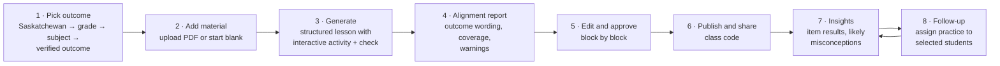
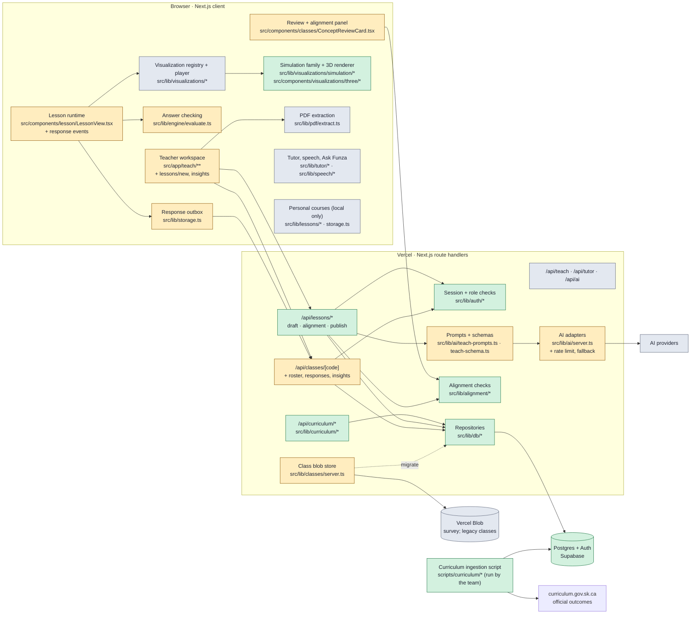

# 02 · Target Architecture

**Goal:** evolve Funza into a curriculum-aligned teaching platform for Saskatchewan high school teachers and students, later sold to school divisions, without rebuilding what works.
**Status:** proposal for team review. Nothing here is implemented unless marked EXISTING.

---

## 1. Product shape

| | University (today) | High school (target) |
|---|---|---|
| Who creates lessons | Professor uploads a lecture PDF | Teacher picks an official outcome, then uploads material or starts blank |
| What a lesson is | Concepts drafted from one PDF | A short, structured lesson linked to one or more verified curriculum outcomes, with an interactive activity and an assessment |
| Quality gate | Professor approves each concept | Teacher approves each block **and** sees an alignment report before publishing |
| Students | Join with a class code, anonymous, progress stays on the device | Join with a class code and a name from the teacher's roster; answers in class lessons are reported to the teacher |
| Feedback loop | None | Item results, likely misconceptions, follow-up assignments |
| Buyer | Individual students (Pro plan) | Teachers first (free pilot), then school divisions |

Design principles:

1. **Teachers stay in control.** Nothing reaches students until a teacher approves and publishes it; every published lesson is an immutable version.
2. **The AI never invents curriculum.** Outcomes come only from a verified catalog; the AI can only reference catalog IDs it was given.
3. **Deterministic where it matters.** Answer checking, misconception counting, and simulations run as plain code, not AI.
4. **Student data stays minimal.** No student accounts, emails or birthdates in the MVP; nothing identifiable goes to an AI provider.
5. **One app.** Keep the single Next.js codebase and its route handlers; add a managed Postgres database. No microservices.

---

## 2. Teacher experience

### 2.1 Journey



### 2.2 Screens

| # | Screen | Route (proposed) | Builds on |
|---|---|---|---|
| T1 | Teacher home: classes, lessons, "needs attention" insights | `/teach` | EXISTING `src/app/teach/page.tsx` |
| T2 | New lesson: grade, subject, outcome picker with "Verified · source · date" badge; upload or blank | `/teach/lessons/new` | NEW; upload reuses `src/lib/pdf/extract.ts` |
| T3 | Lesson editor: blocks on the left, alignment panel on the right, approve per block | `/teach/lessons/[lessonId]` | MODIFY `src/app/teach/[code]/lectures/[lectureId]/page.tsx`, `ConceptReviewCard.tsx` |
| T4 | Alignment report (full page, printable) | `/teach/lessons/[lessonId]/alignment` | NEW |
| T5 | Publish and assign to a class; class code | `/teach/classes/[code]` | EXISTING class page and `BrickCode` |
| T6 | Class insights: items, misconceptions, students to follow up | `/teach/classes/[code]/insights` | NEW |
| T7 | Follow-up: pick students, pick practice, assign | dialog in T6 | NEW |
| S1 | Student: join with code, choose name from roster | `/` and `/class/[code]` | MODIFY `JoinClassForm.tsx`, class page |
| S2 | Student: lesson with interactive activity and check | `/class/[code]/lessons/[lessonId]` | EXISTING `LessonView.tsx`, MODIFY to emit responses |

### 2.3 Visual direction

- **Teacher workspace: calm and professional.** White tiles on the light baseplate, Fredoka for headings, brick colour used for meaning only (status chips, class codes, the primary action). No studs on dense editing screens.
- **Student lessons: playful and immersive.** The existing brick look, mascot and demos stay. 3D appears only inside a simulation that needs depth (see `04_simulation_engine.md`), never as dashboard decoration.
- **Alignment is always visible.** The outcome code and its official wording sit at the top of the editor and the student lesson, with a link to the source page.

---

## 3. Diagram A · Existing to proposed architecture



Grey = EXISTING and unchanged · yellow = MODIFY · green = NEW.

---

## 4. Containers after the change

| Container | Technology | Change |
|---|---|---|
| Client app | Next.js 16 client components | MODIFY: new teacher screens, response outbox |
| Route handlers | Next.js on Vercel, Node runtime | MODIFY: auth checks, new lesson, curriculum, roster, response and insight routes |
| Database and auth | Supabase (Postgres, Auth, row-level security) | NEW. Chosen because it bundles auth and Postgres on a free tier, supports row-level security for multi-tenant rules, and offers a Canadian region (confirm at setup) |
| Object store | Vercel Blob | EXISTING: survey responses; legacy classes until migrated; later lesson attachments |
| AI providers | Anthropic, Groq, OpenRouter, Gemini | EXISTING, plus rate limiting and fallback |
| Curriculum ingestion | A TypeScript script the team runs locally, writing to the database | NEW. Not a service; run when a curriculum is added or changes |

**Not added:** separate backend service, queue, cache server, search engine, analytics warehouse. Postgres views and indexes are enough at pilot scale (tens of classes).

---

## 5. Core data model

```mermaid
erDiagram
  TEACHER ||--o{ CLASS : teaches
  TEACHER ||--o{ LESSON : owns
  CLASS ||--o{ ENROLMENT : has
  CLASS ||--o{ CLASS_LESSON : "assigned"
  LESSON ||--|{ LESSON_VERSION : "versions"
  LESSON_VERSION ||--|{ BLOCK : contains
  LESSON_VERSION ||--o{ OUTCOME_LINK : "aligned to"
  OUTCOME_LINK }o--|| OUTCOME : references
  BLOCK ||--o{ ITEM : "assessment items"
  ITEM ||--|{ ITEM_OPTION : options
  ITEM_OPTION }o--o| MISCONCEPTION : "tagged with"
  LESSON_VERSION ||--o| ALIGNMENT_REPORT : "checked by"
  CLASS_LESSON }o--|| LESSON_VERSION : "pins version"
  ENROLMENT ||--o{ RESPONSE : submits
  RESPONSE }o--|| ITEM : answers
  CLASS ||--o{ ASSIGNMENT : "follow-up"

  TEACHER {
    uuid id PK
    string email
    string display_name
  }
  CLASS {
    string code PK
    uuid teacher_id FK
    string name
    int grade
    bool reporting_enabled
  }
  ENROLMENT {
    uuid id PK
    string class_code FK
    string roster_name "first name + initial"
    string device_token_hash
  }
  LESSON {
    uuid id PK
    uuid teacher_id FK
    string title
  }
  LESSON_VERSION {
    uuid id PK
    int number
    string status "draft, approved, published, retired"
    string drafted_by "ai, rules, teacher"
  }
  BLOCK {
    uuid id PK
    string kind "hook, explain, interactive, check, practice, exit"
    string review "pending, approved, removed"
    json content "Concept fields + visualization config"
  }
  ITEM {
    uuid id PK
    string kind "mcq, short, numeric"
    string prompt
  }
  ITEM_OPTION {
    string id
    string text
    bool correct
  }
  MISCONCEPTION {
    string id PK
    string label
  }
  OUTCOME {
    uuid id PK
    string code "e.g. SCI10-FM2"
    string statement "verbatim"
  }
  OUTCOME_LINK {
    string origin "teacher or ai_suggested"
    string indicator_codes
    string status "proposed, confirmed"
  }
  ALIGNMENT_REPORT {
    json structural
    json flags
    string teacher_decision
  }
  CLASS_LESSON {
    string visibility "draft, published"
  }
  RESPONSE {
    uuid id PK
    string option_id
    bool correct
    int attempt
    int hints_used
  }
  ASSIGNMENT {
    uuid id PK
    string target "students"
    uuid lesson_version_id
  }
```

How it maps from today:

| Today (`src/lib/classes/model.ts`) | Target |
|---|---|
| `ClassRecord` | `CLASS` + `TEACHER` (owner replaces the edit key) |
| `Lecture` | `LESSON` |
| `Lecture.published` snapshot | `LESSON_VERSION` with status `published`, pinned by `CLASS_LESSON` |
| `DraftConcept` (`Concept` + `review`) | `BLOCK` (content keeps the `Concept` shape, so `LessonView` still renders it) |
| `Concept.question` | `ITEM` + `ITEM_OPTION`, options gain misconception tags |
| (none) | `OUTCOME`, `OUTCOME_LINK`, `ALIGNMENT_REPORT`, `ENROLMENT`, `RESPONSE`, `ASSIGNMENT` |

Curriculum tables are detailed in `03_curriculum_verification.md`; responses in `05_classroom_analytics.md`; organizations in `06_school_division_readiness.md`.

---

## 6. API contracts (new and changed)

All routes are Next.js route handlers returning `{ ok: true, ... }` or `{ ok: false, reason, message }`, the convention already used in `src/app/api/`.

| Route | Method | Caller | Request | Response | Auth |
|---|---|---|---|---|---|
| `/api/curriculum/outcomes` | GET | Teacher | `?jurisdiction=SK&subject=science&grade=10` | Verified outcomes: `{ id, code, statement, unit, sourceUrl, verifiedAt, version }[]` | Teacher session |
| `/api/lessons` | POST | Teacher | `{ outcomeIds: uuid[], title?, sourceText? }` | `{ lessonId, versionId }` (empty draft) | Teacher |
| `/api/lessons/[id]/draft` | POST | Teacher | `{ versionId }` | Draft blocks; AI receives only the outcome IDs and texts from the catalog | Teacher, owner; rate-limited |
| `/api/lessons/[id]` | GET / PUT | Teacher | Version with blocks; PUT carries `baseRevision` | Saved version or `409 conflict` | Owner |
| `/api/lessons/[id]/alignment` | POST | Teacher | `{ versionId }` | `AlignmentReport` (structural results + flags) | Owner |
| `/api/lessons/[id]/publish` | POST | Teacher | `{ versionId, classCodes: string[] }` | Published version number | Owner; requires all blocks approved and the alignment report acknowledged |
| `/api/classes/[code]/roster` | GET / PUT | Teacher | Roster names | Roster | Class teacher |
| `/api/classes/[code]/enrol` | POST | Student device | `{ rosterName }` | `{ enrolmentToken }` (shown once, kept on the device) | Class code |
| `/api/classes/[code]` | GET | Student | — | Published lessons (as today) | Class code |
| `/api/classes/[code]/responses` | POST | Student device | `{ enrolmentToken, responses: Response[] }` (batched) | `{ accepted }` | Enrolment token; only if reporting is on |
| `/api/classes/[code]/insights` | GET | Teacher | `?lessonVersionId=` | Item stats, misconception counts, students to follow up | Class teacher |
| `/api/classes/[code]/assignments` | POST | Teacher | `{ lessonVersionId, enrolmentIds }` | Assignment | Class teacher |

Existing routes `/api/teach`, `/api/ai`, `/api/tutor` and `/api/survey` keep their contracts.

---

## 7. Proposed changes

Effort assumes the two-person team at about 16–20 hours a week combined. S ≈ 4–8 h, M ≈ 10–20 h, L ≈ 25–40 h.

| ID | Change | Why it is necessary | Affects | Depends on | Technical risk | Effort | MVP? |
|---|---|---|---|---|---|---|---|
| C01 | Housekeeping: commit the UI restyle, upgrade Next.js to 16.4.6, set an AI key on the deployment | Critical framework advisory; AI drafting must actually run | `package.json`, Vercel env | — | Low | S (6 h) | **Yes** |
| C02 | Postgres + repository layer; move classes off Blob JSON | Accounts, versions, responses and reporting need queries and transactions | `src/lib/classes/server.ts` → `src/lib/db/*` | C01 | Medium: data migration, new dependency | L (30 h) | **Yes** |
| C03 | Teacher accounts (Supabase Auth, email link; Google later) | Replace shareable edit keys; ownership; recovery | `src/lib/classes/useEditableClass.ts`, all `/api/classes` handlers, new `src/lib/auth/*` | C02 | Medium: session handling in route handlers | M (15 h) | **Yes** |
| C04 | Curriculum catalog, ingestion script and verification workflow | Outcomes must be real, versioned and traceable | NEW `src/lib/curriculum/*`, `scripts/curriculum/*`, `/api/curriculum` | C02 | Medium: parsing official pages, reuse terms | M–L (25 h) | **Yes** (one subject) |
| C05 | Lesson model v2: versions, blocks, items, misconception tags, outcome links | Alignment, assessment and analytics all hang off it | `src/lib/classes/model.ts` (rules reused), `src/lib/types.ts` | C02 | Medium: keep `LessonView` compatible | L (30 h) | **Yes** |
| C06 | Outcome-constrained drafting + alignment report | Core promise: aligned lessons the AI cannot fabricate | `src/lib/ai/teach-prompts.ts`, `teach-schema.ts`, NEW `src/lib/alignment/*` | C04, C05 | High: AI quality varies by provider | L (35 h) | **Yes** |
| C07 | Teacher lesson workspace (wizard, editor, alignment panel) | Steps 1–6 of the teacher journey | `src/app/teach/**`, `src/components/classes/*` | C05, C06 | Medium: UX scope creep | L (40 h) | **Yes** |
| C08 | Roster enrolment + response capture | First data from students to teachers | `src/components/lesson/LessonView.tsx`, `src/lib/engine/evaluate.ts`, `src/lib/storage.ts`, `/api/classes/[code]/*` | C02, C05, C19 | Medium: privacy, offline devices | M (18 h) | **Yes** |
| C09 | Teacher insights (item stats, misconception counts) | Step 7 of the journey; the reason teachers return | NEW `src/app/teach/classes/[code]/insights`, SQL views | C08 | Low | M (18 h) | **Yes** |
| C10 | Follow-up assignments (simple) | Step 8; closes the loop | NEW assignments route and dialog | C09 | Low | M (12 h) | **Yes** (simple) |
| C11 | Rate limiting and provider fallback | Public URL with paid or quota-limited AI | `src/lib/ai/server.ts`, `/api/*` | C02 (store counters) | Low | S–M (10 h) | **Yes** |
| C12 | Simulation family (deterministic models, 2D renderer) | Investigations with data, verifiable answer keys | `src/lib/visualizations/*` (extend), NEW `simulation/*` | — | Low–medium | M (20 h) | No (after the slice) |
| C13 | 3D renderer (React Three Fiber), lazy-loaded | Only for spatial outcomes | NEW `src/components/visualizations/three/*` | C12 | Medium: bundle size, low-end devices | L (30 h) | No |
| C14 | Organizations and roles (division, school) | Division sales | DB schema, `src/lib/auth/*` | C03 | Low | M (15 h) | No |
| C15 | Division aggregated reporting | Division buyers need outcome-level views | SQL views, new admin screens | C09, C14 | Medium: privacy thresholds | L (30 h) | No |
| C16 | Single sign-on (Google Workspace, Microsoft) | Divisions expect it | Supabase Auth config | C03 | Low | S–M (8 h) | No |
| C17 | Division lesson library | Reuse across teachers | DB + UI | C14 | Low | M (15 h) | No |
| C18 | Audit log and error monitoring | Accountability for published content and data access | NEW `src/lib/audit.ts` | C02 | Low | S (6 h) | **Yes** |
| C19 | Privacy package: join notice, reporting switch, retention and deletion | Required before any real student data | Class settings, scheduled cleanup, docs | C02 | Medium: getting obligations right | M (15 h) | **Yes** |

MVP total (C01–C11, C18, C19): about 255–270 hours, roughly one term of the team's current pace. The roadmap in `07_migration_roadmap.md` orders this work.

---

## 8. What stays exactly as it is

- Personal courses from a student's own PDFs: local, unreported, unchanged (`src/lib/lessons/*`, `src/lib/storage.ts`).
- The eight visualization types and their tests.
- The tutor, speech and screen-sharing features.
- The AI adapters' interface (`complete()`), prompts for adaptive lessons, and every validator.
- The rule that a class lesson shows only approved text and keeps the live "Ask Funza" box off.
- The survey.

---

## 9. Open decisions for the team

| Decision | Options | Recommendation |
|---|---|---|
| Database and auth vendor | Supabase; Neon + Auth.js | Supabase: one vendor for Postgres, auth and row-level security, with a Canadian region option |
| Student identity in the MVP | Anonymous; roster name + device token; student accounts | Roster name + device token: enough for teacher insights, nothing to remember, no email |
| Keep university mode? | Keep; hide; remove | Keep the code, hide it from the high school navigation; it costs nothing to keep |
| Data residency | Default US regions; Canadian regions | Ask the first pilot division before storing student responses; choose regions accordingly |
