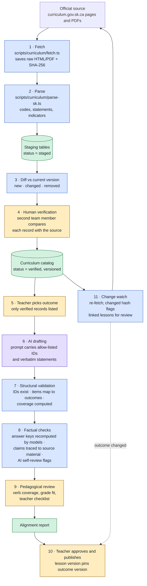
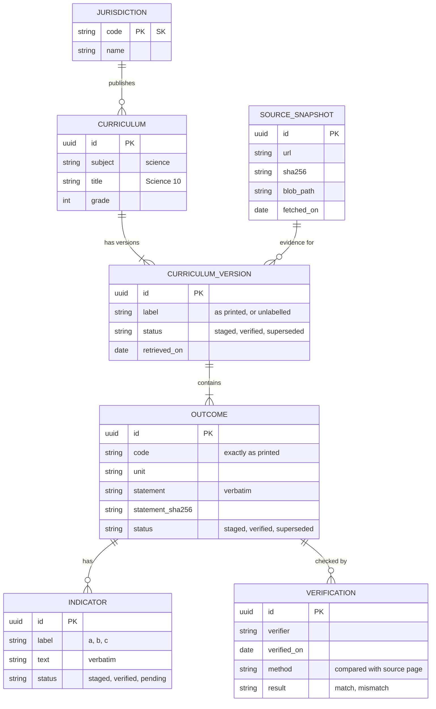
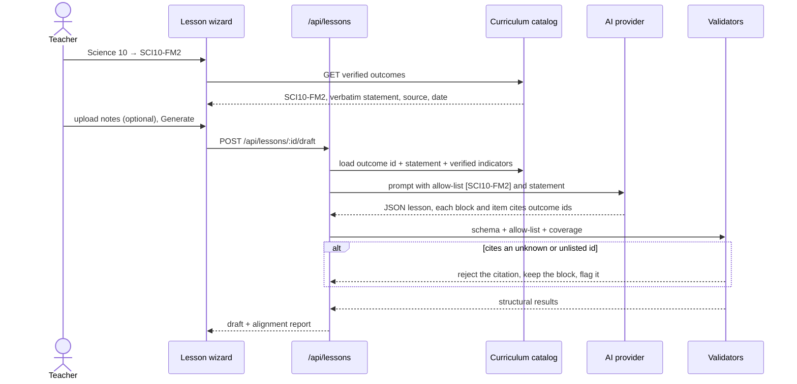

# 03 · Curriculum Alignment and Verification

**Goal:** every lesson that claims alignment to a Saskatchewan outcome links to an official outcome the team has verified against its source, and the teacher sees exactly how the lesson meets it before publishing.
**Status:** proposal. No curriculum code exists today (`01_existing_system_audit.md`, section 3.4).

---

## 1. Rules

1. **Curriculum is reference data, never AI output.** Outcome codes and wording enter Funza only through the ingestion and verification workflow below.
2. **The AI may only cite IDs it was given.** Drafting prompts include the selected outcomes' catalog IDs and verbatim text; the validator rejects any other code.
3. **Verification is recorded, not assumed.** Each outcome carries its source URL, retrieval date, content hash, and who verified it. Unverified records are never shown to teachers as "verified".
4. **Alignment is a claim the teacher approves.** Funza proposes and checks; the teacher decides. The interface never says "compliant".
5. **Lessons pin a curriculum version.** If the official text changes, affected lessons are flagged for review, not silently updated.

---

## 2. Verified example (used by the first vertical slice)

| Field | Value |
|---|---|
| Jurisdiction | Saskatchewan |
| Curriculum | Science 10 |
| Unit | Force and Motion in Our World |
| Outcome code | **SCI10-FM2** |
| Official wording | "Investigate and represent the motion of objects that travel at a constant speed in a straight line." |
| Source | https://curriculum.gov.sk.ca/CurriculumOutcomeContent?id=63 |
| Retrieved | 17 November 2026 |
| Version label on page | None shown (record as "unlabelled; retrieved 2026-11-17") |
| Indicators | **Pending.** The fetched page text listed outcomes only; the indicators (a, b, c…) were not retrieved and must be verified from the official "Outcomes & Indicators" view or curriculum PDF before they are used |
| Reuse terms | No licence or terms notice appeared on the page; confirm reuse of the text with the Ministry (the site footer lists STaNS@gov.sk.ca) before a commercial launch |
| Status | Outcome statement: **verified once** (single retrieval, needs the second-person check below). Indicators: **pending** |

The same page lists SCI10-FM1, SCI10-FM3 and SCI10-FM4 in the unit, which makes Force and Motion a good first unit to ingest whole.

---

## 3. Diagram B · Ingestion, verification, linking and approval

Blue = deterministic code · purple = AI · yellow = people · green = stored data.

---

## 4. Ingestion

| Step | What happens | Notes |
|---|---|---|
| Fetch | A script the team runs locally downloads each curriculum page or PDF, stores the raw file in Vercel Blob under `curriculum/raw/<date>/…`, and records its SHA-256 | Run by hand when adding a subject or on a monthly check; not a scheduled crawler at first |
| Parse | A Saskatchewan-specific parser extracts unit, outcome code, statement and indicators | Codes follow patterns seen on the official site (`SCI10-FM2`, `N9.1`); the parser keeps the code exactly as printed, never normalizes it |
| Stage | Parsed records go to staging tables with `status = staged` and a hash of the statement text | Nothing staged is visible in the app |
| Diff | Compares with the current verified version: new, changed (hash differs), removed | Changed records create a new version; old versions are kept |
| Verify | A second team member checks each new or changed record against the source and records the result | Two-person rule: the person who ran the import cannot verify it |

### 4.1 Data model

### 4.2 Contracts

| Route | Purpose | Notes |
|---|---|---|
| `GET /api/curriculum/outcomes?jurisdiction=SK&subject=&grade=` | Verified outcomes for the picker | Returns `code`, `statement`, `unit`, `sourceUrl`, `verifiedOn`, `versionLabel`; staged records never returned |
| `GET /api/curriculum/outcomes/[id]` | One outcome with verified indicators | Indicators with `status = pending` are returned as pending so the UI can say so |

Ingestion has no public API: the scripts write to the database with a service key on a team member's machine.

---

## 5. Linking lessons to outcomes

The prompt contract (extends `draftPrompt` in `src/lib/ai/teach-prompts.ts`):

- The prompt lists allowed outcomes as `{ "id": "<catalog uuid>", "code": "SCI10-FM2", "statement": "…" }`.
- The model must reply with `outcomeRefs: ["<catalog uuid>"]` on every block and item, plus a short `alignmentNote` in plain words.
- The validator (extends `validateDraft` in `src/lib/ai/teach-schema.ts`) accepts a reference only if the UUID is in the allow-list **and** its code matches. Free-text codes in prose are stripped from student-facing text.

---

## 6. Three kinds of verification

| Kind | Question it answers | Who or what decides | How | Blocks publishing? |
|---|---|---|---|---|
| **Structural** | Is the alignment well-formed? | Code, deterministic | Every cited ID exists, is verified and was allowed; every assessment item maps to at least one linked outcome; every linked outcome has at least one item; required block kinds are present | Yes, until fixed |
| **Factual** | Is the content true and consistent with the source? | Code first, then the teacher | Answer keys of items tied to a simulation are recomputed from its model (for example, distance after 4 s at 3 m/s = 12 m); numeric answers re-evaluated with the expression engine (`src/lib/visualizations/expr.ts`); statements flagged when they cannot be traced to the uploaded material; an optional AI self-review pass lists doubtful claims | Mismatched answer keys block; other flags need the teacher's acknowledgement |
| **Pedagogical** | Does it teach the outcome at the right level? | The teacher | Checklist generated from the outcome's verbs and indicators (for SCI10-FM2: is there an *investigation* the student carries out? does the student *represent* motion as a graph or table?); grade-level reading check; the teacher ticks or edits | Teacher's call; recorded in the report |

Structural checks prove the links are real. They do not prove the lesson is good. The report presents them separately so a green structural check is never read as "aligned".

---

## 7. The alignment report

What the teacher sees before publishing:

| Section | Content |
|---|---|
| Outcome | Code, verbatim statement, source link, "verified on" date, curriculum version label |
| Indicators | Verified indicators with the blocks that address each; "pending verification" where indicators are not yet verified |
| Coverage | Each block and item with its linked outcomes; items with no link; outcomes with no item |
| Verb check | Each action verb in the outcome ("investigate", "represent") and the blocks that make students do it |
| Factual checks | Recomputed answer keys (pass or mismatch), untraceable statements, AI self-review flags |
| Teacher decisions | Checklist ticks, notes, who approved and when |

Stored as `ALIGNMENT_REPORT` on the lesson version (see `02_target_architecture.md`, section 5), so a published lesson always carries the report it was approved with.

---

## 8. Keeping up with curriculum changes

The Saskatchewan site labels some curricula "(2026)" or "(2026 PRELIMINARY)", so renewal is ongoing. Funza handles it like this:

1. A monthly (manual, then scheduled) re-fetch compares hashes of every ingested page.
2. A changed statement creates a new `OUTCOME` row in a new `CURRICULUM_VERSION`; the old one becomes `superseded`.
3. Lesson versions linked to a superseded outcome show "Curriculum updated: review alignment" to their teacher. Published lessons stay available; nothing is changed automatically.
4. Preliminary curricula are ingested only when a teacher asks, labelled "Preliminary".

---

## 9. Risks

| Risk | Mitigation |
|---|---|
| Parser misreads a page | Raw snapshot kept; two-person verification; parser tests against saved snapshots |
| Indicators unavailable or hard to parse | Ship with outcome statements only, indicators marked pending; teachers can still align at outcome level |
| Reuse terms for curriculum text | Ask the Ministry before launch; store and display text with attribution and a link to the source |
| AI cites the right code with wrong reasoning | The pedagogical checklist and teacher approval; structural checks do not claim more than they prove |
| Scope creep into all subjects | One unit (Science 10 Force and Motion) for the MVP; add subjects on teacher demand |
