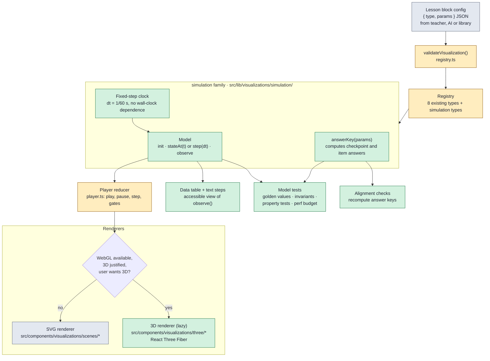

# 04 · Interactive Simulation Engine

**Goal:** add investigations students can run and measure, including 3D where depth teaches something, by extending the existing visualization registry rather than replacing it.
**Status:** proposal (changes C12, C13 in `02_target_architecture.md`). Not on the critical path of the first vertical slice.

---

## 1. Starting point (EXISTING)

| Piece | Path | What it gives us |
|---|---|---|
| Registry of 8 types | `src/lib/visualizations/registry.ts` | `function-graph`, `node-diagram`, `process-sequence`, `quantity-model`, `geometry-scene` (generic) and `packet-transmission`, `pcm-sampling`, `protocol-layers` (specialized) |
| Definition contract | `src/lib/visualizations/types.ts` (`VisualizationDefinition`) | `normalize`, `controls`, `applyControl`, `steps`, `checkpoints`, `describe`, `useWhen`, `schemaDoc` |
| Player | `src/lib/visualizations/player.ts`, `usePlayer.ts` | A pure reducer for play, pause, step, reset and prediction gates; the tutor drives it |
| Expression language | `src/lib/visualizations/expr.ts` | Formulas parsed into a tree and evaluated by hand; never `eval` |
| Renderer | `src/components/visualizations/LearningVisualization.tsx` + `scenes/*` | SVG scenes, captions, controls, a "read every step as text" list, reduced-motion support |
| Validation | `validateVisualization()` | AI or stored configs become a checked config or `null` |

Today every demo is a sequence of **authored steps**. A step shows a picture; nothing is simulated over time, and students cannot collect measurements.

---

## 2. What changes

Add a third family, `simulation`, next to `generic` and `specialized`. A simulation has a **deterministic model** that produces state over time, and one or two **renderers** that draw that state.

| Concern | Rule |
|---|---|
| Determinism | `state(t)` is a pure function of params and time, computed analytically or with a fixed time step. Same params, same numbers, on every device |
| Configuration | JSON only, normalized by the same contract; numbers clamped to ranges; formulas only through `expr.ts` |
| Measurement | Every simulation exposes `observe(state)`: named, unit-carrying values (position in m, time in s) the student can record in a table |
| Answer keys | Checkpoints and assessment items can compute their correct answer from the model, which is how the alignment report verifies them (`03_curriculum_verification.md`, section 6) |
| Rendering | SVG renderer required for every simulation; a 3D renderer is optional and must pass the learning-benefit test (section 5) |
| Accessibility | Text step list, a live data table, keyboard controls, reduced motion, no colour-only meaning |

---

## 3. Diagram C · Engine structure



### 3.1 Proposed contract

```ts
// src/lib/visualizations/simulation/types.ts (proposed)
type Measurement = { key: string; label: string; unit: string; value: number };

type SimulationDefinition<P, S> = VisualizationDefinition<P> & {
  family: "simulation";
  duration: (params: P) => number;               // seconds of simulated time
  stateAt: (params: P, t: number) => S;          // pure; analytic or fixed-step internally
  observe: (params: P, state: S) => Measurement[];
  answerKey: (params: P, question: string) => number | string | null;
  renderers: { svg: true; three?: { justification: string } };
};
```

`steps()` and `checkpoints()` still exist, so the player, tutor script and captions work unchanged: a simulation's steps are moments in simulated time.

### 3.2 First simulation types

| Type | Model | Used for | Renderer |
|---|---|---|---|
| `uniform-motion` | x(t) = x0 + v·t for up to three objects on a straight track | SCI10-FM2: constant speed in a straight line | SVG track + live distance-time graph |
| `accelerated-motion` | x(t) = x0 + v0·t + ½·a·t² | SCI10-FM3 (verified outcome: "Investigate and represent the motion of objects that undergo acceleration.") | SVG |
| `projectile` | 2D kinematics with constant g, no drag | SCI10-FM4 (verified outcome: "Explore the relationship between force and motion for objects moving in one and two dimensions.") | SVG first; 3D only if it passes section 5 |

All three are closed-form, so they need no physics engine.

---

## 4. React Three Fiber and Three.js

| Option | For | Against | Verdict |
|---|---|---|---|
| **React Three Fiber (R3F) + Three.js** | Declarative scenes in React; state flows from the same player and model hooks; `frameloop="demand"` renders only on change; a large ecosystem of helpers | Adds Three.js to the bundle (on the order of 150 KB gzipped for the core); WebGL needed | **Use, lazy-loaded** via `next/dynamic` with `ssr: false`, only on screens that show a 3D simulation |
| Plain Three.js | Full control, no React layer | Imperative glue code to sync with React state; more code for two developers to maintain | No |
| Physics engines (Rapier, Cannon) | Realistic collisions | Non-trivial determinism across devices, heavier, rarely needed for high school kinematics | Not now; revisit for collision outcomes |
| Babylon.js | Batteries included | Larger, separate ecosystem | No |
| CSS 3D / SVG fake depth | Tiny | Limited, inaccessible orbit controls | Only for small decorative depth, not simulations |

Rules for the 3D renderer:

- It renders **only** what `stateAt()` returns; it never runs its own physics.
- `frameloop="demand"`, device pixel ratio capped at 1.5, low-poly geometry, instanced meshes for many objects, no post-processing.
- A performance budget: 60 fps target, 30 fps floor on a low-end Chromebook-class device; if the first seconds drop below the floor, switch to SVG automatically and say so.
- No 3D on teacher dashboards or navigation.

---

## 5. When 3D is worth it

A simulation gets a 3D renderer only if the answer to the first question is yes and at least one other is yes:

1. Is depth or spatial orientation part of what the outcome asks students to understand?
2. Does rotating or viewing from another angle reveal something a 2D view hides?
3. Would a teacher otherwise use a physical model in class for this?

| Candidate | Depth essential? | 3D? |
|---|---|---|
| Constant-speed motion on a line (SCI10-FM2) | No: one dimension | **No**: SVG track and graph |
| Accelerated motion (SCI10-FM3) | No | **No** |
| Motion in two dimensions (SCI10-FM4) | No: a plane | **No** by default |
| 3D geometry, surface area and volume of composite objects (mathematics; outcome code to verify) | Yes | Candidate |
| Molecular shapes (chemistry; outcome code to verify) | Yes | Candidate |
| Earth–Sun geometry and seasons (science; outcome code to verify) | Yes | Candidate |

None of the 3D candidates are needed for the MVP. Their outcome codes must go through the verification workflow before any lesson claims them.

---

## 6. Safety of configurations

The existing protections carry over unchanged, and simulations add a few:

| Threat | Protection |
|---|---|
| Code in a config | Configs are data; only registered types render; formulas go through `expr.ts`, which allows arithmetic, a fixed list of functions and declared parameter names |
| Absurd values (huge speeds, negative time) | `normalize` clamps every number to a range declared per parameter; duration and object counts capped |
| Denial of service in the browser | Step count, object count, mesh count and duration caps; the fixed-step loop has a maximum iteration count |
| A wrong answer key from the AI | `answerKey()` comes from code, not from the AI; AI-written keys are replaced or flagged |

---

## 7. Testing

| Level | What | Where |
|---|---|---|
| Model unit tests | Golden values (v = 3 m/s, t = 4 s gives 12 m); invariants (constant speed gives equal distance in equal time; slope of x(t) equals v) | `tests/simulation-*.test.ts` (Node test runner, like today) |
| Property tests | Random params within declared ranges never produce NaN, infinity or out-of-range output; `normalize(normalize(x)) = normalize(x)` | Same files, seeded random |
| Answer-key tests | Every checkpoint's correct answer equals `answerKey()` | Same files |
| Renderer smoke tests | A config renders in headless Chrome with no console errors; screenshot stored for review | Playwright script (already used manually; commit it with C12) |
| Performance | Frame time on a throttled CPU profile; bundle-size check that Three.js is absent from routes without 3D | Playwright + build output |

---

## 8. Accessibility

| Need | Design |
|---|---|
| Screen reader users | Text step list (exists) plus a live data table of `observe()` values; captions describe what changed |
| Keyboard | Play, pause, step, sliders and the 3D camera presets (front, side, top) reachable by Tab; no drag-only interaction |
| Reduced motion | Jumps between states instead of animation (existing behaviour) |
| Colour | Objects differ by shape and label, not only colour |
| Low-end devices or no WebGL | SVG renderer always available; a "2D view" toggle on every 3D simulation |
| Cognitive load | One simulation per block; a short "what to watch for" line (existing `observe` caption pattern) |

---

## 9. Effort and order

| Step | Effort | When |
|---|---|---|
| `simulation` family contract, fixed-step clock, `uniform-motion` with SVG renderer and data table | M (20 h) | After the first vertical slice ships with existing types |
| `accelerated-motion`, `projectile` | S–M (10 h) | With the rest of the Force and Motion unit |
| R3F renderer with one justified 3D type, lazy-loaded, with fallback and budget | L (30 h) | Only after teachers ask for a spatial topic that passes section 5 |
