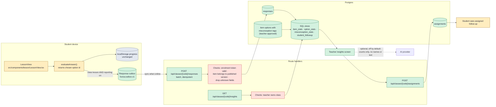
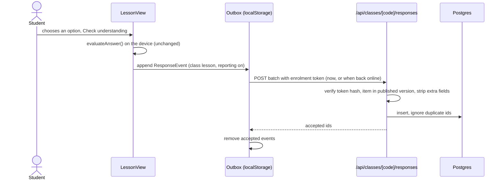
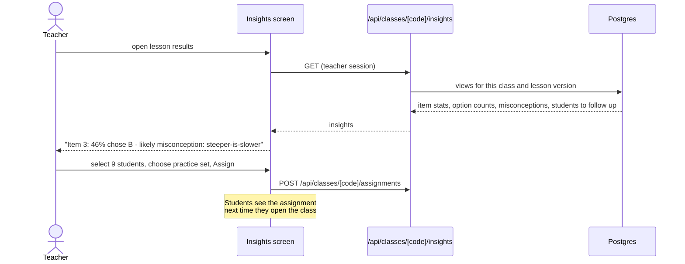

# 05 · Classroom Analytics

**Goal:** turn what students do in a class lesson into insights a teacher can act on (which items went wrong, which misconceptions are common, who needs follow-up) while collecting as little student data as possible.
**Status:** proposal (changes C08, C09, C10, C19). Today no student data leaves the device (`01_existing_system_audit.md`, section 5).

---

## 1. From local-only to classroom reporting

| | Today (EXISTING) | Proposed |
|---|---|---|
| Where progress lives | `funza.progress.v1` in `localStorage`, via `recordConceptResult()` in `src/lib/storage.ts` | Still local for personal courses; for class lessons with reporting on, a copy of each answer event goes to the class |
| What is recorded | Status (completed or needs practice) and attempt count per concept | Per answer: item, chosen option, correct or not, attempt number, hints used, time on item |
| Who sees it | The student, on that device | The student (own data) and the class teacher; divisions see only aggregates (`06_school_division_readiness.md`) |
| Identity | None | Pseudonymous enrolment: the name on the teacher's roster plus a random token kept on the device |

**Reporting is a class setting, off by default.** Personal courses never report anything.

---

## 2. Diagram D · From interactions to insights



---

## 3. What is captured

```ts
// proposed: src/lib/classes/responses.ts
type ResponseEvent = {
  id: string;               // random UUID, makes uploads idempotent
  lessonVersionId: string;
  blockId: string;
  itemId: string;
  optionId: string | null;  // mcq: the option chosen
  correct: boolean;
  attempt: number;          // 1, 2, 3...
  hintsUsed: number;
  msOnItem: number;         // capped at 30 minutes
  at: string;               // ISO time, minute precision
};
```

Not captured: free-text answers (by default), keystrokes, screen content, device fingerprints, location, the student's IP address in the database, anything typed into "Ask Funza" (which is off in class lessons anyway).

Short-answer text is a separate, per-class opt-in ("Let me read short answers"). It is shown to the teacher only and is never sent to an AI provider with a name attached.

---

## 4. Turning answers into misconceptions without AI

The draft prompt already asks for wrong options that "reflect real misconceptions" (`draftPrompt` in `src/lib/ai/teach-prompts.ts`). The proposal makes that explicit and teacher-approved:

1. Each wrong option carries a **misconception tag** (for example `steeper-is-slower`), proposed by the AI or the teacher and approved with the item.
2. `option_stats` counts how many enrolled students chose each option on their **first attempt**.
3. A misconception is **likely in the class** when at least 30 % of students who answered chose options with that tag (the threshold is configurable per class), with at least 5 answers.
4. A student is **flagged for follow-up** when they chose options with the same tag on two or more items, or used every attempt without a correct answer.

This is deterministic, explainable ("12 of 26 chose B on item 3"), works without an AI key, and sends nothing to a provider.

### 4.1 Optional AI help (off by default)

A teacher can ask "Suggest a follow-up activity". The request sends only the lesson content and **aggregate counts** (`item 3: A 10, B 12, C 4`), never names, tokens or free text. The suggestion arrives as a draft block that the teacher reviews like any other.

---

## 5. Data model

```mermaid
erDiagram
  CLASS ||--o{ ENROLMENT : has
  ENROLMENT ||--o{ RESPONSE : submits
  ITEM ||--o{ RESPONSE : "answered in"
  ITEM ||--|{ ITEM_OPTION : has
  ITEM_OPTION }o--o| MISCONCEPTION : "tagged"
  CLASS ||--o{ ASSIGNMENT : has
  ASSIGNMENT ||--o{ ASSIGNMENT_TARGET : "for"
  ENROLMENT ||--o{ ASSIGNMENT_TARGET : "receives"

  ENROLMENT {
    uuid id PK
    string class_code FK
    string roster_name
    string token_hash "SHA-256 of device token"
    date created_on
  }
  RESPONSE {
    uuid id PK "client-generated"
    uuid enrolment_id FK
    uuid lesson_version_id
    uuid item_id FK
    string option_id
    bool correct
    int attempt
    int hints_used
    int ms_on_item
    timestamp at
  }
  ITEM {
    uuid id PK
    uuid block_id
    string kind
  }
  ITEM_OPTION {
    string id
    bool correct
    string misconception_id
  }
  MISCONCEPTION {
    string id PK "steeper-is-slower"
    string label
    string description
  }
  ASSIGNMENT {
    uuid id PK
    uuid lesson_version_id
    string reason "misconception id or teacher note"
    date due_on
  }
  ASSIGNMENT_TARGET {
    uuid assignment_id FK
    uuid enrolment_id FK
    string status "assigned, done"
  }
```

Views (no warehouse): `item_stats` (answered, first-try correct %, average attempts), `option_stats`, `misconception_stats`, `student_followup`. At pilot scale (30 students × 20 items × a few lessons per week) plain SQL over indexed tables is enough; materialize only if a query gets slow.

---

## 6. Flows

### 6.1 Capture and sync



### 6.2 Insight and follow-up



---

## 7. Authorization

| Actor | Can read | Can write |
|---|---|---|
| Student device (enrolment token) | Own assignments; published lessons of the class | Own responses for published items in that class |
| Class teacher (session) | Everything about their class: roster, responses, insights | Roster, reporting settings, assignments, deletions |
| Another teacher | Nothing in this class | Nothing |
| Division admin (later) | Aggregates across classes with at least 10 students per group; no names | Nothing about students |
| AI provider | Lesson content; optional aggregate counts | — |

Enforced in each route handler, and again with Postgres row-level security as a second line (Supabase policies keyed on `auth.uid()` and class ownership).

---

## 8. Privacy safeguards

| Safeguard | Detail |
|---|---|
| Off by default | Reporting is enabled per class by the teacher |
| Clear notice | When a student joins a class with reporting on: "Your answers in this class are shared with your teacher. Nothing from your own courses is shared." |
| Minimal identity | Roster name (teacher-chosen, first name + initial suggested) and a random device token; no email, birthdate, student number or password |
| Minimal content | Option ids and counts; free text only by explicit class opt-in |
| No AI by default | Nothing identifiable is sent to an AI provider; the optional follow-up helper sends aggregate counts only |
| Retention | Raw responses deleted 30 days after the class end date (configurable); aggregate counts kept without enrolment ids |
| Deletion | Teacher can delete a student's data or the whole class; a student can leave a class and request deletion through the teacher |
| Access logging | Teacher reads of student-level data written to the audit log (C18) |
| Residency and law | Saskatchewan school divisions are generally local authorities under LA FOIP; confirm obligations and hosting region with the first pilot division's privacy officer before storing real student responses |

---

## 9. Effort

| Piece | Effort |
|---|---|
| Roster, enrolment token, join notice | M (8 h) |
| Outbox and response route, `evaluateAnswer` returning the option | M (10 h) |
| Misconception tags in the item model and review UI | S (6 h) |
| Views and insights screen | M (18 h) |
| Simple assignments | M (12 h) |
| Retention job and deletion actions | S (8 h) |
