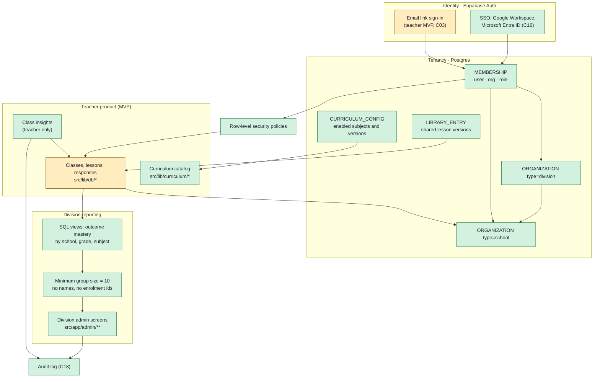
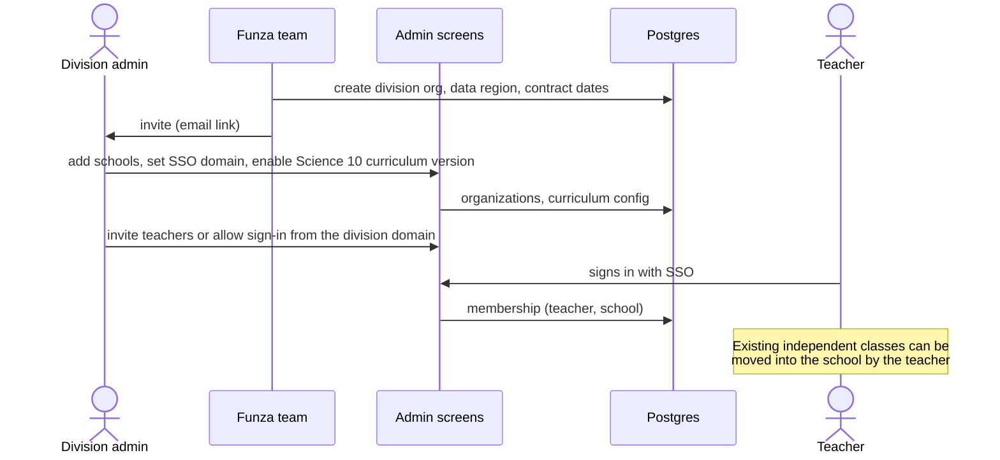

# 06 · School Division Readiness

**Goal:** the smallest extension that lets a Saskatchewan school division adopt Funza: identity for its schools and staff, permissions, curriculum configuration, teacher access and aggregated reporting.
**Status:** proposal (changes C14–C17). Deliberately **after** the teacher MVP: divisions buy what their teachers already use.

---

## 1. What a division needs, and what it does not (yet)

| Need | Minimal answer | Not now |
|---|---|---|
| Know which schools and teachers belong to it | `ORGANIZATION` rows (division, schools) and memberships | Sync with the provincial student information system |
| Control who can do what | Four roles, enforced in route handlers and row-level security | Custom roles, delegated admin chains |
| Choose curricula | Division turns subjects and curriculum versions on or off | Division-authored curricula |
| Give teachers access | Invite by email domain or SSO; seat count | Automatic provisioning from HR systems |
| See results | Outcome-level aggregates by school and grade, with a minimum group size | Student-level division dashboards |
| Share lessons | Opt-in division library of published lesson versions | Marketplace, ratings |
| Assurance | Data processing agreement, privacy notice, audit log, data region, deletion on exit | Formal certifications |

---

## 2. Diagram E · Division layer on top of the teacher product



---

## 3. Roles and permissions

| Action | Student (device token) | Teacher | School admin | Division admin |
|---|---|---|---|---|
| Study published class lessons | ✓ own classes | — | — | — |
| Create and publish lessons, manage own classes | — | ✓ | — | — |
| See own class's student-level results | — | ✓ | — | — |
| See school-level aggregates (≥ 10 students per group) | — | — | ✓ own school | ✓ all schools |
| Invite teachers, assign schools | — | — | ✓ own school | ✓ |
| Enable subjects and curriculum versions | — | — | — | ✓ |
| Curate the division library | — | Submit own lessons | Recommend | Approve |
| Read the audit log | — | Own actions | Own school | ✓ |
| See any individual student's answers in another teacher's class | — | ✗ | ✗ | ✗ |

The last row is deliberate: administrators get aggregates, not surveillance. If a division needs student-level access for a case, it goes through the teacher or a documented export, not a dashboard.

---

## 4. Data model additions

```mermaid
erDiagram
  ORGANIZATION ||--o{ ORGANIZATION : "contains schools"
  ORGANIZATION ||--o{ MEMBERSHIP : has
  USER ||--o{ MEMBERSHIP : holds
  ORGANIZATION ||--o{ CLASS : "school owns"
  ORGANIZATION ||--o{ CURRICULUM_CONFIG : "division sets"
  ORGANIZATION ||--o{ LIBRARY_ENTRY : "division library"
  ORGANIZATION ||--o{ AUDIT_EVENT : "logged for"

  ORGANIZATION {
    uuid id PK
    uuid parent_id FK "school → division"
    string type "division or school"
    string name
    string data_region
    string sso_domain
  }
  USER {
    uuid id PK
    string email
    string display_name
  }
  MEMBERSHIP {
    uuid user_id FK
    uuid org_id FK
    string role "teacher, school_admin, division_admin"
  }
  CLASS {
    string code PK
    uuid school_id FK "nullable for independent teachers"
  }
  CURRICULUM_CONFIG {
    uuid curriculum_version_id
    bool enabled
  }
  LIBRARY_ENTRY {
    uuid lesson_version_id
    string status "submitted, approved, withdrawn"
  }
  AUDIT_EVENT {
    uuid id PK
    uuid actor_id
    string action
    string target
    timestamp at
  }
```

`CLASS.school_id` is nullable, so independent teachers (the MVP) keep working unchanged when divisions arrive. This is the one decision to make early: add the nullable column in C02 even though nothing uses it yet.

### 4.1 Row-level security sketch

```sql
-- Teachers see only their own classes; school and division admins see classes in their orgs.
create policy class_read on class for select using (
  teacher_id = auth.uid()
  or school_id in (select org_id from membership where user_id = auth.uid() and role in ('school_admin', 'division_admin'))
  or school_id in (select o.id from organization o join membership m on m.org_id = o.parent_id
                   where m.user_id = auth.uid() and m.role = 'division_admin')
);

-- Responses: only the class teacher, never admins (admins use aggregate views).
create policy response_read on response for select using (
  enrolment_id in (select e.id from enrolment e join class c on c.code = e.class_code where c.teacher_id = auth.uid())
);
```

Route handlers check the same rules first. Row-level security is the backstop if a handler has a bug.

---

## 5. Aggregated reporting

| View | Grain | Measures | Privacy rule |
|---|---|---|---|
| `outcome_mastery_by_school` | Division · school · grade · outcome · term | Students reached, first-try correct %, items answered | Suppress any cell with fewer than 10 students |
| `misconception_trends` | Division · outcome · misconception · term | Share of answers choosing tagged options | Same; no school breakdown below 10 |
| `adoption` | Division · school | Active teachers, published lessons, classes with reporting on | No student data |

These read from the same `RESPONSE` table through views that drop enrolment ids and names. No separate warehouse.

---

## 6. Onboarding a division



---

## 7. Compliance and assurance (to prepare, not to build)

| Item | Why | Owner |
|---|---|---|
| Data processing agreement template | Divisions will ask who processes student data, where, and for how long | Team, with advice |
| Privacy impact assessment | Saskatchewan school divisions are generally local authorities under LA FOIP; a PIA is the usual way to show the analysis | Team, reviewed with the pilot division |
| Data region decision | Some divisions may require Canadian hosting; Supabase offers a Canadian region, Vercel function regions must be checked | Team, before the first division contract |
| Deletion on exit | Contract end must delete division data within an agreed period | C19 jobs, extended per org |
| Accessibility statement | Public sector buyers expect one | Team |

None of these claims compliance; they are the documents a division's privacy officer will ask for.

---

## 8. Effort and timing

| Change | Effort | Trigger to start |
|---|---|---|
| C14 organizations and roles | M (15 h) | A division agrees to a pilot |
| C16 SSO | S–M (8 h) | Same; pick the provider the division uses |
| C15 aggregated reporting | L (30 h) | At least 3 teachers in one division using reporting |
| C17 division library | M (15 h) | Teachers ask to share lessons |
| Compliance documents | ~20 h writing | Before any division contract |
