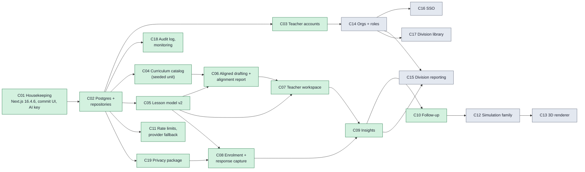
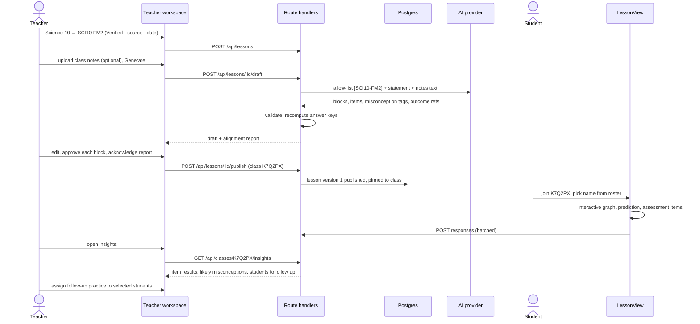

# 07 · Migration Roadmap

**Goal:** a dependency-ordered path from today's prototype to a working high school teacher MVP, proven by one complete vertical slice, without breaking what works.
**Capacity assumption:** two developers, about 16–20 hours a week combined. Effort codes and change IDs (C01–C19) come from `02_target_architecture.md`, section 7.
**Status:** plan for review. Nothing here is implemented.

---

## 1. Dependency order

Green = MVP · grey = after the pilot.

## 2. Phases

| Phase | Changes | Outcome | Effort | Weeks at current pace |
|---|---|---|---|---|
| 0 · Stabilize | C01 | Patched framework, committed UI, AI drafting actually running on the deployment | 6 h | 0.5 |
| 1 · Foundation | C02, C03, C18 | Classes in Postgres behind a repository; teachers sign in; existing classes claimed with their edit key | 51 h | 3 |
| 2 · Curriculum and lessons | C04 (seeded unit), C05 | Science 10 Force and Motion outcomes in a verified catalog; lesson versions with blocks and items | 55 h | 3 |
| 3 · Aligned authoring | C06, C07, C11 | Teacher picks SCI10-FM2, generates, reads the alignment report, edits, approves, publishes | 85 h | 4.5 |
| 4 · Students to insights | C19, C08, C09, C10 | Students join from the roster, answers sync, teacher sees misconceptions and assigns follow-up: **vertical slice complete** | 63 h | 3.5 |
| 5 · Pilot | — | One or two Saskatchewan teachers use it with a class; fixes from feedback | — | 3–4 |
| 6 · Simulations | C12 (then C13 only if justified) | `uniform-motion`, `accelerated-motion`, `projectile`; full ingestion pipeline | 30 h+ | 2+ |
| 7 · Division readiness | C14, C16, C15, C17 | First division pilot | 68 h | 4 |

Phases 0–4 total about 260 hours, roughly 14–15 weeks at the current pace. Starting late November 2026 and allowing for the holiday break, the vertical slice lands around mid-March 2027, inside the ENSE 477 term.

Working rules for every phase:

- **Nothing that works today breaks.** Personal courses, sample courses, the tutor, demos and the survey keep their tests passing at every merge.
- **Classes migrate, they do not disappear.** The Blob store stays readable until every existing class is claimed or exported.
- **No production data is changed by hand.** Migrations are SQL files in the repository; the Blob-to-database copy is a script with a dry-run mode.
- **Read the Next.js 16 docs first.** `app/AGENTS.md` warns that this Next.js version differs from older conventions; check `node_modules/next/dist/docs/` before writing routes.

---

## 3. The first vertical slice

**Verified outcome → teacher-generated lesson → alignment report → teacher approval → interactive student activity → assessment → teacher insights.**

### 3.1 The outcome

| | |
|---|---|
| Code | **SCI10-FM2** (Saskatchewan Science 10, unit "Force and Motion in Our World") |
| Official wording | "Investigate and represent the motion of objects that travel at a constant speed in a straight line." |
| Source | https://curriculum.gov.sk.ca/CurriculumOutcomeContent?id=63, retrieved 17 November 2026 |
| Verification | Outcome statement retrieved from the official page; needs the second-person check before release. **Indicators pending**: not retrieved; the slice aligns at outcome level until they are verified |

### 3.2 Walkthrough

### 3.3 The lesson Funza should produce

Built only from blocks and visualization types that exist or are specified here; numbers are illustrative.

| # | Block | Content | Built with |
|---|---|---|---|
| 1 | Hook | Two cyclists leave school at the same time; who gets to the rink first, and how could you show it? | `Concept` text (EXISTING shape) |
| 2 | Explain | Constant speed means equal distances in equal times; d = v × t; on a distance–time graph, constant speed is a straight line and a steeper line means a higher speed | `Concept` explanation + second explanation |
| 3 | Investigate | Two riders on a distance–time graph with speed sliders; the demo stops to ask "which rider is faster?" before revealing it | `function-graph` (EXISTING); the Physics sample in `src/lib/lessons/demo-subjects.ts` already has a two-rider distance–time demo to reuse |
| 4 | Represent | Distance grows as speed × time; the student sets speed and time and reads the distance | `quantity-model` (EXISTING); the Physics sample "Distance = speed × time" is the starting config |
| 5 | Check | Four multiple-choice items (below), hints and second explanation per item | `LessonView` (EXISTING) with item model v2 |
| 6 | Exit ticket | One item: describe a horizontal line on a distance–time graph | Same |

Assessment items, each wrong option tagged with a misconception:

| Item | Correct | Distractors → misconception tag |
|---|---|---|
| A distance–time graph is a straight line rising from the origin. What does it show? | Moving at a constant speed | "Speeding up" → `rising-line-means-accelerating` · "Moving uphill" → `graph-is-a-picture-of-the-path` · "Not moving" → `confuses-axes` |
| On one graph, line A is steeper than line B. Which object is faster? | A | "B" → `steeper-is-slower` · "Same speed, both lines are straight" → `straight-means-same-speed` |
| A cart moves at 3 m/s for 4 s. How far does it go? | 12 m | "7 m" → `adds-speed-and-time` · "0.75 m" → `divides-instead-of-multiplies` · "1.33 m" → `divides-time-by-speed` |
| A horizontal line on a distance–time graph means… | The object is stopped | "Moving at a constant speed" → `horizontal-means-moving` · "Moving backwards" → `confuses-axes` |

### 3.4 The alignment report for this lesson

| Check | Result |
|---|---|
| Outcome | SCI10-FM2, verbatim statement, source link, retrieved 2026-11-17 |
| Indicators | Pending verification: shown as "not yet available" |
| Structural | Every block and item cites SCI10-FM2 from the allow-list ✓ · every item linked ✓ · the outcome has 5 items ✓ |
| Verb "investigate" | Block 3 (prediction before reveal, sliders) ✓ |
| Verb "represent" | Blocks 3–4 and items 1, 2, 4 (reading and choosing graph representations) ✓ · suggestion: add a task where students sketch or build a graph themselves (needs the `uniform-motion` simulation's data table, C12) |
| Factual | Item 3 answer key recomputed: 3 × 4 = 12 ✓ |
| Teacher decision | Approved by the teacher, with date |

The "represent" suggestion is honest: the MVP can test reading representations, while asking students to produce one is better served by the simulation family later.

### 3.5 What the teacher sees afterwards

Example (illustrative numbers): "Item 2: 10 of 26 students (38 %) chose B on the first try. Likely misconception: *steeper is slower*. 9 students chose options tagged with it twice." The teacher selects the 9 students and assigns a short practice block on comparing slopes, which they can generate, review and approve like any other block.

### 3.6 What the slice needs (and does not)

| Needs | Does not need |
|---|---|
| C01, C02, C03, C04 (seed only), C05, C06, C07, C08, C09, C10 (simple), C11, C18, C19 | 3D, simulation family, the full ingestion pipeline, divisions, SSO, short-answer AI grading |

---

## 4. Prioritized backlog

| Priority | ID | Item | Phase |
|---|---|---|---|
| P0 | C01 | Upgrade Next.js to 16.4.6, commit UI restyle, configure AI key on Vercel | 0 |
| P0 | C02 | Supabase project, migrations, repository layer, Blob → DB class migration with dry run | 1 |
| P0 | C03 | Teacher sign-in, session checks in handlers, claim existing class with edit key | 1 |
| P0 | C19 | Reporting switch, join notice, retention and deletion | 4 (design in 1) |
| P1 | C04 | Seed Science 10 Force and Motion outcomes with provenance; `/api/curriculum/outcomes`; second-person verification | 2 |
| P1 | C05 | Lesson model v2 with versions, blocks, items, misconception tags, outcome refs; converter from `DraftConcept` | 2 |
| P1 | C06 | Outcome-constrained draft prompt, allow-list validator, structural and factual checks, report | 3 |
| P1 | C07 | Lesson wizard, block editor, alignment panel, publish to class | 3 |
| P1 | C11 | Per-teacher and per-IP rate limits on AI routes; fallback to a second free provider | 3 |
| P1 | C08 | Roster, enrolment token, outbox, responses route | 4 |
| P1 | C09 | Insight views and screen | 4 |
| P1 | C10 | Assign follow-up to selected students | 4 |
| P1 | C18 | Audit log for publishing and student-data reads; error monitoring | 1 |
| P2 | — | Commit the Playwright walkthrough as a repeatable smoke test | 1 |
| P2 | — | Update Workshop 3 requirements (TR-1, TR-3, TR-6) and the architecture document | 1 |
| P2 | C12 | Simulation family and `uniform-motion` with data table | 6 |
| P2 | — | Full curriculum ingestion pipeline with change watch | 6 |
| P3 | C14, C16 | Organizations, roles, SSO | 7 |
| P3 | C15, C17 | Division reporting and library | 7 |
| P3 | C13 | 3D renderer, only for an outcome that passes the learning-benefit test | On demand |

---

## 5. The first ten development tasks

Paths are relative to `app/`. Each task ends with `npm test`, `npm run lint`, `npm run build` and the browser walkthrough passing.

| # | Task | Files | Done when |
|---|---|---|---|
| 1 | Upgrade Next.js and `eslint-config-next` to 16.4.6; commit the UI restyle and the architecture docs separately | `package.json`, `package-lock.json` | `npm audit` clean for Next.js; all checks pass |
| 2 | Create the Supabase project (region decided with the team), add server-only DB client and the core migration | `supabase/migrations/0001_core.sql`, `src/lib/db/client.ts`, `.env.example` | Migration applies to a local and a cloud database; no client bundle imports the DB client |
| 3 | Introduce a class repository interface; wrap today's Blob code as one implementation and add the Postgres one; route handlers depend only on the interface | `src/lib/classes/repository.ts`, `src/lib/classes/server.ts`, `src/lib/db/classes.ts`, `src/app/api/classes/**` | Existing class tests pass against both implementations |
| 4 | Teacher sign-in (email link) and session checks; "claim this class" with the old edit key | `src/lib/auth/session.ts`, `src/app/teach/sign-in/page.tsx`, `src/app/api/classes/[code]/claim/route.ts`, `src/lib/classes/useEditableClass.ts` | A signed-in teacher edits their class without an edit key; others get 403 |
| 5 | Migration script from Blob classes to Postgres with `--dry-run` | `scripts/migrate-classes.ts` | Dry run reports counts; real run copies without changing the Blob objects |
| 6 | Curriculum tables, seed for Science 10 Force and Motion (FM1–FM4) with source URL, retrieval date and statement hash; outcomes route | `supabase/migrations/0002_curriculum.sql`, `scripts/curriculum/seed-sk-science10.ts`, `src/lib/curriculum/catalog.ts`, `src/app/api/curriculum/outcomes/route.ts` | Route returns only verified outcomes; a second team member's verification is recorded |
| 7 | Lesson model v2 and converter from the current `DraftConcept`; misconception tags on options | `src/lib/lessons/v2/model.ts`, `src/lib/lessons/v2/convert.ts`, `tests/lesson-v2.test.ts` | Existing class lessons convert and render unchanged in `LessonView` |
| 8 | Outcome-constrained draft prompt and allow-list validator | `src/lib/ai/teach-prompts.ts`, `src/lib/ai/teach-schema.ts`, `src/app/api/lessons/[id]/draft/route.ts`, `tests/lesson-draft.test.ts` | A reply citing an unlisted code is rejected in tests; a valid reply produces blocks with outcome refs |
| 9 | Structural and factual alignment checks and the report route | `src/lib/alignment/structural.ts`, `src/lib/alignment/factual.ts`, `src/app/api/lessons/[id]/alignment/route.ts`, `tests/alignment.test.ts` | The SCI10-FM2 example produces the report in section 3.4 |
| 10 | Answer events: `evaluateAnswer` returns the chosen option; outbox store; `LessonView` emits events for class lessons with reporting on | `src/lib/engine/evaluate.ts`, `src/lib/storage.ts`, `src/components/lesson/LessonView.tsx`, `tests/outbox.test.ts` | Personal courses emit nothing; class lessons queue events offline and drain when online |

Tasks 11 onward: enrolment and responses routes, insights views and screen, the lesson wizard and editor, follow-up assignments, privacy jobs.

---

## 6. The three biggest technical risks

| Risk | Why it matters | Mitigation |
|---|---|---|
| **Curriculum data correctness and rights** | A wrong code, stale wording or unclear reuse terms destroys teacher trust and could block a division sale | Seed one unit by hand with provenance and two-person verification; show the source on every screen; mark indicators pending until verified; ask the Ministry about reuse before launch; change watch flags lessons when wording changes |
| **Student data privacy in K-12** | The first time student answers leave a device; minors; local-authority privacy law; possible residency requirements | Reporting off by default; roster names and device tokens instead of accounts; no identifiable data to AI providers; retention and deletion built before real students; region and obligations confirmed with the pilot division |
| **AI draft quality and teacher review burden** | If drafts are wrong or long, teachers stop using it, and every lesson costs review time and AI money | Constrain drafting to the selected outcome and uploaded material; deterministic answer-key checks; short lessons (5–6 blocks); a reliable free provider configured on the deployment with fallback; measure review time in the pilot |

Also watch: two-person capacity. The plan keeps one codebase, one database vendor and no new services for that reason.

---

## 7. Recommendation: the smallest working high school teacher MVP

**One unit, one province, one loop.**

- **Curriculum:** Saskatchewan Science 10, "Force and Motion in Our World" (SCI10-FM1 to FM4), seeded with provenance; indicators shown as pending until verified.
- **Teacher:** signs in with an email link, picks an outcome, optionally uploads notes, generates a 5–6 block lesson using the existing `function-graph` and `quantity-model` demos, reads the alignment report, edits and approves each block, and publishes to a class with the existing class code.
- **Student:** joins with the code, picks their name from the roster, studies in the existing lesson screen, answers 4–6 multiple-choice items with hints. Nothing else changes for students.
- **Insights:** per-item results, misconception counts from teacher-approved distractor tags, students to follow up, and a one-click assignment of a practice block.
- **Left out on purpose:** 3D, new simulation types, divisions, SSO, student accounts, AI grading of written answers, other subjects.

This reuses the parts that already work (PDF reading, the lesson runtime, the visualization registry, the AI layer, the review-and-publish rules, class codes) and adds the three things a teacher cannot do without: a real outcome, a way to see whether students understood it, and an account to own their work.
